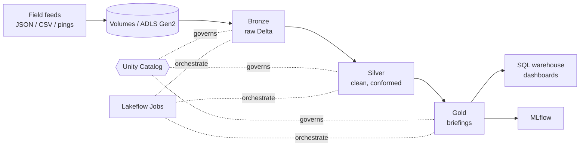

# S.H.I.E.L.D. Data Engineering — from 0 to hero (Azure Databricks)

> "I recruit based on potential." — Nick Fury

A hands-on learning path for data engineering on **Azure Databricks**, told as the story of Nick Fury rebuilding S.H.I.E.L.D.'s intelligence platform. It is a **learning repo, not a production template**.

> **Status: v0.1, work in progress.** Chapters are added incrementally. The status column below says honestly what has been verified.

## TL;DR

1. Deploy the platform with `azd up` (chapter 01).
2. Generate a synthetic S.H.I.E.L.D. dataset with `src/shield_data` (no external downloads).
3. Work through the numbered notebooks in `notebooks/databricks/` in order. Each has a matching page in `docs/`.
4. Every chapter ends with "Try it yourself" mini-projects, because inventing your own exercises is how the skills stick.
5. Tear down with `azd down --purge` when you are done, since clusters and warehouses cost money.

Microsoft Fabric is out of scope here; it gets its own repo.

## What you will learn

Spark and Delta Lake, batch and streaming ingestion, the medallion architecture, data quality, declarative pipelines, orchestration, Unity Catalog governance, performance tuning, infrastructure as code, CI/CD, and serving. See [docs/data-engineering-roadmap.md](docs/data-engineering-roadmap.md) for how each chapter maps to the skills a data engineering role asks for.

## The story

S.H.I.E.L.D. lost its intel platform and Fury is rebuilding it. Read [story.md](story.md) for the full build log.

| Who | What they teach |
|---|---|
| Nick Fury | Why the platform exists |
| Phil Coulson | Ingestion |
| Natasha Romanoff | Data quality |
| Doctor Strange | Delta time travel |
| Daisy Johnson | Streaming |
| Maria Hill | Orchestration |
| Hawkeye | Performance |
| Hydra | Bad data, drift, and breaches |
| The Avengers | Consumers of the gold layer |

## Architecture



## Prerequisites

- An Azure subscription where you can create a resource group and an Azure Databricks workspace
- Azure CLI, Azure Developer CLI (`azd`), Python 3.11+
- Databricks CLI (needed from chapter 13)

## Chapters

| # | Chapter | Topic | Status |
|---|---|---|---|
| 00 | Briefing room | Concepts, glossary, repo tour | planned |
| 01 | Assemble the platform | Bicep + azd, Unity Catalog | planned |
| 02 | First recon | Spark, SQL, compute | planned |
| 03 | Coulson ingests | Volumes, Auto Loader | planned |
| 04 | Delta Lake 101 | ACID, MERGE, OPTIMIZE | planned |
| 05 | Medallion | Bronze, silver, gold | planned |
| 06 | Natasha spots the fake | Data quality | planned |
| 07 | Doctor Strange's time stone | Time travel, CDF | planned |
| 08 | Declarative pipelines | Lakeflow Spark Declarative Pipelines | planned |
| 09 | Quake tremors | Structured Streaming | planned |
| 10 | Maria Hill schedules | Lakeflow Jobs | planned |
| 11 | Governance vs Hydra | Unity Catalog | planned |
| 12 | Hawkeye's precision | Performance and cost | planned |
| 13 | Infrastructure as code | Databricks Asset Bundles | planned |
| 14 | CI/CD | GitHub Actions | planned |
| 15 | The Avengers Initiative | Serving, dashboards, MLflow | planned |
| 16 | Project Insight | Capstone | planned |

Status values: `planned`, `drafted` (written, not run), `verified` (run end to end in a real workspace).

## Dataset

`src/shield_data` generates a seeded, synthetic dataset: `incident_reports` (JSON), `agents` and `locations` (CSV), `sensor_pings` (stream), and `threat_assessments` (changes over time). It can inject duplicates, nulls, bad timestamps, and schema drift so the quality chapters have something real to catch.

```bash
pip install -r requirements.txt
python -m shield_data.generate --out ./data --incidents 10000 --seed 42 --dirty 0.05
pytest
```

## Contributing

Issues and PRs welcome. See [CLAUDE.md](CLAUDE.md) for conventions.
