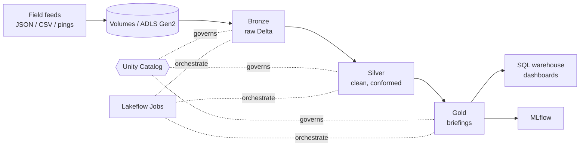

# S.H.I.E.L.D. Data Engineering — from 0 to hero (Azure Databricks)

> "I recruit based on potential." — Nick Fury

A hands-on learning path for data engineering on **Azure Databricks**, told as the story of Nick Fury rebuilding S.H.I.E.L.D.'s intelligence platform. It is a **learning repo, not a production template**.

> **Status: v0.1, work in progress.** Chapters are added incrementally. The status column below says honestly what has been verified.

## TL;DR

1. Deploy the platform with `azd up` (chapter 01).
2. Generate a synthetic S.H.I.E.L.D. dataset with `src/shield_data` (no external downloads).
3. Work through the numbered notebooks in `notebooks/databricks/` in order. Each has a matching page in `docs/`.
4. Every chapter ends with "Try it yourself" mini-projects, because inventing your own exercises is how the skills stick.
5. Tear down with `azd down --purge` when you are done, since clusters and warehouses cost money.

Microsoft Fabric is out of scope here; it gets its own repo.

## What you will learn

Spark and Delta Lake, batch and streaming ingestion, the medallion architecture, data quality, declarative pipelines, orchestration, Unity Catalog governance, performance tuning, infrastructure as code, CI/CD, and serving. See [docs/data-engineering-roadmap.md](docs/data-engineering-roadmap.md) for how each chapter maps to the skills a data engineering role asks for.

## The story

S.H.I.E.L.D. lost its intel platform and Fury is rebuilding it. Read [story.md](story.md) for the full build log.

| Who | What they teach |
|---|---|
| Nick Fury | Why the platform exists |
| Phil Coulson | Ingestion |
| Natasha Romanoff | Data quality |
| Doctor Strange | Delta time travel |
| Daisy Johnson | Streaming |
| Maria Hill | Orchestration |
| Hawkeye | Performance |
| Hydra | Bad data, drift, and breaches |
| The Avengers | Consumers of the gold layer |

## Architecture



## Prerequisites

- An Azure subscription where you can create a resource group and an Azure Databricks workspace
- Azure CLI, Azure Developer CLI (`azd`), Python 3.11+
- Databricks CLI (needed from chapter 13)

## Region

The default is `swedencentral`; `germanywestcentral` also works (set `AZURE_LOCATION`). Both support Databricks serverless compute. Sweden Central is the default because it has system tables (used in the capstone) and a lower Databricks DBU price. Check [feature availability by region](https://learn.microsoft.com/azure/databricks/resources/feature-region-support) before picking another region.

```bash
azd env new shielddev
azd env set AZURE_LOCATION swedencentral
azd up
```

This creates: a Databricks workspace (Premium), ADLS Gen2 storage, an access connector for Unity Catalog, Key Vault, and an Event Hubs namespace (Standard, for chapter 09). Unity Catalog's regional metastore is created automatically with the workspace; the catalog and external location are created in chapter 01.

## Chapters

| # | Chapter | Topic | Docs | Notebook | Status |
|---|---|---|---|---|---|
| 00 | Briefing room | Concepts, repo tour | [doc](docs/00-briefing-room.md) | [00_briefing_room.py](notebooks/databricks/00_briefing_room.py) | drafted |
| 01 | Assemble the platform | Unity Catalog bootstrap | [doc](docs/01-assemble-the-platform.md) | [01_assemble_the_platform.py](notebooks/databricks/01_assemble_the_platform.py) | drafted (Azure part verified) |
| 02 | First recon | Spark, SQL, compute | [doc](docs/02-first-recon.md) | [02_first_recon.py](notebooks/databricks/02_first_recon.py) | drafted |
| 03 | Coulson ingests | Volumes, Auto Loader | [doc](docs/03-coulson-ingests.md) | [03_coulson_ingests.py](notebooks/databricks/03_coulson_ingests.py) | drafted |
| 04 | Delta Lake 101 | ACID, MERGE, OPTIMIZE | [doc](docs/04-delta-lake-101.md) | [04_delta_lake_101.py](notebooks/databricks/04_delta_lake_101.py) | drafted |
| 05 | Medallion | Bronze, silver, gold | [doc](docs/05-medallion.md) | [05_medallion.py](notebooks/databricks/05_medallion.py) | drafted |
| 06 | Natasha spots the fake | Data quality | [doc](docs/06-natasha-spots-the-fake.md) | [06_natasha_spots_the_fake.py](notebooks/databricks/06_natasha_spots_the_fake.py) | drafted (rules unit-tested) |
| 07 | Doctor Strange's time stone | Time travel, CDF | [doc](docs/07-doctor-strange-time-stone.md) | [07_doctor_strange_time_stone.py](notebooks/databricks/07_doctor_strange_time_stone.py) | drafted |
| 08 | Declarative pipelines | Lakeflow Spark Declarative Pipelines | [doc](docs/08-declarative-pipelines.md) | [08_declarative_pipelines.py](notebooks/databricks/08_declarative_pipelines.py) | drafted |
| 09 | Quake tremors | Structured Streaming, Event Hubs | [doc](docs/09-quake-tremors.md) | [09_quake_tremors.py](notebooks/databricks/09_quake_tremors.py) | drafted (part B unverified) |
| 10 | Maria Hill schedules | Lakeflow Jobs | [doc](docs/10-maria-hill-schedules.md) | [10_maria_hill_schedules.py](notebooks/databricks/10_maria_hill_schedules.py) | drafted |
| 11 | Governance vs Hydra | Unity Catalog | [doc](docs/11-governance-vs-hydra.md) | [11_governance_vs_hydra.py](notebooks/databricks/11_governance_vs_hydra.py) | drafted |
| 12 | Hawkeye's precision | Performance and cost | [doc](docs/12-hawkeyes-precision.md) | [12_hawkeyes_precision.py](notebooks/databricks/12_hawkeyes_precision.py) | drafted |
| 13 | Infrastructure as code | Declarative Automation Bundles | [doc](docs/13-infrastructure-as-code.md) | n/a (config chapter) | drafted (not validated) |
| 14 | CI/CD | GitHub Actions | [doc](docs/14-ci-cd.md) | n/a (config chapter) | drafted (tests run locally) |
| 15 | The Avengers Initiative | Serving, dashboards, MLflow | [doc](docs/15-avengers-initiative.md) | [15_avengers_initiative.py](notebooks/databricks/15_avengers_initiative.py) | drafted |
| 16 | Project Insight | Capstone, runbook | [doc](docs/16-project-insight.md) | [16_project_insight.py](notebooks/databricks/16_project_insight.py) | drafted |

Status values: `planned`, `drafted` (written and checked against Microsoft Learn, **not yet run** in a real workspace), `verified` (run end to end). Nothing is `verified` yet. Extra guides: [glossary](docs/glossary.md), [troubleshooting](docs/troubleshooting.md), [runbook](docs/runbook.md).

## Dataset

`src/shield_data` generates a seeded, synthetic dataset: `incident_reports` (JSON), `agents` and `locations` (CSV), `sensor_pings` (stream), and `threat_assessments` (changes over time). It can inject duplicates, nulls, bad timestamps, and schema drift so the quality chapters have something real to catch.

```bash
pip install -r requirements.txt
python -m shield_data.generate --out ./data --incidents 10000 --seed 42 --dirty 0.05
pytest
```

## Contributing

Issues and PRs welcome. See [CLAUDE.md](CLAUDE.md) for conventions.
