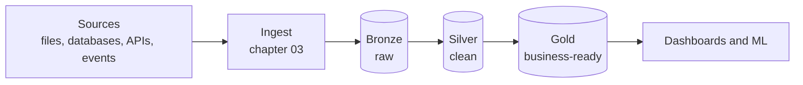
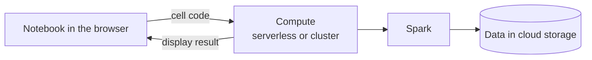
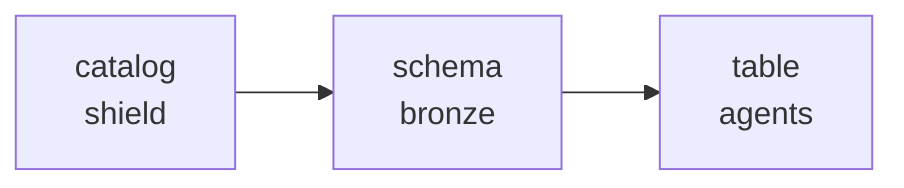

# 00 · Briefing room

> "I recruit based on potential." — Nick Fury

**Notebook:** [00_briefing_room.ipynb](../notebooks/databricks/00_briefing_room.ipynb) · **Story:** [story.md](../story.md) · **Code it imports:** [src/shield_data](../src/shield_data)

> 💡 **TL;DR:** Chapter 00 is a smoke test. A notebook is only a document: your cells run on **compute**, where Databricks has already created the `spark` session. If the notebook can run Spark, tell you who you are (user, catalog, schema) and import this repo's `shield_data` package from a **Git folder**, every later chapter can start. It changes nothing in your workspace.

---

## What a data engineer does
A data engineer builds and runs the systems that move data from where it is created to where decisions are made, and keeps it **correct, fresh, secure, and affordable** on the way. The daily work:

1. **Ingest** data from files, databases, APIs, and event streams.
2. **Transform** it into clean, modelled tables.
3. **Orchestrate** the steps so they run on time, in order, and recover from failure.
4. **Guard quality** so bad data is caught, not trusted.
5. **Govern** who may see what, and where data came from.
6. **Operate** it: monitoring, cost, incidents, deployments.

## The big picture



Unity Catalog governs every table, Jobs orchestrate the steps, and the whole thing is deployed as code (the [deploy guide](deploy-and-automate.md)). Bronze, silver and gold are explained in [chapter 05](05-medallion.md); this chapter only needs the picture.

## Databricks in five lines
* **Workspace**: the web UI and the place where code runs. **Compute**: serverless or clusters that run Spark.
* **Spark**: distributed engine; you describe transformations on DataFrames or SQL.
* **Delta Lake**: table format on cloud storage with transactions, history, and schema control.
* **Unity Catalog**: catalogs → schemas → tables/volumes, with permissions and lineage.
* **Lakeflow**: Jobs (orchestration), Spark Declarative Pipelines (declarative ETL), Connect (ingestion).

## Repo tour
`infra/` (Bicep) · `notebooks/databricks/` (chapters) · `pipelines/` (declarative pipeline code) · `resources/` + `databricks.yml` (bundle) · `src/shield_data/` (data generator + quality rules) · `tests/` · `docs/`.

---

## Concepts

### 1 · Notebook, compute and the `spark` session

**The idea.** A notebook is a document in your browser. It has no engine of its own. When you run a cell, the code travels to **compute**, runs there, and the result travels back.



Databricks creates a Spark session on that compute and puts it in a variable called `spark`. `display(...)` is a second ready-made helper that renders a table. Neither needs an `import`. This is Databricks behaviour, not Spark in general: in a plain Python script you would build the session yourself.

**How this repo implements it (Step 1).**
* `spark.range(5).withColumnRenamed("id", "agent_number")` builds five rows (0 to 4) in one column, `agent_number`. No files, no tables.
* `display(agents_demo)` renders them. `show_checks([...])` then shows a check table with `rows` = 5 and `columns` = `["agent_number"]`.
* Every chapter notebook defines the same small `show_checks` helper: rows of check, result, expected and a tick or cross. A cross means "different from the expectation", which is not always a bug.
* The first run on serverless can take a moment while compute starts.

**Serverless or classic compute.** Both run the same notebook. The choice is about who manages the machines:

| | Serverless | Classic cluster |
|---|---|---|
| Who sizes and updates it | Databricks | You |
| Start-up | Seconds (performance-optimized notebooks, per Microsoft Learn) | Minutes, unless already running |
| Billing | Per use (DBU consumption) | Cluster uptime, plus the VMs in your subscription |
| Streaming triggers | Only `availableNow` (and the deprecated `Trigger.Once`) | Any trigger |
| Restrictions | Spark Connect only: no RDD APIs, no R, limited DBFS | Few |

This course assumes serverless. Chapter 02 compares the two in more detail; the streaming trigger rule matters in [chapter 03](03-coulson-ingests.md).

**Why it helps.** If this step fails, nothing else works, and the cause is almost always compute: not attached, no permission to attach, or the workspace is not running.

**Common mistakes.**
* Forgetting to attach compute. The notebook then shows no compute in the selector and cells do not run.
* Treating the notebook like a local script. Files you write to the driver's local disk are not in your repo and are not shared.
* Assuming `spark` exists in a `.py` file you run elsewhere. It exists in notebooks and jobs; locally you need Databricks Connect (not covered here).

**Not covered yet.** Creating the catalog and schemas ([chapter 01](01-assemble-the-platform.md)), choosing between serverless and classic compute ([chapter 02](02-first-recon.md)), Delta tables ([chapter 04](04-delta-lake-101.md)).

### 2 · Identity and Unity Catalog's three-level names

**The idea.** Every action in Databricks runs as someone, and every table is addressed with three parts: `catalog.schema.table`. The catalog is the top level, then the schema, then the table (or volume, or function). Permissions are granted on those objects, so "who am I" is the first question when something is denied.



**How this repo implements it (Step 2).** One query: `SELECT current_user() AS me, current_catalog() AS catalog, current_schema() AS schema`.
* `me` is the account you signed in with.
* `catalog` and `schema` are your workspace's **defaults**. A name without catalog and schema, like `agents`, resolves against them. Later chapters always write the full name (`shield.bronze.agents`) so they never depend on your defaults.
* The values differ per workspace, so there is no single right answer. The check table only confirms that each value came back.
* The catalog `shield` does not exist yet. [Chapter 01](01-assemble-the-platform.md) creates it.

**Why it helps.** You learn what a permission error is about before meeting one. In chapter 01 the same identity needs `CREATE CATALOG` and `CREATE EXTERNAL LOCATION`; in [chapter 11](11-governance-vs-hydra.md) you grant access to others.

**Alternatives and trade-offs.** You can change the defaults with `USE CATALOG` and `USE SCHEMA`. That shortens queries but makes notebooks depend on session state, which is why this repo avoids it.

**Common mistakes.** Writing two-part names (`bronze.agents`) and getting the table from whatever catalog is the default. Assuming the default catalog is `main`: it depends on the workspace.

**Not covered yet.** Grants, groups and row or column security (chapter 11).

### 3 · Git folder: importing the repo's own code

**The idea.** A **Git folder** is a real clone of a Git repository inside the workspace. Because the clone has the whole repo, a notebook sits next to the code it needs and can import it.

**How this repo implements it (Step 3).**
```python
repo_root = os.path.abspath(os.path.join(os.getcwd(), "..", ".."))
sys.path.insert(0, os.path.join(repo_root, "src"))
from shield_data.generate import make_locations
```
* The notebook lives in `notebooks/databricks/`, so two levels up (`..`, `..`) is the repo root, and `src/` holds the package.
* `make_locations()` returns the 10 S.H.I.E.L.D. locations. The notebook prints `10 S.H.I.E.L.D. locations loaded from <path>` and checks that the module file really lives under this repo's `src/`.
* Chapters 02, 03, 06 and others import the same package (the data generator and the quality rules), so this is the shared dependency.
* Re-running adds the same path to `sys.path` again, which is harmless.

**Setting it up.** Workspace → Create → Git folder. Public repositories can be cloned without Git credentials (Microsoft Learn: "You can clone public remote repositories without Git credentials"). Private repositories and pushes need a personal access token or OAuth set up under your Git provider settings. Git folders support HTTPS, not SSH.

**Why it helps.** The synthetic dataset is generated by tested code ([tests/](../tests)), not copied from a download, and you can read and change that code in the same place.

**Alternatives and trade-offs.**

| Option | How | Trade-off |
|---|---|---|
| Git folder + `sys.path` (here) | clone the repo, add `src/` to the path | Simple, always the code of the branch you checked out. The path trick depends on the notebook's location |
| Install as a wheel | build the package and `%pip install` it | Proper dependency handling; one more build step (not used here, not verified for this repo) |
| Upload single notebooks | Import file | No `src/` next to it, so Step 3 fails |

**Common mistakes.**
* `ModuleNotFoundError: No module named 'shield_data'`: the notebook is not inside a Git folder (for example it was uploaded as one file), so `../../src` does not exist. Clone the repo as a Git folder and open the notebook from there.
* Editing code in the Git folder and forgetting that the change is only local until you commit and push from the Git dialog.
* Relative paths and serverless: Microsoft Learn notes that the working directory of serverless notebooks and job tasks is not guaranteed, and recommends absolute paths. The notebook relies on `os.getcwd()` being the notebook's folder, which Git folders provide interactively. This has not been run in a workspace (not verified), and a job run may behave differently.

**Not covered yet.** Committing and pushing from a Git folder, deploying the same code with a bundle (the [deploy guide](deploy-and-automate.md)).

---

## What the notebook does
Three small steps, each with a check table. It creates nothing, so there is nothing to clean up. The expected values stay expectations until you run the notebook in your own workspace.

| Step | Goal | Expected |
|---|---|---|
| 1 | Prove the notebook is attached to working compute | A table with one column `agent_number` and five rows (0 to 4) |
| 2 | See your identity and default catalog | One row with `me`, `catalog`, `schema`; the checks only confirm each value came back |
| 3 | Import `shield_data` from `src/` | `10 S.H.I.E.L.D. locations loaded from <your Git folder>`; 10 locations, module loaded from this repo's `src/` |

Needs: an Azure Databricks workspace and this repo cloned as a **Git folder**. Any compute works; serverless is the simplest. No earlier chapters, no tables, no special permissions.

## Gotchas
* `spark` and `display` are already defined in every Databricks notebook; the compute you attach to runs your cells.
* The repo must be a Git folder, so that `../../src` sits next to the notebook.
* The identity and default catalog differ per workspace; do not compare them with a friend's.
* None of this has been run in a real workspace yet.

## Cost warning
Compute and Event Hubs cost money. Prefer serverless, stop what you are not using, and run `azd down --purge` when you pause.

## Not covered yet
* Catalog, schemas and volumes: [chapter 01](01-assemble-the-platform.md).
* Serverless versus classic compute, DataFrames and SQL: [chapter 02](02-first-recon.md).
* Local development with Databricks Connect and committing from a Git folder: not planned in this course.

## Try it yourself
1. In the notebook, turn `spark.range(5)` into a DataFrame of ten agent codenames with a column for the codename length. (`spark.createDataFrame` with a list of tuples is enough.)
2. Find where in the UI you can see the compute the notebook ran on, and what else you can switch it to.
3. Explain the medallion architecture to a friend with a non-data example (a kitchen: delivery, prep, plated dish), then find your employer's "bronze, silver, gold" even if nobody calls them that.
