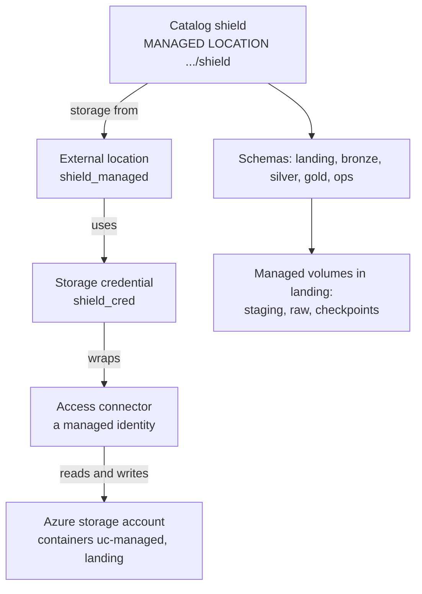

# 01 · Assemble the platform

**Notebook:** [01_assemble_the_platform.ipynb](../notebooks/databricks/01_assemble_the_platform.ipynb) · **Infra:** [infra/](../infra)

> 💡 **TL;DR:** Unity Catalog never lets code touch cloud storage directly. A chain of named objects sits in between: an Azure **access connector** (managed identity), a **storage credential** that wraps it, an **external location** (a path plus that credential), and a **catalog** whose `MANAGED LOCATION` points into it. `azd up` builds the Azure side, you create the credential once by hand, and the notebook creates the Unity Catalog side: one catalog `shield`, five schemas and three managed volumes. Every later chapter lives inside them.

---

## The big picture

| Layer | Created by | What |
|---|---|---|
| Azure | `azd up` | Databricks workspace (Premium), ADLS Gen2 storage, access connector, Key Vault, Event Hubs |
| Unity Catalog | you (once, UI/CLI) | **Storage credential** `shield_cred` using the access connector |
| Unity Catalog | notebook 01 | External location `shield_managed`, catalog `shield`, schemas `landing`/`bronze`/`silver`/`gold`/`ops`, managed volumes `staging`/`raw`/`checkpoints` |

---

## Concepts

### 1 · The chain from storage to catalog

**The idea.** Code asks for `shield.bronze.agents` or `/Volumes/shield/landing/raw`. It never asks for `abfss://...` or a storage key. Unity Catalog translates the name into a path and checks your privileges first, then uses a credential you never see. Permissions are therefore granted on Unity Catalog objects (catalog, schema, volume), in one place. The product feature is Unity Catalog; the object names and the schema-per-layer layout are this repo's convention.

**How this repo implements it.**

| Object | Name here | Made by | What it is |
|---|---|---|---|
| Storage account | created by `azd up` | Bicep | ADLS Gen2 with containers `uc-managed` and `landing`; shared-key access disabled |
| Access connector | created by `azd up` | Bicep | A managed identity with *Storage Blob Data Contributor* on the account |
| Storage credential | `shield_cred` | you, by hand, once | A Unity Catalog object that holds the access connector's identity |
| External location | `shield_managed` | notebook Step 1 | The URL `abfss://uc-managed@<account>.dfs.core.windows.net/` plus `shield_cred` |
| Catalog | `shield` | notebook Step 2 | Top-level namespace with its own managed storage |

**Why it helps.** There are no storage keys or SAS tokens in notebooks or config. The storage account has shared-key access disabled, so everything goes through Entra identities. You can answer "who can read this?" by looking at grants, not at storage ACLs.

**Alternatives and trade-offs.**
* *Service principal instead of a managed identity* in the credential: works, but then you own a secret and its rotation. The managed identity has no secret.
* *Metastore-level managed storage* instead of a catalog-level one: one shared root for every catalog. The metastore Azure creates for the region has none (see the next concept), and a root set on the metastore can only be set by an account admin.
* *Everything in the default workspace catalog*: quickest, but you do not choose where the files live, and you cannot separate this course from other work.

**Common mistakes.** Creating the credential in the wrong place (it is a metastore-level object, not part of a catalog). Mixing up the credential (an identity) with the external location (an identity plus a path).

**Not covered yet.** Granting access to other people ([chapter 11](11-governance-vs-hydra.md)).

### 2 · External location and why a catalog needs a managed location

**The idea.** An **external location** pairs one storage path with one credential and is itself a securable object, so you can grant who may use that path. A **managed location** is the place where Unity Catalog stores the *managed* tables and volumes of a catalog or schema. If a catalog (or schema) does not name one, Unity Catalog falls back to the metastore's storage root. The metastore Azure creates for the region has none, so a catalog must say where its data lives.

**How this repo implements it.**
* Step 1 creates `shield_managed` on the `uc-managed` container with `shield_cred`. `IF NOT EXISTS` does nothing when the name is taken, so an external location created earlier with a wrong account name stays wrong: `DROP EXTERNAL LOCATION shield_managed` and run the cell again.
* Step 2 creates `shield` with `MANAGED LOCATION 'abfss://uc-managed@<account>.dfs.core.windows.net/shield'`. The location must be covered by an external location, which Step 1 made. Unity Catalog adds opaque hashed subfolders below the path you give, so you never see tidy table folders.
* `DESCRIBE CATALOG EXTENDED shield` shows the storage root. The label of the row can differ between runtime versions, so look for the path.

**Privileges.**

| Action | Privilege |
|---|---|
| Create the storage credential | `CREATE STORAGE CREDENTIAL` on the metastore |
| Create the external location | `CREATE EXTERNAL LOCATION` on the metastore **and** on the credential |
| Create a catalog | `CREATE CATALOG` on the metastore |
| Put the catalog on a path | `CREATE MANAGED STORAGE` on the external location (you own `shield_managed`, so you have it) |

**Why it helps.** Different catalogs can live on different containers or accounts, and a catalog can be isolated from the rest of the metastore.

**Alternatives and trade-offs.** A managed location can also be set per *schema* (`CREATE SCHEMA ... MANAGED LOCATION`), which isolates data further at the cost of more external locations to manage. This repo sets it once, on the catalog. The managed location of an existing catalog can be changed later, but only new managed tables and volumes use the new place; existing ones stay (Microsoft Learn, runtime 18.1 and above).

**Common mistakes.** Typing the storage account name wrong (see the `IF NOT EXISTS` note above). Trying to create the catalog without a managed location on a metastore that has no root. Pointing two managed locations at overlapping paths or at a path that holds external tables.

### 3 · Schemas: one per medallion layer, plus landing and ops

**The idea.** A schema is the second level of the name and the natural unit for grants. The layer pattern (raw, clean, business-ready) is explained in [chapter 05](05-medallion.md); here you only create the containers.

**How this repo implements it (Step 3).**

| Schema | Holds | From chapter |
|---|---|---|
| `landing` | files (volumes only) | 01 |
| `bronze` | raw tables | 03 |
| `silver` | cleaned tables | 05 |
| `gold` | aggregates | 05 |
| `ops` | operational tables used later | later chapters |

Unity Catalog also lists `default` and `information_schema`, which it creates itself. `SHOW SCHEMAS IN shield` therefore returns seven rows, five of them yours.

**Why it helps.** The schema name tells you the layer, and a grant on `shield.gold` gives analysts the business tables without the raw ones.

**Alternatives and trade-offs.** A catalog per layer (or per environment and layer) gives coarser access control and a clearer cost split, with more objects to manage. [Chapter 05](05-medallion.md) compares the options.

### 4 · Managed volumes for files

**The idea.** A **volume** is Unity Catalog's governed folder for files (non-tabular data). Paths look like `/Volumes/<catalog>/<schema>/<volume>/...` and work for Python and Spark alike.

**How this repo implements it (Step 4).** Three volumes in `shield.landing`:

| Volume | Holds | Used by |
|---|---|---|
| `shield.landing.staging` | the generated seed data | chapter 02 writes, chapter 03 reads |
| `shield.landing.raw` | files "arriving from the field" | chapter 03 |
| `shield.landing.checkpoints` | Auto Loader checkpoints and inferred schemas | chapter 03 |

The notebook reads `shield.information_schema.volumes` and expects all three with type `MANAGED`.

**Managed versus external.**

| | Managed volume (here) | External volume |
|---|---|---|
| Where files live | Inside the schema's or catalog's managed location; Unity Catalog chooses the layout | A folder you name inside an external location |
| Drop the volume | The files are deleted, after a 7-day recovery window (see below) | The files stay |
| Access from other tools | Only through Unity Catalog | Also directly by URI, but then Unity Catalog does not govern those reads |
| Needs | `CREATE VOLUME` | `CREATE EXTERNAL VOLUME` on the external location |

Microsoft Learn: dropping a managed volume does not delete the files at once. Unity Catalog keeps them for 7 days (`UNDROP VOLUME` can recover them), then purges them within about 48 hours of the end of that window. External volumes keep their files. The `landing` container that `azd` created is unused by the notebook on purpose, for the first mini-project below.

**Why it helps.** One name for files that is governed like a table, and no storage paths or keys in notebooks.

**Common mistakes.** Writing to the `raw` volume by hand and expecting Auto Loader to have seen it before the checkpoint says so ([chapter 03](03-coulson-ingests.md)). Dropping a volume and expecting the space back immediately.

---

## Manual steps

1. `azd env new shielddev` → `azd env set AZURE_LOCATION swedencentral` → `azd up`.
2. `azd env get-values` and note `DATABRICKS_HOST`, `STORAGE_ACCOUNT_NAME`, `ACCESS_CONNECTOR_ID`.
3. Open the workspace URL. The first user to open it is a workspace admin.
4. Create the storage credential. In **Catalog**, click **+** → **Create a credential**, type *Azure Managed Identity*, name `shield_cred`, *Access Connector ID* = the `ACCESS_CONNECTOR_ID` output. (Menu labels move between releases; existing credentials are listed under **Catalog → Connect → Credentials**.) (CLI alternative: `databricks storage-credentials create --json '{"name":"shield_cred","azure_managed_identity":{"access_connector_id":"<id>"}}'` — unverified here.)
5. Clone this repo as a **Git folder** (Workspace → Create → Git folder) and open notebook 01.
6. Fill the `storage_account` widget and run all. Every statement uses `IF NOT EXISTS`, so re-running is safe.

The setup cell stops early if the widget is empty or the credential does not exist.

## What the notebook does

Four steps with check tables. Everything it creates is a Unity Catalog object; no Azure resource is created or changed. The **Expected** values are expectations until you run the notebook in your workspace.

| Step | Goal | Expected |
|---|---|---|
| 1 | External location | `shield_managed` listed by `SHOW EXTERNAL LOCATIONS` with the URL of the `uc-managed` container |
| 2 | Catalog `shield` with a managed location | `shield` in `SHOW CATALOGS`; the storage root ends in `uc-managed@<account>.dfs.core.windows.net/shield` |
| 3 | Five schemas | `landing`, `bronze`, `silver`, `gold`, `ops` (plus the built-in `default` and `information_schema`) |
| 4 | Three volumes in `shield.landing` | `checkpoints`, `raw`, `staging`, all `MANAGED` |

Nothing is cleaned up because every later chapter needs it. The notebook has a commented reset (`DROP CATALOG ... CASCADE`) that deletes all tables and managed volumes in `shield`, including the data of later chapters.

## Gotchas
* The credential needs the `CREATE STORAGE CREDENTIAL` privilege on the metastore; the notebook needs `CREATE EXTERNAL LOCATION` (on the metastore and on the credential) and `CREATE CATALOG`. If it is denied, ask an **account admin** to make you metastore admin (account console → Catalog → your metastore).
* The storage account has shared-key access disabled; everything goes through Entra identities.
* `azd down --purge` removes the Azure resources, but the credential, location and catalog live in the Unity Catalog metastore. Whether they disappear with the workspace is not verified here; drop them yourself for a clean slate. (Microsoft Learn says a workspace's default catalog is retained after deleting the workspace unless you force-delete it; it does not say this about catalogs you created yourself.)
* Optional file events need two extra roles for the connector (Storage Account Contributor, EventGrid EventSubscription Contributor). Not required for this repo.
* Menu names, the privilege list and the `DESCRIBE CATALOG` labels were checked against Microsoft Learn, but nothing here has run in a workspace.

## Not covered yet
* Granting access to other people ([chapter 11](11-governance-vs-hydra.md)).
* An *external* volume on the `landing` container: left unused on purpose (mini-project 1).
* The layers themselves ([chapter 05](05-medallion.md)).
* Creating the metastore, and the Bicep modules in detail: the [deploy guide](deploy-and-automate.md).

## Try it yourself
1. Create an *external* volume on the `landing` container (it needs a second external location and `CREATE EXTERNAL VOLUME`), then compare it with a managed volume: where do the files go, and what happens to them when you drop each volume?
2. Run `DESCRIBE CATALOG EXTENDED shield`, find the managed location, and open that folder in the Azure portal's storage browser. What is in it now, and what appears there after chapter 03? (Unity Catalog chooses opaque folder names on purpose.)
3. Add a `sandbox` schema and grant a colleague `USE SCHEMA` + `CREATE TABLE` on it only (plus `USE CATALOG` on the catalog). Check with `SHOW GRANTS` what they can and cannot do. Bonus: re-run `azd up` and read the `what-if` output to see which parts of the infrastructure are idempotent.
