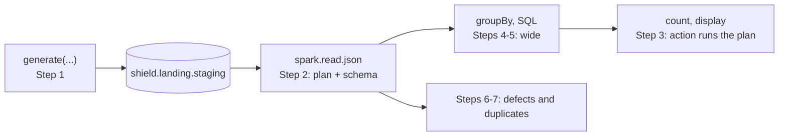
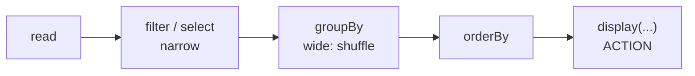

# 02 · First recon

**Notebook:** [02_first_recon.ipynb](../notebooks/databricks/02_first_recon.ipynb) · **Code:** [src/shield_data/generate.py](../src/shield_data/generate.py)

> 💡 **TL;DR:** Spark reads your question lazily. `filter`, `select` and `groupBy` only add steps to a plan, and an **action** (`count`, `display`, `write`) runs the whole plan. Steps that need rows to meet (`groupBy`, `join`) cause a shuffle, which is where time goes. SQL and DataFrames are the same engine. This chapter generates the seed data, reads it, summarises it both ways and finds the defects and duplicates the generator planted, by hand, before anything is cleaned.

---

## The big picture

---

## Concepts

### 1 · A DataFrame is a lazy plan; actions run it

**The idea.** A **DataFrame** is a table with a schema, spread over many machines. `filter`, `select`, `groupBy` and `join` are **transformations**: they do not compute, they add a step to a plan. Only an **action** (`display`, `count`, `write`) makes Spark run the plan, and because it sees the whole plan first it can optimise it as one. This is how Spark works in general, not something Databricks added.

**How this repo implements it.**
* Step 2 builds `incidents = spark.read.json(".../incident_reports")`. To learn the column types Spark has to look at the data once, so even this line does a little work. That is the exception that proves the rule: schema inference is eager, the rest is lazy.
* Step 3 triggers real work: `incidents.count()` reads all files and returns 10,250. `display(incidents.limit(10))` reads only what it needs for ten rows.
* Nothing is cached. Run `count()` twice and time it: the second run is no faster, because Spark keeps nothing unless you ask (`cache()` / `persist()`, not used here).

**Why it helps.** Knowing what is lazy explains most "why did nothing happen?" and "why is this slow?" questions. A cell that only builds DataFrames returns instantly and fails later, in the cell that finally runs an action.

**Common mistakes.**
* Calling `count()` after every step "to check". Each action re-reads the data.
* Expecting an error in the line that has the bug. With lazy plans the error often shows up at the action.
* Treating `display` as free: it is an action.

**Not covered yet.** Caching, partitions and query plans in depth. Delta tables with statistics come in [chapter 04](04-delta-lake-101.md).

### 2 · Schema inference when reading JSON

**The idea.** JSON files carry no schema. `spark.read.json` looks at the data and guesses one. That is convenient for exploration and fragile for production, because the guess depends on the data it saw.

**How this repo implements it (Step 2).** The inferred schema has nine columns. Spark sorts inferred JSON fields alphabetically, so the order differs from the files:

| Column | Type |
|---|---|
| `agent_id`, `incident_id`, `incident_type`, `location_id`, `reported_at`, `severity`, `source_channel`, `summary` | string |
| `casualties` | long (shown as `bigint` by `dtypes`) |

* `reported_at` is a **string**: a timestamp written as text stays text until you parse it ([chapter 05](05-medallion.md) does).
* `source_channel` exists although only the last files have it, because Spark looks at all five files. Rows from the first files have `NULL` there.

**Alternatives and trade-offs.**

| Option | Behaviour | Trade-off |
|---|---|---|
| Inference (here) | Spark reads data to guess types | Easy; an extra pass over the data, and the result changes with the data |
| Explicit schema (`.schema(...)`) | You declare the types | Fast and stable; you must maintain it |
| Auto Loader with a schema location | Infers once, stores the schema, evolves it | Needs a checkpoint; see [chapter 03](03-coulson-ingests.md) |

**Common mistakes.** Trusting the guess when the sample is unlucky: a column that is all digits in the sample becomes a number, then one text value breaks it. Reading a feed of mixed files and assuming the first file defines the schema.

### 3 · Transformations: narrow versus wide

**The idea.** A **narrow** transformation (`filter`, `select`) works on each partition on its own. A **wide** one (`groupBy`, `join`, `orderBy`) needs rows with the same key to be on the same machine, so Spark moves rows across the network: a **shuffle**. In a query plan it shows up as `Exchange`. Shuffles are usually the most expensive step.

**How this repo implements it (Step 4).** `groupBy("incident_type", "severity")` with `count(*)` and `sum(casualties)`, ordered by `n` descending.
* 30 groups: 6 incident types times 5 severity values. The fifth severity, `catastrophic`, is not a real value; Step 6 explains.
* The largest group is `surveillance` / `low` with 895 incidents and 501 casualties.
* The numbers count raw rows, so duplicates and defects are included on purpose.

**Why it helps.** Filter before you group. A `filter` placed before the `groupBy` shrinks the data that has to be shuffled (mini-project 2).

**Alternatives and trade-offs.** Small lookup tables can be broadcast to avoid shuffling the big side (a broadcast join); Spark often does this on its own. Pre-aggregating in an earlier layer removes the shuffle from every later query, which is part of the point of gold tables ([chapter 05](05-medallion.md)).

**Common mistakes.** Aggregating on a key with very few values and wondering why one task is slow (skew). Calling `orderBy` on the whole dataset when you only need the top rows (use `limit` with it).

### 4 · SQL and DataFrames are the same engine

**The idea.** Both languages are turned into the same logical plan and optimised by the same engine. Pick whichever reads better; mix them freely. A **temporary view** gives a DataFrame a name that SQL can use.

**How this repo implements it (Step 5).** `incidents.createOrReplaceTempView("incidents_tmp")`, then the same aggregation in SQL. The check compares both results in both directions with `exceptAll` (rows only in the DataFrame result: 0; rows only in the SQL result: 0) and expects 30 rows.
* The view exists only in the notebook session. `createOrReplace` makes the cell safe to repeat.

**Why it helps.** Analysts and engineers can work on the same data in the language they prefer, and a result you can express in SQL can be handed to a dashboard or a pipeline unchanged.

**Common mistakes.**
* Expecting a temp view to be visible in another notebook or after you detach: it is per session.
* On serverless compute, which uses Spark Connect, temporary views are evaluated lazily. Reusing the same view name in a loop can give surprising errors, so Microsoft Learn recommends unique names there. The notebook uses one name once.

**Not covered yet.** Persistent views and tables ([chapter 04](04-delta-lake-101.md)).

### 5 · Compute: serverless versus classic

| | Serverless | Classic cluster |
|---|---|---|
| Set-up | None; Databricks manages it | You pick size, runtime and access mode |
| Start | Seconds | Minutes unless already running |
| Billing | Per use | Per uptime; you stop it |
| Good for | Notebooks, scheduled jobs, this course | Custom libraries, R or Scala, special runtime or networking |

This course assumes serverless. Two consequences you meet in this chapter and the next: ANSI mode is on by default, so invalid casts raise errors instead of returning `NULL` (the reason Step 6 uses `try_to_timestamp`), and only Spark Connect APIs work (no RDDs). Details are in Microsoft Learn's serverless limitations page.

### 6 · Reading data critically: defects and duplicates

**The idea.** Before you clean data, count what is wrong with it. You cannot fix what you have not measured, and the numbers become the first test of your quality rules.

**How this repo implements it (Steps 6 and 7).** The generator ([src/shield_data/generate.py](../src/shield_data/generate.py)) gives 5 % of the incidents exactly one defect and replays some deliveries.
* The counts are over rows, duplicates included.
* `try_to_timestamp(reported_at, "yyyy-MM-dd'T'HH:mm:ss'Z'")` returns `NULL` for text that does not match, which is how unparsable and future timestamps are separated.
* The "future" defects are planted 30 to 400 days after the day you generate the data, so that count depends on when you ran Step 1.
* Step 7 compares row count with distinct `incident_id`: 10,250 rows, 10,000 ids, so 250 ids appear twice.

**Why it helps.** These five defect types and the duplicates reappear as quality rules in [chapter 06](06-natasha-spots-the-fake.md) and as the deliberate flaw in [chapter 05](05-medallion.md). Bronze keeps all of it ([chapter 03](03-coulson-ingests.md)).

**Common mistakes.** Deleting duplicates "to make the count nice" before you know why they exist. Counting defects after deduplication, which changes the numbers.

---

## What the notebook does

Seven steps, each with a goal, an expected result and a check table. The numbers are expectations for the seeded dataset (`seed=42`, `dirty=0.05`); they were computed from the generator, not from a workspace run. Needs chapter 01 (the volume `shield.landing.staging`) and the Git folder from chapter 00.

| Step | Goal | Expected |
|---|---|---|
| 1 | Generate the seed data into `shield.landing.staging` (10,000 incidents, 20,000 pings, `seed=42`, `dirty=0.05`, `batches=5`) | 10,250 incident rows (10,000 plus 250 replayed duplicates) in five files `part-0000.json` to `part-0004.json`; 10 locations, 50 agents, 120 threat assessments, 20,000 pings |
| 2 | Read the JSON and look at the schema | Nine columns, alphabetical; `casualties` is `long`, everything else `string`, including `reported_at` |
| 3 | An action runs the plan | 10,250 rows; the table shows the first 10 |
| 4 | Group by incident type and severity | 30 groups; largest is `surveillance` / `low`, 895 incidents, 501 casualties |
| 5 | The same thing in SQL via a temp view | Identical to Step 4 (30 rows, no differences either way) |
| 6 | Count the planted defects | Missing agent 96, invalid severity 110, negative casualties 96, unparsable timestamp 99, future timestamp 110; severity values `low` 5,036, `medium` 3,123, `high` 1,512, `critical` 469, `catastrophic` 110 |
| 7 | Find duplicates | 10,000 distinct `incident_id`, 250 ids appear twice |

Nothing is stored apart from the seed data in staging, so there is nothing to clean up. Regenerating writes the same files over the old ones, and chapter 03 works on copies, so it does not change files it already ingested. Chapters 03, 09, 10 and 12 read the seed data.

## Gotchas
* `spark.read.json` infers the schema by reading data: fine here, slow and fragile in production (chapter 03 fixes that).
* Files in volumes are available as ordinary paths (`/Volumes/...`) to Python and to Spark.
* The "future timestamp" defects are planted relative to the day you generate the data (30 to 400 days ahead). Data generated long ago may show a different count in Step 6.
* Other data gives other numbers and a cross in the check table. That is not a bug.
* None of these numbers has been run in a workspace.

## Not covered yet
* Auto Loader instead of `spark.read.json`, which avoids re-inferring the schema on every read ([chapter 03](03-coulson-ingests.md)).
* Delta tables ([chapter 04](04-delta-lake-101.md)), parsing and cleaning ([chapter 05](05-medallion.md)), quality rules ([chapter 06](06-natasha-spots-the-fake.md)).
* Caching, partition tuning and reading query plans in depth.

## Try it yourself
1. Join incidents with `agents/agents.csv` (read it with `header=True`) and list the five busiest codenames. The incident feed has 51 distinct `agent_id` values: 50 agents and `NULL`. What does your join do with the `NULL` rows?
2. Use `explain()` on `by_type` and find the shuffle (`Exchange`) in the plan. Then add a `filter` before the `groupBy` and see which step moves.
3. Step 6 counts 99 rows with an unparsable `reported_at`. Count the distinct incidents instead (expected: 97, from the generator) and explain the difference. Bonus: time `count()` twice. Why is the second no faster? (There is no caching unless you ask for it.)
