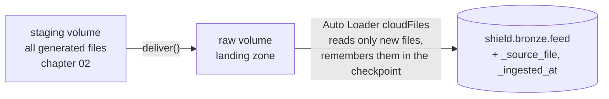
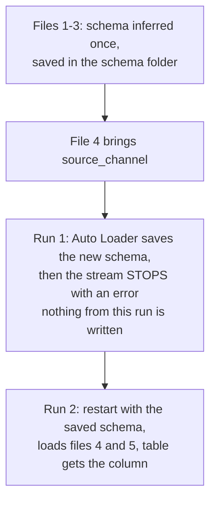

# 03 · Coulson ingests

**Notebook:** [03_coulson_ingests.ipynb](../notebooks/databricks/03_coulson_ingests.ipynb) · **Code:** [src/shield_data/generate.py](../src/shield_data/generate.py)

> 💡 **TL;DR:** Files arrive late, twice and in new shapes. **Auto Loader** (`cloudFiles`) loads each file from a landing folder exactly once, remembering what it has done in a **checkpoint**, and `trigger(availableNow=True)` turns it into an incremental batch that stops by itself. When a feed adds a field, the stream stops once after saving the new schema and the restart succeeds. **Bronze** keeps everything as received, plus lineage columns, including the duplicates and bad rows.

---

## The big picture

---

## Concepts

### 1 · Landing zone

**The idea.** A landing zone is a folder where files are put exactly as delivered and never edited. It is your replay source: if the logic downstream changes, you rebuild from the untouched files. This is a pattern, not a Databricks feature.

**How this repo implements it.**

| What | Path or name |
|---|---|
| All generated files, the "field" | `/Volumes/shield/landing/staging/<feed>` |
| Landing zone: a file is copied here when it "arrives" (`deliver()`) | `/Volumes/shield/landing/raw/<feed>` |
| Target | `shield.bronze.<feed>` for `agents`, `locations`, `threat_assessments`, `incident_reports` |

* `deliver(feed, total=N)` makes sure the first `N` staged files are in `raw/<feed>`. It skips files already delivered and never delivers more than `N`, so calling it again does nothing. That is what makes every cell safe to repeat.
* The incident feed is five files (`part-0000.json` to `part-0004.json`) of 2,050 rows each: 10,250 rows including 250 replayed duplicates. You deliver them in three rounds: file 1, files 2 and 3, files 4 and 5.

**Why it helps.** Fixing a bug in silver never needs a new delivery from the field.

**Alternatives and trade-offs.** Landing zones in production are usually an ADLS container fed by another system, not a volume you copy into. Some teams archive or delete processed files (Auto Loader has a `cloudFiles.cleanSource` option for that, not used or verified here). Keep them while you are learning, because chapters 08 and 10 reuse them.

**Common mistakes.** Editing a file in place after delivery (Auto Loader tracks files by path, not by content, so it will not see the change). Overwriting a file name that was already ingested.

### 2 · Auto Loader and the checkpoint

**The idea.** **Auto Loader** is a Databricks streaming source (format `cloudFiles`) that watches a folder, loads only files it has not seen, and records progress in a **checkpoint**. Microsoft Learn: the file metadata is kept in a key-value store (RocksDB) in the checkpoint location, which gives exactly-once processing when writing to Delta.

**How this repo implements it.** `ingest(feed, fmt, table)` in the notebook:
* reads `spark.readStream.format("cloudFiles")` with `cloudFiles.format` (`csv` or `json`), `cloudFiles.schemaLocation`, `cloudFiles.inferColumnTypes = true` and `cloudFiles.schemaEvolutionMode = addNewColumns`;
* adds `_source_file` (`_metadata.file_path`) and `_ingested_at` (`current_timestamp()`);
* writes with `checkpointLocation` and `mergeSchema = true` to `shield.bronze.<table>`.

| State | Path |
|---|---|
| Which files are done | `/Volumes/shield/landing/checkpoints/<feed>/checkpoint` |
| Schema Auto Loader inferred | `/Volumes/shield/landing/checkpoints/<feed>/schema` |

`inferColumnTypes` makes Auto Loader guess real types (numbers, booleans). Without it, JSON and CSV columns are all strings.

**Why it helps.** A re-run costs almost nothing because old files are skipped. Step 3 proves it: a second call with nothing new leaves the table at 2,050 rows.

**Alternatives and trade-offs.**

| Option | Behaviour | Trade-off |
|---|---|---|
| `spark.read.json` in a batch (chapter 02) | Reads everything every time | Simple; re-reads and re-infers |
| `COPY INTO` | Idempotent file loading in SQL | Not used here; not verified in this repo |
| Auto Loader, directory listing (default) | Lists the folder to find new files | Easy; listing cost grows with the number of files |
| Auto Loader, file events or notifications | Storage events announce new files | Scales better; needs extra Azure set-up (event subscriptions and roles) |
| Declarative pipeline with Auto Loader | Pipeline manages schema and checkpoint | [Chapter 08](08-declarative-pipelines.md) |

**Common mistakes.**
* Checkpoint and schema paths must be stable and outside the table folder.
* Deleting a checkpoint means reprocessing everything; deleting only the table leaves a checkpoint that still says the files are done, so the new table never gets them.
* Sharing one checkpoint between two feeds. Microsoft Learn: each ingestion workload needs its own checkpoint. Here each feed has its own folder.

### 3 · `trigger(availableNow=True)`: incremental batch

**The idea.** Auto Loader is a *streaming* source, and a stream normally runs forever. `availableNow` means "process everything that is new, then stop", so each call is an incremental **batch** you can put on a schedule. Serverless notebooks and jobs accept only this trigger (and the deprecated `Trigger.Once`); the default, a stream that never stops, is rejected there (Microsoft Learn, serverless limitations). Files that arrive after the query started wait for the next run.

**How this repo implements it.**
* `.trigger(availableNow=True)` in `ingest()`.
* `toTable(...)` starts the stream and returns at once, so `ingest()` calls `query.awaitTermination()`. That waits until the stream is done and makes a failed stream raise its error in the cell that started it. Without it, Step 3 would count rows before the load finished and Step 5 would not see the failure.

**Why it helps.** Compute starts, runs the batch and stops. Microsoft Learn calls a scheduled `availableNow` job the most cost-efficient streaming pattern on serverless when minute-level latency is acceptable.

**Alternatives and trade-offs.** A continuous stream (`processingTime` trigger) gives seconds of latency on classic compute at the price of a cluster that never stops. [Chapter 09](09-quake-tremors.md) covers real streaming; [chapter 10](10-maria-hill-schedules.md) schedules this batch.

**Common mistakes.** Forgetting `awaitTermination()`. Running without a trigger on serverless and getting a trigger error. Expecting `availableNow` to see files that land while it is running.

### 4 · Bronze and the lineage columns

**The idea.** Bronze is the first layer of the medallion pattern ([chapter 05](05-medallion.md) explains all three): the raw data as received, plus columns that say where each row came from. No cleaning happens here.

**How this repo implements it.** Every bronze table has:
* `_source_file`: the file the row came from;
* `_ingested_at`: when the stream wrote it;
* `_rescued_data`: added by Auto Loader. It collects values that do not fit the schema (a new column in a mode that does not evolve, a type mismatch, a case mismatch) as a JSON blob.

Tables: `shield.bronze.agents` (50 rows), `locations` (10), `threat_assessments` (120: 30 subjects, 4 versions each) and `incident_reports` (10,250 after Step 6).

**Why it helps.** `_source_file` lets you find the delivery that caused a problem, and a group by `_source_file` shows rows per file (Step 7). Lineage columns are cheap now and impossible to reconstruct later.

**Common mistakes.** Cleaning in bronze "just a little". Bronze contains duplicates and bad rows **on purpose**; fixing them there destroys your audit trail.

### 5 · Schema drift and schema evolution

**The idea.** A feed you do not control will change. **Schema drift** is the feed sending a field your table has never seen. **Schema evolution** is how your pipeline reacts. Auto Loader stores the schema it inferred in `schemaLocation`, and an evolution mode says what happens when a new field shows up. This is an Auto Loader option, not a general Spark feature.

**How this repo implements it.**
* `schemaEvolutionMode = addNewColumns` (also the default when you give no schema): the first run that meets a new field fails once, after saving the new schema. Microsoft Learn names the error `UnknownFieldException`. `mergeSchema` on the write lets the bronze table add the column. Existing rows get `NULL` in it.
* The generator adds `source_channel` (`radio`, `satellite` or `informant`) to the last 20 % of the incidents. That starts in the **fourth** file `part-0003.json`, where 200 of the 2,050 rows have it; 1,845 of the 2,050 rows of `part-0004.json` have it too (the other 205 are replayed duplicates of older incidents, which never had it). That is why Step 4 delivers files with `total=3` and stops before the drift.
* Step 5 delivers files 4 and 5 and catches the expected error. Step 6 is the restart: the same `ingest()` call, unchanged.

**The modes** (Microsoft Learn):

| Mode | On a new column | Restart |
|---|---|---|
| `addNewColumns` (default without a schema) | Stream fails once after adding the column to the saved schema | Succeeds with the new schema |
| `rescue` | Never fails; the new field goes to `_rescued_data` | Not needed |
| `failOnNewColumns` | Fails, schema is not updated | Keeps failing until you update the schema or remove the offending file |
| `none` | Ignores new fields; nothing is rescued unless `rescuedDataColumn` is set | Not needed |
| `addNewColumnsWithTypeWidening` | Like `addNewColumns`, and also widens types such as `int` to `long`. Public Preview 🧪 (runtime 16.4 and above, per Microsoft Learn) | Like `addNewColumns` |

`addNewColumns` is not allowed when you provide a full schema; with a schema the default is `none`. Existing columns do not change type: a column that changes from number to text lands in `_rescued_data`.

**Why it helps.** No data is lost and nobody edits the table by hand. In production you do not restart by hand either: a Lakeflow Job with retries does it ([chapter 10](10-maria-hill-schedules.md)); Microsoft Learn recommends exactly that.

**Alternatives and trade-offs.** `rescue` keeps the pipeline green and pushes the decision to later (someone must read `_rescued_data`). `failOnNewColumns` makes drift loud and forces a human decision. An explicit `.schema(...)` gives the strictest contract and the most maintenance. Choose by who pays more when a column is missed.

**Common mistakes.** Treating the Step 5 failure as a bug. Expecting the failed run to have written the new rows (it did not; the table is still 6,150 rows, per the Databricks documentation, not run here). Hard-coding "the last file" as the drift file, when it starts in the fourth.

---

## What the notebook does

A `deliver()` function simulates files arriving; `ingest()` loads new ones to `shield.bronze.*`. Seven steps with check tables, and **one deliberate failure** in Step 5.

| Step | Goal | Expected |
|---|---|---|
| 1 | Load the three CSV dimension feeds | 50 agents, 10 locations, 120 threat assessments; lineage columns on all three |
| 2 | First incident file | 2,050 rows from 1 source file; no `source_channel` column |
| 3 | Run again with nothing new (the checkpoint) | Still 2,050 |
| 4 | Files 2 and 3 | 6,150 rows from 3 source files; still no `source_channel` |
| 5 | Files 4 and 5 bring `source_channel` (deliberate failure) | The stream stops once with an unknown-field error; the table still has 6,150 rows |
| 6 | Restart: same call again | 10,250 rows from 5 files; `source_channel` exists, 2,045 rows have a value (200 + 1,845), 8,205 are `NULL` |
| 7 | Bronze keeps everything | 10,250 rows; 10,000 distinct `incident_id`; 250 ids twice; 96 missing agents; 110 invalid severity (`catastrophic`); 2,050 rows in each of the five files |

The numbers assume the chapter 02 dataset and a fresh start; they are expectations computed from the generator and not from a workspace run. The exact exception name and message of Step 5 are not verified: Microsoft Learn documents `UnknownFieldException`, but the notebook prints whatever Python class wraps it.

**Running it again.** Every cell is safe to repeat (a finished stream loads nothing), but the counts of a fresh run no longer hold: a second run finds everything delivered and loaded, so some checks show a cross. That is correct. Use the commented reset cell under Clean up: it drops the bronze tables **and** deletes the landing files and checkpoints, which must go together.

## Gotchas
* Checkpoint and schema paths must be stable and outside the table folder. Delete a checkpoint = reprocess everything.
* Bronze contains duplicates and bad rows **on purpose**. Fixing them there would destroy your audit trail.
* Directory-listing mode is the default; file-events mode scales better but needs extra Azure setup.
* Chapters 08 and 10 use the same landing zone and bronze tables. Do not reset them in the middle of those chapters.
* Auto Loader tracks files by path, not by content.

## Not covered yet
* Ingesting `sensor_pings` (mini-project 3) and real streaming ([chapter 09](09-quake-tremors.md)).
* Scheduling and retries ([chapter 10](10-maria-hill-schedules.md)); the same job as a declarative pipeline ([chapter 08](08-declarative-pipelines.md)).
* Cleaning the data ([chapter 05](05-medallion.md), [chapter 06](06-natasha-spots-the-fake.md)).
* `rescue` and `failOnNewColumns` in practice (mini-project 2), file events mode, and the type-widening preview.

## Try it yourself
1. Copy an already delivered file into `raw/incident_reports` under a new name (for example `part-0000-copy.json`) and run `ingest`. What does Auto Loader do, and how many duplicates does bronze have now? Auto Loader tracks files by path, not by content.
2. Reset the incident feed (see Clean up), switch `schemaEvolutionMode` to `rescue`, redo the deliveries, and look at `_rescued_data` after the drift files. Compare with `failOnNewColumns`: how do you get that stream going again?
3. Ingest `sensor_pings` too with a new bronze table, and compare file count vs. row count. Bonus: ingest the same feed with a `.schema(...)` instead of inference, and compare behaviour on drift.
