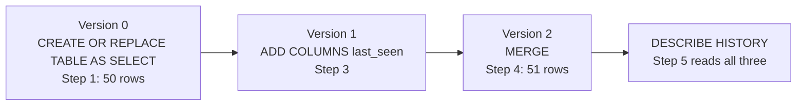
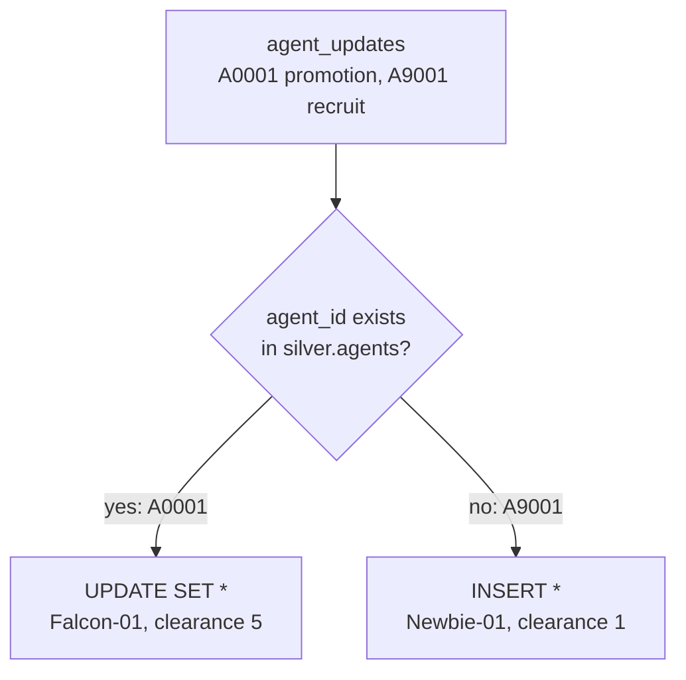

# 04 · Delta Lake 101

**Notebook:** [04_delta_lake_101.ipynb](../notebooks/databricks/04_delta_lake_101.ipynb)

> 💡 **TL;DR:** A Delta table is ordinary Parquet files plus a transaction log (`_delta_log`). Every write is one numbered, all-or-nothing commit, so a half-written table never reaches a reader. That one design gives you schema enforcement, a safe `MERGE` upsert, a built-in history, and a file layout you keep tidy with `OPTIMIZE` and `VACUUM`. Delta is a table format and the default on Azure Databricks, not a pattern you have to follow.

---

## The big picture

The notebook builds one small table, `shield.silver.agents`, and changes it one thing at a time. Each change that writes becomes one commit in the log. Step 2 is the exception: the write is rejected, so it leaves no commit.



---

## Concepts

### 1 · Data files plus a transaction log

The idea: a Delta table is a folder of Parquet data files plus a log (`_delta_log`) that says which files make up the table right now. A write adds files, then appends one commit to the log. Readers use the log, not the folder listing, so they see the table before a commit or after it, never half of it. That is what **ACID** means here (atomic, consistent, isolated, durable). Data files are never edited in place: an update or merge writes new files and marks the old ones as removed in the log.

```
 shield.silver.agents                      (illustrative; a managed table's folder is not meant to be browsed)
 ├── part-0000-….parquet                   data files are never edited in place
 ├── part-0001-….parquet
 └── _delta_log/
      ├── …0000.json   version 0   CREATE OR REPLACE TABLE AS SELECT   + file A
      ├── …0001.json   version 1   ADD COLUMNS                         new schema
      └── …0002.json   version 2   MERGE                               − file A  + file B
```

Delta is a table format and the default one on Azure Databricks. Per Microsoft Learn, the commits are JSON files in the log directory, and Databricks aggregates them into Parquet checkpoint files so readers do not have to replay every JSON file. You never touch checkpoints yourself.

| Because of the log | You get | Step |
|---|---|---|
| a commit is atomic | no half-written table, even if a job dies halfway | every step |
| the schema is stored in the log | writes that do not match it are rejected | Steps 2 and 3 |
| each commit is a numbered version | an audit trail, and time travel (chapter 07) | Step 5 |
| files are only added or removed from the log, never edited | `MERGE` and `OPTIMIZE` write new files; the old ones stay on storage until `VACUUM` | Steps 4 to 8 |

How this repo implements it:

* `shield.silver.agents` is a copy of `shield.bronze.agents` (50 rows) with five columns: `agent_id`, `codename`, `clearance_level`, `home_location_id`, `active`. The lineage columns `_source_file` and `_ingested_at` stay behind in bronze.
* A second throwaway table, `shield.silver.small_files_demo`, takes the file experiments in Steps 6 to 8. You never run maintenance experiments on a table other chapters use.
* Every step ends with a check table that reads its result from the table itself (row counts, columns, commit metrics), not from the cell's own variables.

Why it helps: you can trust a table after a failed job, you can see who changed what and when, and you get safe ways to change a schema or upsert rows.

Alternatives and trade-offs:

* **Plain Parquet or CSV folders** have no atomic commit. A reader that lists the folder during a write sees a mix of old and new files, and a failed job leaves partial files behind.
* **Apache Iceberg** is another open table format with a similar design. Databricks can read and write Iceberg tables as well, but this repo uses Delta only.
* The log is also the cost: many tiny commits mean many small JSON files and many small data files (concept 5).

Common mistakes:

* Browsing or editing the table folder directly. On a managed table the folder is not meant to be touched, and a hand-deleted file corrupts the table.
* Assuming a failed statement leaves a trace. It does not: a failed commit adds nothing to the history.

### 2 · Schema enforcement and schema evolution

The idea: Delta compares every write with the schema stored in the log. If the data does not match, it rejects the write instead of guessing (**enforcement**). A schema change is something you ask for (**evolution**). Both are Delta features.

| | What it does | Where in the notebook |
|---|---|---|
| Enforcement | rejects a write with a column the table lacks, or with a type that cannot be cast safely | Step 2 |
| Explicit evolution | `ALTER TABLE ... ADD COLUMNS` changes the schema without writing data | Step 3 |
| Automatic evolution | a write adds the missing columns itself, if you opt in | not run; see below |

How this repo implements it:

* **Step 2** appends one row `A9999 / Ghost-00 / 1 / L001 / true` with an extra column `nickname`. The append raises an exception, and the check table confirms the row count did not change (50 on a first run). The cell prints only the exception class, because the exact error text has not been checked in a workspace.
* **Step 3** adds `last_seen DATE` after checking that it is not already there. The table now has six columns, existing rows read `NULL` in the new one, and the change is one new commit that rewrites no data files.

Automatic evolution, which the notebook leaves to this page. Microsoft Learn lists these ways to opt in:

| Way | Scope | Note |
|---|---|---|
| `.option("mergeSchema", "true")` on a write | one write (batch or streaming) | the common choice in ETL; Databricks recommends it per write |
| `INSERT WITH SCHEMA EVOLUTION INTO ...` | one statement | Databricks Runtime 18.1 and above |
| `MERGE WITH SCHEMA EVOLUTION INTO ...` | one statement | Databricks Runtime 15.4 LTS and above |
| `spark.databricks.delta.schema.autoMerge.enabled = true` | the whole session | legacy; Databricks does not recommend it for production |

Evolution by merge adds columns that exist in the source and not in the target. It does not drop columns or change types. Renaming or dropping a column without rewriting files needs column mapping, which this repo does not use.

Why it helps: a producer that adds a column can no longer silently change your table, and the column you do want is one explicit statement.

Trade-offs and common mistakes:

* **Strict versus convenient.** Enforcement protects downstream readers; automatic evolution keeps a pipeline running when a source grows. For bronze, evolution is often the right choice; for silver and gold, be explicit.
* Updating a table schema terminates streams reading from the table, and schema changes conflict with concurrent writes. Coordinate them.
* `ALTER TABLE ... ADD COLUMNS` fails if the column exists. Guard it, as Step 3 does.
* Turning on `autoMerge` for the whole session. One careless notebook then changes every table it writes to.
* A type change is not evolution. You rewrite the table (`overwriteSchema`) or use type widening, which is not covered here.

### 3 · MERGE: the upsert

The idea: `MERGE` matches rows from a source to rows of the table by a key, runs `WHEN MATCHED` on the matches (usually an update) and `WHEN NOT MATCHED` on the rest (an insert), all in one atomic commit. It is the workhorse of incremental loads: you apply a batch of changes without rewriting the table by hand.



How this repo implements it (Step 4):

* The source is the temp view `agent_updates`: `A0001 / Falcon-01 / 5 / L001 / true` (an existing agent, previously `Nomad-13` with clearance 3 in the chapter 02 dataset) and `A9001 / Newbie-01 / 1 / L002 / true` (a new recruit). Both get today's date in `last_seen`.
* The statement is `MERGE INTO shield.silver.agents AS t USING agent_updates AS s ON t.agent_id = s.agent_id WHEN MATCHED THEN UPDATE SET * WHEN NOT MATCHED THEN INSERT *`.
* Afterwards the table has 51 rows. Re-running is safe: both agents now match, so the second run updates them and the table stays at 51 rows. Each run adds one commit.

The rule that bites: **one source row per key.** If two source rows match the same target row, the update is ambiguous and the statement fails with `DELTA_MULTIPLE_SOURCE_ROW_MATCHING_TARGET_ROW_IN_MERGE`. Deduplicate the source first, for example keep the newest row per key with `row_number() OVER (PARTITION BY agent_id ORDER BY ...)` (chapter 05 does this for incidents).

Beyond what the notebook runs:

* `WHEN NOT MATCHED BY SOURCE` acts on target rows that have no source row. It can `UPDATE` or `DELETE` them (Databricks Runtime 12.2 LTS and above). Databricks recommends adding a condition so the statement does not rewrite the whole table. See mini-project 2.
* **Insert-only merge** (`WHEN NOT MATCHED THEN INSERT` and nothing else) is a deduplicating append: rows already in the table are skipped. The new batch must be unique within itself, or the duplicates are inserted.
* `UPDATE SET *` and `INSERT *` assume source and target have the same columns, otherwise you get an analysis error (unless schema evolution is on). That is why the notebook adds `last_seen` to the source.
* With multiple `WHEN MATCHED` clauses they run in order and all but the last need a condition.

Why it helps: one statement, one commit, safe to retry. The alternative (delete the matching rows, then insert) leaves a window where the table is wrong and cannot be undone as one step.

Trade-offs:

* `MERGE` reads the target to find matches, so on a big table the `ON` clause should be selective. A match on a non-key column is slow and often wrong.
* For change feeds with out-of-order records or slowly changing dimensions, hand-written `MERGE` gets intricate. Pipelines have `AUTO CDC` for that (chapter 08 mentions it; not covered in this repo).

### 4 · The transaction log as history

The idea: each commit is a numbered version with a timestamp, user, operation and metrics. `DESCRIBE HISTORY` shows the log as a table, newest first. You get an audit log of writes without building one. Chapter 07 uses the same versions for time travel, `RESTORE` and the change data feed.

How this repo implements it (Step 5):

* On a first run the history of `shield.silver.agents` is `MERGE` (version 2), `ADD COLUMNS` (1) and `CREATE OR REPLACE TABLE AS SELECT` (0). Earlier runs add versions below those, and background maintenance on managed tables can add more.
* The `MERGE` row carries `operationMetrics`. The check adds `numTargetRowsUpdated` and `numTargetRowsInserted` and expects 2: 1 + 1 on a first run, 2 + 0 on a re-run. The metric names come from the Databricks docs; the exact operation names in this table have not been checked in a workspace.

Facts from Microsoft Learn: history is kept as long as the table property `delta.logRetentionDuration` says (30 days by default), and Catalog Explorer shows the same list on the **History** tab. Failed writes (Step 2) are not in it. Auto compaction and manual `OPTIMIZE` both appear as `OPTIMIZE`; `operationParameters.auto` tells them apart.

Limits: the history is an audit log, not a backup. It ages out, and it only covers this table.

### 5 · Small files and OPTIMIZE

The idea: every write adds files. Many tiny writes (a streaming job, or 15 single-row `INSERT`s) leave many tiny files, and each file costs a round trip when you read. **`OPTIMIZE`** rewrites small files into fewer, larger ones. It is a commit like any other: it changes the layout, not the data, so a read before and after returns the same rows, and readers in flight are not interrupted.

How this repo implements it (Steps 6 and 7):

* `shield.silver.small_files_demo` is `(id BIGINT, v STRING)`, filled by 15 separate single-row `INSERT` statements. Auto compaction and optimized writes are switched off on it with table properties (`delta.autoOptimize.autoCompact` and `delta.autoOptimize.optimizeWrite` set to `false`) so the problem shows up.
* Step 6 expects 15 rows in about 15 files. If `numFiles` is lower, that is the platform compacting in the background, not a bug.
* Step 7 runs `OPTIMIZE` and expects 1 file and still 15 rows. The history metric `numRemovedFiles` is 15 (and one file added). The 15 old files are out of the log but still on storage.
* Re-running is safe: with one file left there is nothing to compact.

Ways to avoid the problem (from Microsoft Learn):

| Mechanism | What it does | Note |
|---|---|---|
| `OPTIMIZE` | compacts on demand (bin-packing unless the table uses liquid clustering or you ask for `ZORDER`) | idempotent: a second run on the same data does nothing |
| Auto compaction | compacts small files after a write succeeds, on the cluster that wrote | independent of predictive optimization |
| Optimized writes | writes fewer, larger files in the first place | most useful on partitioned tables |
| Predictive optimization | Databricks runs maintenance for Unity Catalog managed tables, asynchronously on serverless compute | why file counts in this chapter can differ from the notebook |
| Liquid clustering | a data layout that replaces partitioning and Z-order | not covered here |

The default maximum output file size of `OPTIMIZE` is 1 GB (`spark.databricks.delta.optimize.maxFileSize`); you can tune it, or set the table property `delta.targetFileSize`.

Trade-offs and common mistakes:

* Compaction costs compute, so do not run it after every write. Schedule it, or leave it to auto compaction or predictive optimization.
* Compacting does not free storage. The replaced files stay until `VACUUM`.
* Over-partitioning (a partition per day on a tiny table) creates the same problem. Not covered here.

### 6 · VACUUM and the retention period

The idea: `OPTIMIZE`, `UPDATE` and `MERGE` leave files that the log no longer references. **`VACUUM`** deletes them from storage once they are older than the retention period (7 days by default, the table property `delta.deletedFileRetentionDuration`). Until then they protect time travel (chapter 07) and readers or jobs that started before the change.

How this repo implements it (Step 8):

* `VACUUM shield.silver.small_files_demo DRY RUN` lists what would be deleted and deletes nothing. The 15 files from Step 7 became unreferenced just now and are far younger than 7 days, so the expected list is empty. How an empty dry run is displayed has not been checked in a workspace.
* That empty result is the lesson: you cannot clean up files you just replaced. Do not shorten the retention to make the dry run show something.

Facts from Microsoft Learn:

* Databricks recommends a retention of at least 7 days. A job that runs longer than the retention can have its uncommitted files deleted. A safety check (`spark.databricks.delta.retentionDurationCheck.enabled`) blocks shorter intervals; turning it off is for throwaway tables only.
* After `VACUUM`, you can no longer query versions older than the retention period, and `RESTORE` cannot return to them.
* `VACUUM` also deletes change data feed files (chapter 07). Log files are cleaned separately (30 days by default), not by `VACUUM`.
* Predictive optimization runs `VACUUM` for Unity Catalog managed tables, and `VACUUM` writes an audit entry visible in `DESCRIBE HISTORY`.
* Deletion vectors and column-drop soft deletes mean old values can stay in current files until `REORG TABLE ... APPLY (PURGE)` and a later `VACUUM`. Matters for compliance deletes. Not covered here.

Trade-offs: a longer retention means more history to travel back to and a bigger storage bill; a shorter one saves storage and shrinks your safety net.

---

## What the notebook does

It opens with an explainer ("Delta Lake: data files plus a log"), then eight steps, each with a goal, an expected result and a check table. The numbers assume the chapter 02 dataset (50 agents, seed 42).

| Step | Goal | Expected |
|---|---|---|
| 1 | Copy `bronze.agents` into `silver.agents` and confirm the format | 50 rows, five columns, format `delta`; the file count (probably 1) is not checked |
| 2 | Append a row with an unknown column | the write is rejected; the table keeps its 50 rows |
| 3 | Add `last_seen` on purpose | sixth column of type `date`, 0 rows with a date on a first run |
| 4 | `MERGE` one promotion (`A0001`) and one recruit (`A9001`) | 51 rows; `A0001` is `Falcon-01` with clearance 5 |
| 5 | Read `DESCRIBE HISTORY` | at least 3 commits; the latest `MERGE` touched 2 rows |
| 6 | 15 single-row inserts into `small_files_demo` | 15 rows in about 15 files |
| 7 | `OPTIMIZE` | 1 file, still 15 rows, 15 files replaced by the commit |
| 8 | `VACUUM ... DRY RUN` | nothing to delete (files are younger than 7 days) |

The notebook is standalone: it needs chapter 03's `shield.bronze.agents` and the `shield.silver` schema from chapter 01. It keeps `silver.agents` (chapter 11 applies masks and row filters to it) and drops the demo table. Nothing has been run in a workspace yet, so the expected values are expectations.

## Gotchas
* `CREATE OR REPLACE TABLE` keeps history; `DROP` + create does not.
* Don't lower `VACUUM` retention below the longest running query or time-travel need.
* Managed tables: dropping the table deletes data. External tables: it does not.
* On Unity Catalog managed tables Databricks tunes file sizes and can run `OPTIMIZE` and `VACUUM` for you (predictive optimization), so the file counts in Steps 6 to 8 can differ from what the notebook expects. The notebook switches auto compaction off on its demo table to make the effect visible.
* `ALTER TABLE ... ADD COLUMNS` fails if the column already exists, so guard it (the notebook checks first).
* Re-running Step 1 replaces `silver.agents` and with it anything chapter 11 applied to it. Re-apply the masks and filters.
* A source with two rows for one key makes `MERGE` fail. Deduplicate first.

## Not covered yet
* Reading old versions and `RESTORE` (chapter 07), `CHECK` constraints (chapter 06).
* Clustering and partitioning, Z-order, column mapping, type widening and deletion vectors.
* Automatic evolution (`mergeSchema`) is explained above but not run in the notebook, so its behaviour here is from Microsoft Learn, not from a workspace. Nothing in this chapter has run in a workspace.
* The exact error text of the rejected append in Step 2 and the display of an empty `VACUUM` dry run: not verified.

## Try it yourself
1. **Duplicate keys.** Make the `USING` side of the `MERGE` hold two rows for `A0001`. What does Delta do, and how would you de-duplicate the source first (for example with `row_number()`)?
2. **Deactivate the missing.** Add `WHEN NOT MATCHED BY SOURCE THEN UPDATE SET active = false` to the `MERGE`, with an update batch that lists only some agents. Which agents get deactivated, and why is a condition on that clause a good idea on a big table?
3. **Compare file counts on real data.** Run `DESCRIBE DETAIL` on `bronze.incident_reports`, then `OPTIMIZE` it, then `DESCRIBE DETAIL` again. How many files before and after, and what does `DESCRIBE HISTORY` say about it?
