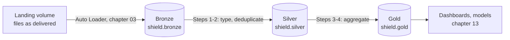

# 05 · Medallion

**Notebook:** [05_medallion.ipynb](../notebooks/databricks/05_medallion.ipynb)

> 💡 **TL;DR:** The medallion architecture keeps data in three stages as separate Delta tables: **bronze** (raw, as received), **silver** (typed, deduplicated, trustworthy) and **gold** (aggregates named after the question they answer). Each stage is built only from the one before it. It is a naming and discipline pattern, not a Databricks feature, and in this repo each layer is one Unity Catalog schema.

---

## The big picture

---

## Concepts

### 1 · The three layers

The idea: data gets better in stages, and you keep every stage. Each stage answers a different question about the data, so each has a different contract.

| Layer | Contract | Tables in this repo | Built by |
|---|---|---|---|
| **Bronze** | Raw data exactly as it arrived, plus lineage columns (`_source_file`, `_ingested_at`). Append-only. Duplicates and bad rows stay. | `incident_reports`, `locations`, `agents`, `threat_assessments` | chapter 03 |
| **Silver** | One typed row per business entity or event. The base everyone trusts. | `incident_reports`, `locations` | Steps 1 and 2 |
| **Gold** | Aggregates and models shaped for one use case, named after the question they answer. | `daily_threat_briefing`, `location_risk` | Steps 3 and 4 |

Why layers:

* **Debugging.** When a number looks wrong, compare layers to find where it changed. Step 5 of the notebook does exactly that: the bad values are in silver, so they are in gold.
* **Reprocessing.** Rebuild silver from bronze whenever the logic changes. You never re-ingest the files.
* **Ownership and access.** Engineers own bronze and silver, analysts read gold. Grants are per schema (chapter 11).

It is a pattern, not a feature. Databricks does not enforce the layers; names and team rules do. You can break the pattern (gold reading bronze, silver written by hand) and nothing stops you, which is why the rules below matter.

### 2 · How this repo implements it

* **One Unity Catalog schema per layer:** `shield.bronze`, `shield.silver`, `shield.gold`, created in chapter 01. The schema name tells you the layer. The table keeps its name across layers (`incident_reports`), so lineage reads naturally.
* **Each layer reads only the layer before it.** Silver reads bronze, gold reads silver. Gold never touches bronze, so a fix in silver reaches every gold table.
* **Silver transforms rows.** Step 1 parses the timestamp text into `reported_ts` and keeps the newest record per `incident_id` (`row_number()` over a window ordered by `_ingested_at`). Step 2 selects the columns the gold joins need.
* **Gold is SQL aggregation.** Steps 3 and 4 are `CREATE OR REPLACE TABLE ... AS SELECT ... GROUP BY`, one table per question.
* **Full refresh.** Every run recomputes each table. It is simple and safe to re-run, but it reads all of the data every time.

Design choices you could make differently:

| Choice | Here | Alternative | Trade-off |
|---|---|---|---|
| Where layers live | schema per layer in one catalog | catalog per layer, or catalog per environment and layer | More catalogs give coarser access control and clearer cost split, and more objects to manage |
| Refresh | full refresh | incremental (`MERGE`, streaming, declarative pipeline; chapter 08) | Incremental scales; full refresh is simpler to reason about |
| Deduplication | latest record per key in silver | keep all versions in silver (history), dedupe in gold | History answers "what did we know when"; latest-wins answers "what is true now" |
| Gold shape | one table per question | one wide model for everything | Narrow tables are cheap and clear, wide ones reduce joins for BI |

### 3 · Layer rules that keep the pattern honest

* **Never "fix" bronze.** It is your audit trail and your replay source.
* **Silver has one row per key.** If you cannot say what a silver row is, the layer is not done.
* **Name gold after the question**, not after the source: `location_risk`, not `incidents_agg`.
* **A layer reads only its predecessor.** Shortcuts (gold reading bronze) hide bugs, because a fix in silver no longer reaches that table.

### 4 · What this chapter does not do yet

Silver validates nothing, so impossible values reach gold. That is the deliberate flaw (below). Chapter 06 adds quality rules and quarantine, chapter 08 makes the refresh incremental.

---

## What the notebook does

Same step numbers and expectations as the [notebook](../notebooks/databricks/05_medallion.ipynb). The numbers assume the chapter 02 dataset (10,000 incidents, seed 42, 5 % dirty).

| Step | Goal | Expected |
|---|---|---|
| 1 | Silver incidents: typed and deduplicated | 10,250 bronze rows become 10,000 silver rows, one per `incident_id` |
| 2 | Silver locations | 10 rows |
| 3 | Gold `daily_threat_briefing` | incidents add up to 9,903 (10,000 minus 97 unparsable timestamps) |
| 4 | Gold `location_risk` | 10 cities, incidents add up to 10,000 |
| 5 | What got through? | 500 defective incidents in silver: 97 unparsable timestamps, 108 in the future, 109 invalid severities, 91 negative casualties, 95 missing agents |

The future-timestamp count depends on the day chapter 02 generated the data, and none of these numbers has been run in a workspace yet.

## The deliberate flaw

Silver here has no quality gate. Step 5 counts 500 defective incidents in silver, among them 109 with the non-existent severity `catastrophic`, and they flow into the gold numbers. Chapter 06 fixes it and the gold totals drop to 9,500.

## Gotchas
* Full refresh (`CREATE OR REPLACE`) is idempotent but costs more as data grows. It also replaces any CHECK constraint that chapter 06 added to the table.
* Model gold tables for consumers, not for symmetry with silver.
* Dropping rows in silver without a trace hides problems. Chapter 06 quarantines them instead.

## Not covered yet
* Quality rules and quarantine (chapter 06), incremental refresh (chapter 08), per-layer permissions (chapter 11).

## Try it yourself
1. Add `gold.agent_workload`: incidents per agent codename (join `silver.agents`). Which agents have no incidents?
2. Run the silver step twice. Why is the result identical, and which part of the cell makes it so?
3. Sketch what each layer would hold for a retail dataset you know. Which layer does a "customer lifetime value" table belong in?
