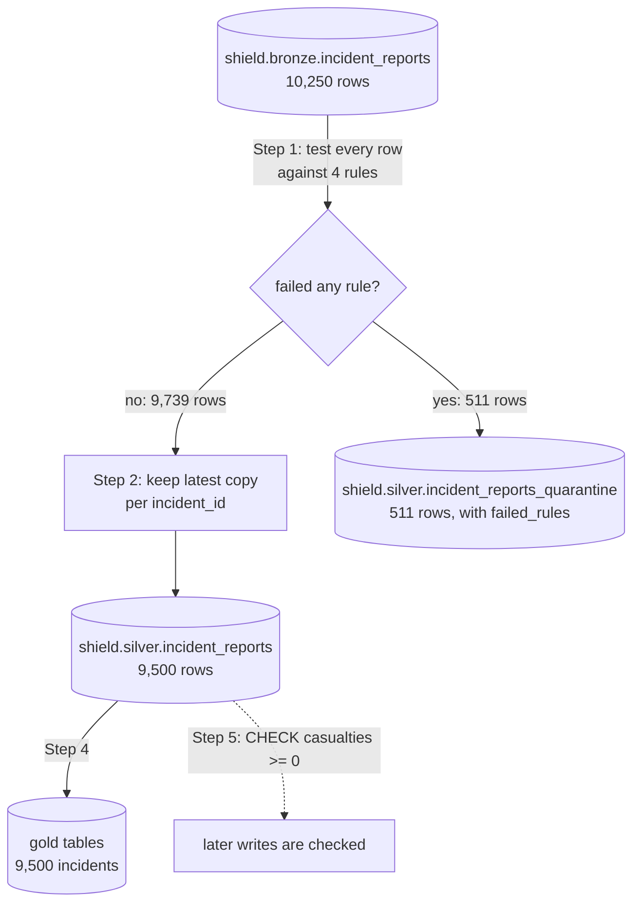

# 06 · Natasha spots the fake

**Notebook:** [06_natasha_spots_the_fake.ipynb](../notebooks/databricks/06_natasha_spots_the_fake.ipynb) · **Rules:** [quality.py](../src/shield_data/quality.py)

> 💡 **TL;DR:** Write down what a good row looks like as four named SQL rules, test every bronze row against all of them, and send the failures to a quarantine table together with the names of the rules they broke, instead of deleting them. Silver then holds only trustworthy rows (9,500 incidents) and quarantine holds the evidence (511 rows). A `CHECK` constraint is the safety net: the table itself refuses a write that breaks a condition, whoever writes it. Rules and quarantine are patterns you follow; the constraint is a real Delta feature.

---

## The big picture



---

## Concepts

### 1 · Data quality dimensions

The idea: "bad data" is not one thing. The usual way to talk about it is a set of dimensions, and each rule you write checks one of them.

| Dimension | Question | Rule in this repo |
|---|---|---|
| Validity | is the value allowed? | `valid_severity`, `non_negative_casualties`, the parsable part of `valid_timestamp` |
| Completeness | is it present? | `has_agent` (and the `IS NOT NULL` parts of the other rules) |
| Timeliness | is it plausible in time? | the `reported_ts <= current_timestamp()` part of `valid_timestamp` (a forged ping from the future) |
| Uniqueness | is the entity there once? | not a rule: silver keeps the latest copy per `incident_id` (Step 2) |
| Consistency | do two sources agree? | not covered (for example `agent_id` that must exist in `silver.agents`: mini-project 1) |

The dimensions are a vocabulary, not a feature. Use them to check you did not forget a kind of defect.

### 2 · Rules as data

The idea: write each rule as a named condition in a plain data structure, not as code buried in a transformation. Then one definition can be tested, reused and reported on. It is a pattern: nothing in Databricks enforces it.

How this repo implements it:

* `INCIDENT_RULES` in [src/shield_data/quality.py](../src/shield_data/quality.py) is a Python dictionary, rule name to SQL condition. The condition is **true for a valid row**.
* The notebook imports it (open the notebook from a Git folder, chapter 00). The declarative pipeline in chapter 08 repeats the same four conditions as expectations, and Step 5 of that notebook checks that the expectation names match the keys of `INCIDENT_RULES`. The tests use it too.

| Rule (name in `INCIDENT_RULES`) | Condition, true for a valid row | Catches |
|---|---|---|
| `has_agent` | `agent_id IS NOT NULL` | missing agent |
| `valid_timestamp` | `reported_ts IS NOT NULL AND reported_ts <= current_timestamp()` | unparsable or future timestamp |
| `valid_severity` | `severity IN ('low', 'medium', 'high', 'critical')` | values such as `catastrophic` |
| `non_negative_casualties` | `casualties IS NOT NULL AND casualties >= 0` | negative or missing casualties |

Step 1 turns each condition into a Spark expression and builds one array column, `failed_rules`, with the names of the rules a row **failed**. `reported_ts` is the bronze text timestamp parsed with `try_to_timestamp(reported_at, "yyyy-MM-dd'T'HH:mm:ss'Z'")`, which returns `NULL` instead of an error for garbage, so an unparsable timestamp becomes a rule failure and not a crashed job. A `NULL` condition result counts as a failure: each condition is wrapped in `coalesce(..., false)`.

Why it helps: the rules live in one place, the notebook and the pipeline cannot drift apart silently, and adding a rule is one dictionary entry. A rule that has a name can be counted, charted and explained to the data owner.

Alternatives and trade-offs:

| Option | Good | Watch out |
|---|---|---|
| Dictionary in a Python module (here) | importable, unit-testable without a cluster | only Python code can import it |
| Rules in a Delta table | analysts can edit them, no deploy | needs access control and review, or anyone changes quality silently |
| Expectations in a pipeline (chapter 08) | metrics in the event log for free | the rule lives in the pipeline file; Microsoft Learn suggests keeping expectation definitions apart from pipeline logic for reuse |
| A library such as Great Expectations or Soda | richer checks, profiling | one more dependency; not used here |

Common mistakes:

* **NULL in a SQL condition is neither true nor false.** `severity IN (...)` on a `NULL` severity yields `NULL`. If you filter with `WHERE condition` such rows vanish from both sides. Use `coalesce(condition, false)`, as the notebook does.
* Rules written from guessing. They reflect business agreements; get them from the data owner (a severity of `catastrophic` may be a real new value, not garbage).
* Two copies of a rule (SQL in a notebook, Python in a test) that drift. `quality.py` keeps a Python mirror, `failed_rules(row)`, and a test compares it to Spark (see "Tests").

### 3 · Quarantine

The idea: a row that fails a rule is not deleted. It is stored in a separate table together with why it failed. Operations can then answer "which feed is sending garbage, and what kind?" and fix and replay the rows. It is a pattern: nothing in Databricks creates the table for you.

How this repo implements it (Steps 2 and 3):

* `shield.silver.incident_reports_quarantine` is an ordinary Delta table next to silver. It holds the bronze row (with its parsed `reported_ts`) plus `failed_rules` (array of rule names) and `_quarantined_at` (a timestamp).
* `shield.silver.incident_reports` gets the valid rows only, with the latest copy per `incident_id` (`row_number()` over a window ordered by `_ingested_at` descending, as in chapter 05).
* Both tables are written with `createOrReplace()`, so each run rebuilds them.

| Table | Rows | Why that number |
|---|---|---|
| bronze | 10,250 | 10,000 incidents plus 250 replayed duplicates |
| valid rows (Step 1) | 9,739 | rows that pass all four rules |
| `silver.incident_reports` | 9,500 | one per valid incident, after deduplication |
| `silver.incident_reports_quarantine` | 511 | every invalid row; includes 11 replayed duplicates of bad incidents |

The books balance: silver (9,500) plus the distinct incidents in quarantine (500) is 10,000, so no incident was lost. Step 2 checks this against the distinct incidents in bronze.

Step 3 answers the operations question from the quarantine table alone. Every defective row fails exactly one rule, so the counts add up to 511:

| Rule | Rows |
|---|---|
| `valid_timestamp` | 209 |
| `valid_severity` | 110 |
| `non_negative_casualties` | 96 |
| `has_agent` | 96 |

The future-timestamp part of `valid_timestamp` depends on the day chapter 02 generated the data (those timestamps are 30 to 400 days ahead of that day), so some drift into the past as time goes by and the counts can change.

Why it helps: silver stays trustworthy, the bad rows keep their evidence, and a count per rule per day is a free data-quality metric.

Trade-offs and common mistakes:

* Quarantine is extra storage and one more table to own. Someone has to look at it: a quarantine nobody reads is a silent delete.
* Quarantine rows contain the raw bad values. They can hold personal data, so apply the same access rules as to bronze (chapter 11).
* The 511 rows include duplicates. Count distinct incidents (500) when you ask "how many incidents were bad".
* Replaying fixed rows is not covered yet. The usual design is to fix the rule or the source, then run the split again, or write corrected rows back through the normal path; do not edit quarantine in place.

### 4 · Fail, quarantine or warn

The idea: a rule can trigger three different reactions. Which one is right depends on what a bad row means.

| Reaction | What happens | Use when | Example here |
|---|---|---|---|
| **Fail** | the job stops, nothing is published | the whole batch is untrustworthy, or downstream cannot tolerate any bad row | a feed where `incident_id` is missing in most rows: something upstream broke |
| **Quarantine** | bad rows go to a side table, good rows continue | single rows are bad, the rest is fine | the four rules in this chapter |
| **Drop and count** | bad rows are removed, only a number remains | the rows are worthless and you only need the metric | chapter 08 (`expect_or_drop`) |
| **Warn** | all rows continue, you only record a metric | the rule is new or soft, and you first want to see how often it fires | `@dp.expect` in chapter 08 |

The notebook only quarantines. A fail-the-job check is a few lines you add around the same rules, for example stop when more than a set share of rows are invalid:

```python
invalid_share = invalid_rows.count() / bronze_incidents.count()
assert invalid_share < 0.20, f"{invalid_share:.0%} of the batch failed quality rules: stop and look at the feed"
```

This snippet is an illustration, not code from the notebook, and the threshold is made up (the dataset here is 5 % dirty on purpose).

How the three map to pipelines (chapter 08), per Microsoft Learn: the default `expect` keeps the invalid records and records metrics (warn); `expect_or_drop` removes them and logs the count; `expect_or_fail` makes the update fail and roll back, and needs manual intervention before reprocessing. Learn also describes a quarantine pattern for pipelines that builds a flag column and then separate valid and invalid views.

Trade-offs:

* Fail protects consumers but costs availability: one broken feed blocks everything behind it, so decide who gets the page.
* Quarantine keeps the flow going but means silver can be incomplete. Tell the consumers (a gold table that says 9,500 incidents while 10,000 happened needs a footnote).
* Mix them: fail on a threshold (too many bad rows) and quarantine below it.

Mini-project 3 asks you to pick a rule for which you would fail.

### 5 · CHECK constraints: the last line of defence

The idea: rules in a job catch bad data on the way in, but only for writers that run the rules. A **constraint** makes the *table* refuse a bad write, whoever writes it: another notebook, a `MERGE`, an external client. It is a real Delta feature. It can only accept or reject the whole statement, it cannot route a row to quarantine.

How this repo implements it (Step 5):

1. `ALTER TABLE shield.silver.incident_reports DROP CONSTRAINT IF EXISTS non_negative_casualties`, so the cell can be re-run. Without it a second run fails with `DELTA_CONSTRAINT_ALREADY_EXISTS`.
2. `ALTER TABLE ... ADD CONSTRAINT non_negative_casualties CHECK (casualties >= 0)`. Delta first verifies that all existing rows satisfy the condition. Silver has no negative casualties, so it succeeds.
3. An `INSERT` of an incident with `casualties = -1` fails and should mention `non_negative_casualties`. The error text has not been checked in a workspace.
4. Silver still has 9,500 rows. The constraint shows up as a table property: `SHOW TBLPROPERTIES shield.silver.incident_reports`.

Facts from Microsoft Learn:

* Enforced constraints are `NOT NULL` and `CHECK`. Primary key, foreign key and unique constraints are informational only and enforce nothing.
* Adding a constraint upgrades the table's writer protocol if the writer version is below 3. That can break external Delta clients that write to the table.
* A `CHECK` expression may not use user-defined functions, aggregate functions, window functions or functions that return multiple rows.
* Constraints can be seen with `DESCRIBE DETAIL` and `SHOW TBLPROPERTIES`. To remove a check constraint and downgrade the protocol, `DROP FEATURE` works in Databricks Runtime 15.4 LTS and above.

Constraint or rule? Use both:

| | Rules (`INCIDENT_RULES`) | `CHECK` constraint |
|---|---|---|
| Where it runs | in your job | in the table, on every write |
| On a violation | row goes to quarantine, job continues | the whole statement fails |
| Reports which rule | yes (`failed_rules`) | one constraint name in the error |
| Covers other writers | no | yes |
| Cost | none extra | a check on each write; keep the expression simple |

Why it helps: it protects the invariant that must never break (`casualties >= 0`) from the day somebody writes a quick `INSERT` that skips the rules.

Common mistakes:

* Adding a constraint on a table that already has violating rows. The `ALTER` fails; clean or quarantine first.
* Expecting `CREATE OR REPLACE TABLE` to keep the constraint. Chapter 05 replaces silver this way, and that should remove the constraint again. The notebook says this has not been verified in a workspace. Re-run Step 5 after chapter 05.
* Assuming a `CHECK` rejects `NULL`. How a `NULL` result is treated by `CHECK` is not verified here; test it before you rely on it, or add `NOT NULL` explicitly. The `INCIDENT_RULES` version rejects `NULL` casualties on purpose.
* Putting every business rule in a constraint. One failing row then blocks the whole batch.

### 6 · Re-running gold on clean data

A concept from chapter 05 (the medallion layers), with one new point: fixing quality in silver reaches gold automatically, because gold only reads silver. Step 4 rebuilds `shield.gold.daily_threat_briefing` and `shield.gold.location_risk` from the clean silver table. It first recreates `silver.locations` from bronze, so the notebook runs without chapter 05.

| Check | Chapter 05 | Now |
|---|---|---|
| incidents in `gold.location_risk` | 10,000 | 9,500 |
| incidents in `gold.daily_threat_briefing` | 9,903 | 9,500 |
| severities in silver | 5 (with `catastrophic`) | 4 |

---

## What the notebook does

Five steps, each with a goal, an expected result and a check table, after an explainer section ("Quality rules, quarantine and CHECK constraints"). The numbers assume the chapter 02 dataset (10,000 incidents, seed 42, 5 % dirty).

| Step | Goal | Expected |
|---|---|---|
| 1 | Tag every row with the rules it failed | 9,739 valid rows and 511 invalid (11 are replayed duplicates of bad incidents) |
| 2 | Split into silver and quarantine | silver 9,500 (one per incident), quarantine 511, together all 10,000 incidents |
| 3 | Which rules fail most? | `valid_timestamp` 209, `valid_severity` 110, `non_negative_casualties` 96, `has_agent` 96 |
| 4 | Rebuild gold on clean data | 9,500 incidents in both gold tables, 4 severities |
| 5 | Add a `CHECK` constraint | the constraint is added, a bad `INSERT` is rejected, silver stays at 9,500 rows |

The notebook is standalone: it needs chapter 03's bronze tables (`shield.bronze.incident_reports` with all five files, `shield.bronze.locations`), not chapter 05. It replaces `shield.silver.incident_reports` and rebuilds the gold tables. Nothing is cleaned up: chapter 07 time-travels on silver and chapters 10 and 11 reuse it. Nothing has been run in a workspace yet, so the expected values are expectations.

## Tests
`tests/test_quality.py` proves every injected defect is caught and, if `pyspark` is installed, that the Spark SQL rules agree with the Python mirror (`failed_rules`). This is how you unit-test data logic without a cluster. When you add a rule to `INCIDENT_RULES`, the test that compares both sides tells you to update the mirror.

## Gotchas
* NULL in a SQL condition is neither true nor false: use `coalesce(..., false)` so NULL counts as failure.
* Rules reflect business agreements; get them from the data owner, not from guessing.
* The 511 quarantined rows are not 511 bad incidents: 500 are distinct.
* The future-timestamp counts depend on the day the data was generated.
* Adding a constraint can upgrade the table writer protocol; check external writers first.
* Chapter 05 uses `CREATE OR REPLACE` on silver, which should drop the constraint again.

## Not covered yet
* A rule that fails the job instead of quarantining (sketched above, not in the notebook).
* Fixing and replaying quarantined rows.
* Consistency rules across tables (mini-project 1) and rules that need other rows (duplicates, outliers).
* The same idea built into pipelines as expectations (`expect_or_drop`, chapter 08).
* Nothing here has run in a workspace; the error text of the rejected `INSERT` and the `NULL` behaviour of `CHECK` are not verified.

## Try it yourself
1. Add a rule: `agent_id` must exist in `silver.agents`. Which rows fail now? Add it to `quality.py`, run `pytest`, and see which test tells you to update the Python mirror.
2. Turn the quarantine counts into a daily quality table in `shield.ops` (rule, date, failed_rows).
3. Decide: for which rule would you rather *fail the job* than quarantine? Why?
