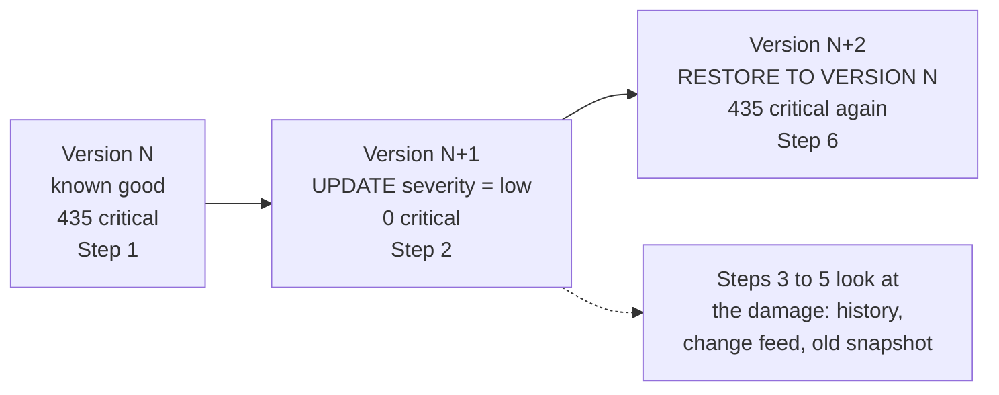

# 07 · Doctor Strange's time stone

**Notebook:** [07_doctor_strange_time_stone.ipynb](../notebooks/databricks/07_doctor_strange_time_stone.ipynb)

> 💡 **TL;DR:** Every write to a Delta table is a numbered version, and Delta keeps the old data files for a while. So you can list who changed the table (`DESCRIBE HISTORY`), see exactly which rows changed (the change data feed), read the table as it was (time travel) and put it back (`RESTORE`). `RESTORE` is itself a new version, so the tampering stays visible. None of this is a backup, and `VACUUM` limits how far back you can go.

---

## The big picture

Hydra downgrades every `critical` incident to `low` in `shield.silver.incident_reports`. The notebook tampers with the table itself, then investigates and repairs it.

---

## Concepts

All four tools below read or use the versions you met in chapter 04. They are Delta features, not patterns.

| Tool | Answers | Step |
|---|---|---|
| `DESCRIBE HISTORY` | which commit, when, by whom, with which metrics | 3 and 7 |
| Change data feed: `table_changes('table', from, to)` | which rows changed, with their value before (`update_preimage`) and after (`update_postimage`) | 4 |
| Time travel: `... VERSION AS OF n` (or `TIMESTAMP AS OF`) | what did the table look like at version n? | 5 |
| `RESTORE TABLE ... TO VERSION AS OF n` | put the table back as it was at version n | 6 |

### 1 · Table history

The idea: `DESCRIBE HISTORY` lists each version with its user, operation, timestamp and metrics, newest first. It is a free audit log of writes.

How this repo implements it:

* **Step 1** sets the table property `delta.enableChangeDataFeed = true` and remembers the newest version as `good_version`. Its value depends on which chapters touched the table before, so it is not predictable and not checked.
* **Step 3** finds the tampering commit without looking at any data: the newest row is the `UPDATE`, with your user name and `numUpdatedRows = 435` in its metrics. Below it are older rows from earlier chapters and, on a first run, the commit that set the property (`SET TBLPROPERTIES`).
* **Step 7** reads the history again after the repair: `RESTORE` on top of `UPDATE`.

Facts from Microsoft Learn: history is kept as long as `delta.logRetentionDuration` says, 30 days by default. Catalog Explorer shows the same list on the table's **History** tab (see "In the workspace" in the notebook). The columns and per-operation metrics are in the "Table history schema and operation metrics" reference.

Common mistakes: treating history as a security log (it records writes to this table, not reads, and it ages out), and expecting it to name the person behind a shared service principal.

### 2 · Time travel

The idea: query an older version of the table without changing it: `SELECT ... FROM t VERSION AS OF n` or `TIMESTAMP AS OF '...'`. Use it to reproduce a report exactly as it was, to debug, to audit, and to fix mistakes by copying rows back from an old version.

How this repo implements it (Step 5): `severity_counts("shield.silver.incident_reports VERSION AS OF <good_version>")` returns the breakdown from Step 1 (435 `critical`) while the current table has none. The check also asserts that the old snapshot equals the Step 1 breakdown.

| Severity | Step 1 (and Step 5, and after Step 6) | After the tampering (Step 2) |
|---|---|---|
| low | 4,722 | 5,157 (4,722 + 435) |
| medium | 2,915 | 2,915 |
| high | 1,428 | 1,428 |
| critical | 435 | 0 |
| total | 9,500 | 9,500 |

Syntax options from Microsoft Learn:

| Form | Example |
|---|---|
| version | `SELECT * FROM t VERSION AS OF 123` |
| timestamp | `SELECT * FROM t TIMESTAMP AS OF '2018-10-18T22:15:12.013Z'` (a timestamp string, a date string, or an expression such as `current_timestamp() - interval 12 hours`) |
| short form | `t@v123`, and `t@20190101000000000` for a timestamp |
| DataFrame API | `.option("versionAsOf", 123)` or `.option("timestampAsOf", "2019-01-01")` |

A timestamp resolves to the version that was current at that time. Timestamps come from the commit files unless the in-commit timestamps feature is on, so a copied or replicated table can resolve a timestamp differently. Neither value can be a subquery.

Why it helps: you can answer "what did the dashboard show last Tuesday" without a snapshot job.

Limits and trade-offs:

* Time travel needs **both** the log entry and the data files. `VACUUM` deletes the files after `delta.deletedFileRetentionDuration` (7 days by default); the log is kept for `delta.logRetentionDuration` (30 days). In Databricks Runtime 18.0 and above, a query for a version older than the file retention period is blocked (for Unity Catalog managed tables from Databricks Runtime 12.2). Microsoft Learn's advice: count on the past 7 days unless you raised both properties.
* Raising retention costs storage, because more data files are kept.
* Disk caching can make a vacuumed version appear readable for a while. Do not rely on it.

### 3 · RESTORE

The idea: `RESTORE TABLE t TO VERSION AS OF n` (or `TO TIMESTAMP AS OF`) makes the table look like version n again. It does not rewind the log. It adds a new version that references the old files, so nothing is erased and the mistake stays in the history.

How this repo implements it (Steps 6 and 7):

* Step 6 restores `good_version`. The breakdown equals Step 1 again (435 `critical`). `RESTORE` returns one row of metrics (files removed and restored). The newest history row is `RESTORE`. Running it again restores the same version once more: harmless, but it adds another `RESTORE` commit.
* Step 7 checks that the two newest operations are `RESTORE` and `UPDATE`, that the tampering commit is still listed, and that the restore came after it. Step 4 would still work on the tampering version.
* The table ends with the data it started with.

Facts from Microsoft Learn: you need `MODIFY` on the table. You can restore an already restored table. After the data files are deleted (by hand or `VACUUM`) you cannot restore to a version that references them.

Alternatives: when only some rows were hurt, a `MERGE` or `INSERT ... SELECT` from `TIMESTAMP AS OF` repairs them without touching the rest of the table. Learn shows both patterns.

Common mistakes:

* **Restoring over good new data.** `RESTORE` rewinds the whole table. Writes made after `good_version` by other jobs are gone from the current state.
* **Forgetting streams.** `RESTORE` logs its file changes as data changes, so a streaming job reading the table can see the restored rows as new data and process them again, producing duplicates.
* Stopping between Steps 2 and 6. The table stays tampered; finish with Step 6 or rebuild it by re-running chapter 06.

### 4 · Change data feed (CDF)

The idea: the change feed records row-level changes. Instead of "435 rows were updated" (history) you get the 435 rows, before and after. `table_changes('table', from, to)` returns the table's columns plus `_change_type` (`insert`, `update_preimage`, `update_postimage`, `delete`), `_commit_version` and `_commit_timestamp`. It powers incremental downstream loads, audit trails and replication.

How this repo implements it (Steps 1 and 4):

* Step 1 sets `delta.enableChangeDataFeed = true` before anyone tampers. Setting it is safe to repeat.
* Step 4 reads `table_changes('shield.silver.incident_reports', tamper_version, tamper_version)`. Start and end are inclusive, so this is the feed of the single tampering commit.
* Expected: 870 change rows, 435 `update_preimage` (severity `critical`, the old value) and 435 `update_postimage` (severity `low`, the new value). The sample shows five incidents with both images (10 rows).
* This works only because the feed was on before the update. Asking for a version from before that raises an error.

Two kinds of change feed exist (Microsoft Learn):

| | Legacy (this chapter) | Automatic |
|---|---|---|
| How it works | writes change records when the data is written | computes changes when the table is read, from row tracking |
| Setup | per table: `delta.enableChangeDataFeed = true` | none; needs row tracking |
| Needs | any runtime that supports CDF | Databricks Runtime 19 or above, on a Unity Catalog table |
| Same APIs | `table_changes()` and `readChangeFeed` | `table_changes()` and `readChangeFeed` |
| Combined | cannot be used together with the automatic one | cannot be used together with the legacy one |
| Status | Databricks recommends migrating to the automatic one | not used here; not verified in a workspace |

To migrate you unset `delta.enableChangeDataFeed`. The notebook's clean-up does exactly that, so the table keeps its original properties.

Why it helps: audit questions ("which incidents did Hydra touch, and what were they before?") and incremental loads (process only what changed since the last run).

Limits and common mistakes:

* CDF only records changes made **after** it is enabled. If you switch it off and on again, the gap cannot be queried with the legacy feed.
* Legacy change data files live in the table folder and `VACUUM` deletes them with the old data files. Changes are also dropped when their version leaves the log.
* A feed read cannot span a non-additive schema change (rename, drop, type change, changing nullability).
* A table with a column named like a metadata column (`_change_type`, `_commit_version`, `_commit_timestamp`) cannot use CDF.
* The feed is transient, not a permanent record. For permanent history write the changes to another table with incremental logic: a streaming read of `readChangeFeed` into an audit table with `availableNow` (mini-project 2). For SCD type 1 or 2, pipelines have `AUTO CDC` (chapter 08).
* Do not reconstruct the feed from the `_change_data` files directly; use the APIs.

---

## What the notebook does

It opens with an explainer ("Table history, time travel, RESTORE and the change data feed"), then seven steps with a goal, an expected result and a check table each. It needs `shield.silver.incident_reports` from chapter 06 (9,500 incidents, 435 of them `critical`); with no table or no `critical` rows the setup cell stops with a message. After chapter 05 or 10 the counts differ and the check tables show ❌, which is not a bug.

| Step | Goal | Expected |
|---|---|---|
| 1 | Turn on the change feed and remember the known-good version | property reads `true`, 9,500 incidents, 435 `critical`; `good_version` is a whole number |
| 2 | "Hydra" downgrades the `critical` incidents with an `UPDATE` | 435 rows updated, 0 `critical`, `low` = 5,157, total still 9,500 |
| 3 | Find the commit in `DESCRIBE HISTORY` | operation `UPDATE`, a user name, `numUpdatedRows = 435` |
| 4 | List the changed rows with `table_changes` | 870 rows: 435 `update_preimage` and 435 `update_postimage` |
| 5 | Read the old snapshot with `VERSION AS OF` | the Step 1 breakdown, 435 `critical`; the current table has none |
| 6 | `RESTORE` the known-good version | breakdown equals Step 1; newest history row is `RESTORE` |
| 7 | Check the history | `RESTORE` on top of `UPDATE`: the tampering is still visible |

The CHECK constraint from chapter 06 (`casualties >= 0`) does not object to Step 2: it says nothing about severity. Run Step 2 once: a second run finds no `critical` rows, and Steps 3 and 4 could then point at an empty commit.

The table ends with the data it started with. The clean-up switches the change feed off again, but the extra versions stay in the history (it ages out after 30 days). The expected values are expectations: the notebook has not been run in a workspace yet. If you stop between steps 2 and 6 the table stays tampered; re-running chapter 06 rebuilds it. Side effect to know: this notebook changes a real table, so it needs `MODIFY` on it.

## Gotchas
* Time travel only reaches back as far as data files still exist: `VACUUM` and the table properties `delta.deletedFileRetentionDuration` (default 7 days) and `delta.logRetentionDuration` (default 30 days) decide that. Recent Databricks Runtime versions block time travel to versions older than the file retention period.
* CDF only records changes made **after** it is enabled, and `VACUUM` removes its files too.
* It is not a backup: a dropped table or deleted storage is gone. Plan real backups/replication separately.
* `RESTORE` rewrites the table's current state, so a streaming job reading the table can see the restored rows as new data.
* `good_version` is the newest version when Step 1 ran. If another job writes between Step 1 and Step 6, `RESTORE` throws that write away too.
* Legacy and automatic change data feed cannot be combined.

## Not covered yet
* What `VACUUM` does to time travel (mini-project 3).
* A permanent audit table or slowly changing dimension built from the feed (mini-project 2).
* The automatic change data feed (Databricks Runtime 19 or above): described above from Microsoft Learn, not run.
* Streaming reads of the change feed, and cloning (`CLONE`) as another way to snapshot a table.
* Nothing here has run in a workspace; expected values and operation names are not verified.

## Try it yourself
1. **Ask by time.** Repeat Step 5 with `TIMESTAMP AS OF` instead of a version number. Pick a timestamp from `DESCRIBE HISTORY` and one just before the tampering. What changes if you pick a time earlier than the table's first version?
2. **Build an audit table.** Use the change feed of the tampering commit to create `shield.silver.incident_audit` with `incident_id`, old severity, new severity and `_commit_timestamp`. Hint: self-join the pre- and post-images on `incident_id`. How would you keep it up to date as more changes arrive?
3. **See what VACUUM does to time travel.** On a throwaway table (never on a shared one), update a few rows, run `VACUUM ... RETAIN 0 HOURS`, then try `VERSION AS OF` the earlier version. You need a classic cluster for this: it requires turning off `spark.databricks.delta.retentionDurationCheck.enabled`, which serverless compute does not let you change. Explain to a colleague when you would use time travel, the change feed, or a proper slowly changing dimension (SCD2) history table.
