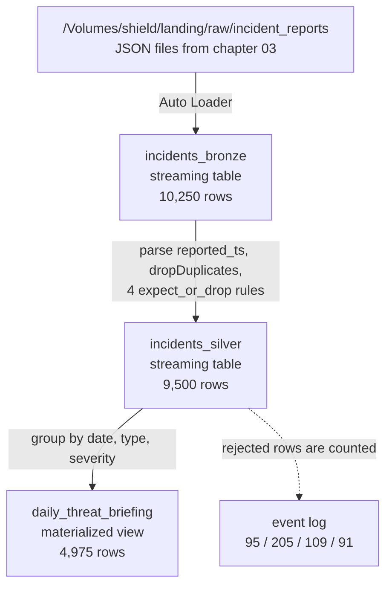

# 08 · Declarative pipelines

**Code:** [pipelines/shield_insight.py](../pipelines/shield_insight.py) · **Notebook:** [08_declarative_pipelines.ipynb](../notebooks/databricks/08_declarative_pipelines.ipynb)

> 💡 **TL;DR:** In chapters 03 to 06 you wrote the plumbing: checkpoints, write modes, the order of the steps, the quality split. In a declarative pipeline you only declare what each dataset is, as a function that returns a DataFrame. The engine builds the dependency graph, tracks what it has already read, retries, and counts every row your quality rules reject. Here the same bronze, silver, gold flow is 3 datasets in one `.py` file, written to `shield.pipeline`. The price is less control and one more thing to learn.

---

## The big picture

All three datasets live in `shield.pipeline`. Nothing in `shield.bronze`, `shield.silver` or `shield.gold` is touched.

---

## Concepts

### 1 · A declarative pipeline

The idea: in a notebook you write *how*: read this, write that, then run the next cell. In a declarative pipeline you write *what*: each dataset is a function that returns a DataFrame. The engine reads all declarations, works out the dependency graph from which dataset reads which, and runs them in the right order with checkpoints and retries. It is a framework (Lakeflow Spark Declarative Pipelines, formerly Delta Live Tables), not a pattern.

Pipeline code is not a notebook. The decorators only work inside a pipeline, which is why the code lives in a `.py` file and the chapter notebook is a companion that creates, runs and inspects it.

How this repo implements it, in [pipelines/shield_insight.py](../pipelines/shield_insight.py):

| Dataset | Type | Reads | What it does |
|---|---|---|---|
| `incidents_bronze` | streaming table (`@dp.table`) | the raw JSON files with Auto Loader (`cloudFiles`, `inferColumnTypes`) | adds `_source_file` and `_ingested_at`, keeps rows as received |
| `incidents_silver` | streaming table (`@dp.table`) | `incidents_bronze` as a stream | parses `reported_ts` with `try_to_timestamp`, `dropDuplicates(["incident_id"])`, four `expect_or_drop` expectations |
| `daily_threat_briefing` | materialized view (`@dp.materialized_view`) | `incidents_silver` as a batch | counts incidents and sums casualties per `(report_date, incident_type, severity)` |

The graph comes from the reads: silver reads `"incidents_bronze"` by bare name, so it runs after bronze. A bare name resolves inside the pipeline's default catalog and schema. The raw path comes from the configuration key `raw_path` (`spark.conf.get`), with `/Volumes/shield/landing/raw` as the default.

Imports: `from pyspark import pipelines as dp`. Older material uses `import dlt`; Microsoft Learn notes that the old `@table` operator created both streaming tables and materialized views, and recommends `@materialized_view` for the latter. `@dp.expect` and friends are Databricks additions, not part of open-source Spark.

Status and plan: the product is generally available according to the notebook, and Microsoft Learn says Lakeflow pipelines require the Premium plan. I could not find a preview label on the pages I read, but I did not confirm GA status on a status page. Features near it that are in preview or beta and **not used here**:

| Feature | Status | Verified |
|---|---|---|
| `pipeline_events` system table | Beta, per Microsoft Learn (use `event_log()` instead) | yes |
| Genie Code in the pipeline editor | Public Preview, per the notebook | not verified |
| standalone pipeline decorators in notebooks | preview, per the earlier text of this doc | not verified |

Why it helps: less code, no checkpoint paths or write modes to get wrong, automatic ordering, retries and incremental processing, and quality numbers for free.

Trade-offs and alternatives:

* **Less control.** You do not choose the write mode or the checkpoint location. Custom logic (calling an API per row, for example) does not fit.
* **Notebooks and jobs** (chapters 03 to 06, 10) give full control and are easier to debug cell by cell, but you own the plumbing.
* **Standalone** streaming tables and materialized views (a single dataset created with SQL from a SQL warehouse) are the lighter option for one dataset. A Lakeflow pipeline, as here, fits multi-stage flows with Python.
* **Triggered or continuous.** This pipeline is triggered: it processes what is there and stops, so it costs nothing while idle. Continuous mode keeps compute running and is meant for a proven freshness need of seconds to minutes. Microsoft Learn recommends starting triggered.

Common mistake: debugging by adding `display()` or writes in the dataset functions. See Gotchas.

### 2 · Streaming table and materialized view

The idea: two dataset types with different processing semantics.

| | Streaming table | Materialized view |
|---|---|---|
| Decorator | `@dp.table` on a **streaming** read | `@dp.materialized_view` on a **batch** read |
| Semantics | each input row is processed once; an update handles only data it has not seen | the result always equals the defining query on the current data |
| Good for | ingestion and row-by-row transforms (bronze, silver) | aggregates and joins (gold) |
| Refresh | appends new data | incremental when the query allows it, otherwise a full recompute; same result either way |
| Needs | an append-only (growing) source | serverless compute for incremental refresh; on classic compute it is always recomputed |

How this repo uses them: bronze and silver are streaming tables, because files only arrive and rows are handled once. The gold view is a materialized view because it aggregates silver; the engine decides on each update whether to refresh incrementally. The notebook (Step 4) shows it has 4,975 rows covering all 9,500 incidents and 5,681 casualties.

Trade-offs and limits (Microsoft Learn):

* A streaming table sees each row once. If you change its query, old rows keep the old logic until you run a full refresh.
* Joins in a streaming table do not recompute when a dimension changes. If a result must always be correct, use a materialized view.
* Streaming tables with stateful operations need bounded state (a watermark). See `dropDuplicates` in the Gotchas.
* A streaming table is owned by one pipeline and cannot be written by another.

The third dataset type in pipelines is a **view**: evaluated on demand, not stored, usable only inside the pipeline. This repo does not use one.

### 3 · Expectations

The idea: an expectation is a named SQL condition attached to a dataset. You choose what happens to a row that fails it: keep it and count it (warn), drop it, or fail the update. This is the pipeline form of chapter 06's rules.

| Decorator | Action on a failing row | SQL form |
|---|---|---|
| `@dp.expect` | keep the row, record the metric (warn, the default) | `EXPECT (...)` |
| `@dp.expect_or_drop` | drop the row before it is written, count it | `EXPECT (...) ON VIOLATION DROP ROW` |
| `@dp.expect_or_fail` | the update fails and rolls back; manual intervention is needed before reprocessing | `EXPECT (...) ON VIOLATION FAIL UPDATE` |

How this repo implements it: `incidents_silver` has four `expect_or_drop` expectations, named exactly like the keys of `INCIDENT_RULES`: `has_agent`, `valid_timestamp`, `valid_severity`, `non_negative_casualties`. The pipeline file repeats the four conditions instead of importing them. Step 5 of the notebook checks that the names match `INCIDENT_RULES`, and Step 3 checks that no silver row fails any of them. Keeping two copies in sync is a known cost; Microsoft Learn recommends storing expectation definitions separately and loading them with `expect_all_or_drop(dict)`, which is how you would remove the duplication.

Facts from Microsoft Learn:

* Each expectation needs a name, unique within its dataset. The condition must be valid SQL; it cannot use custom Python functions, external calls or subqueries on other tables.
* Expectations are supported on streaming tables, materialized views and temporary views.
* `expect_all`, `expect_all_or_drop` and `expect_all_or_fail` take a dictionary of name to condition and apply one action to the group.
* In a triggered pipeline a failed `expect_or_fail` rolls back that flow only; other parallel flows continue. In a continuous pipeline it stops the flow and its dependents. A `fail` update records no metrics.
* Metrics are not available when no expectations are defined, when there was no update for the flow, or for sinks.

Difference from chapter 06:

| | Chapter 06 (notebook) | Chapter 08 (pipeline) |
|---|---|---|
| Failing rows | to `silver.incident_reports_quarantine` with `failed_rules` | dropped; only counted in the event log |
| Evidence kept | yes, the rows | no, only the numbers |
| Reaction choice | quarantine, plus an optional job failure you add | warn, drop or fail per rule |
| Metrics | you compute them | automatic |

If you need the rows, build a quarantine table in the pipeline; Learn describes a pattern (a flag column, then valid and invalid views). That is mini-project 2.

### 4 · The event log

The idea: every update writes events (what ran, how long, what each expectation counted, lineage) to the pipeline's event log. It is how you monitor a pipeline, and here the only trace of the 500 dropped incidents.

How this repo implements it (Step 5): the notebook queries `event_log(TABLE(shield.pipeline.incidents_silver))`, takes the `flow_progress` events that have `data_quality.expectations`, explodes them and sums `failed_records` per expectation.

Expected (over all updates, rows rejected): `has_agent` 95, `valid_timestamp` 205, `valid_severity` 109, `non_negative_casualties` 91. That is 500, one per defective incident. These are the numbers after `dropDuplicates`; chapter 06 shows 96 / 209 / 110 / 96 because it counts the replayed duplicates too (11 extra rows in bronze). The notebook gives two ways your numbers could differ and marks both unverified until it runs: close to chapter 06's means duplicates were counted; about double means the sum counts the final progress event as well as the per-batch ones. Microsoft Learn supports the second reading: a completed flow may carry no metrics, and metrics are reported per micro-batch in `flow_progress` events with status `RUNNING`.

Facts from Microsoft Learn:

* The log is a hidden Delta table (`event_log_<pipeline_id>`) in the pipeline's default catalog and schema. It does not show in Catalog Explorer; use `event_log()`.
* `event_log()` accepts `TABLE(name)` for a streaming table or materialized view, or a pipeline ID. By default only the owner or run-as user can call it. A view over it cannot be shared with others.
* Delivery is best effort, so a missing event is possible.
* You can publish the log to a table of your choice in the pipeline settings, and event hooks can run custom actions.
* Do not delete the event log or its schema; the pipeline can fail on the next update.
* `pipeline_events`, a system table that covers all pipelines in a region, is Beta. Not used here.

In the UI the same counts are on the **Data quality** tab of a dataset.

Step 6 also uses the log: it counts `create_update` events and expects at least 2 after the second run.

### 5 · Incremental processing, checkpoints and refresh

The idea: a streaming table remembers which files it has read in a checkpoint it manages itself. A normal update (a **refresh**) therefore processes only new files. That is the difference to chapter 05's full recompute.

How this repo implements it (Step 6): you click **Run pipeline** a second time with no new files. The update finishes quickly, `incidents_bronze` still has 10,250 rows (not 20,500), silver still has 9,500 and the event log has at least two `create_update` events.

Refresh types (Microsoft Learn):

| Update | Streaming table | Materialized view |
|---|---|---|
| Refresh (default) | processes records that arrived since the last update | incremental when cheaper and supported, otherwise recompute |
| Full refresh | truncates the table, clears the checkpoints and re-reads the whole source | recomputes the result (same data as a refresh) |
| Reset checkpoints | clears checkpoints but keeps the data, then reprocesses the source (REST API only) | not applicable |

A full refresh is fine here, because the raw files stay in the volume. It loses data if the source no longer has it (a Kafka topic past retention, files removed by a lifecycle rule). Set the table property `pipelines.reset.allowed` to `false` to block it on a table. If a streaming table has downstream tables, they must be fully refreshed as well.

Common mistake: assuming "Run pipeline" re-reads everything. It does not; use **Full refresh** only on purpose, and not casually in Step 6.

---

## What the notebook does

The notebook opens with an explainer (declarative pipelines, streaming table vs materialized view, expectations, event log), then six steps, each with a goal, an expected result and a check table. Steps 1, 2 and 6 are clicks in the workspace UI, not code; the code cells check what the UI produced. The numbers assume the chapter 02 dataset (10,000 incidents, seed 42, 5 % dirty, 250 replayed duplicates, all five files delivered).

| Step | Goal | Expected |
|---|---|---|
| 1 | Create the pipeline in the UI (**New → ETL pipeline**, catalog `shield`, schema `pipeline`, source `pipelines/shield_insight.py`) and **Dry run** it | the graph shows three nodes `incidents_bronze → incidents_silver → daily_threat_briefing`, no errors. UI step, no code |
| 2 | **Run pipeline** | the three datasets appear in `shield.pipeline`; `incidents_bronze` holds 10,250 rows (10,000 incidents plus 250 replayed deliveries) |
| 3 | Silver has only valid, unique incidents | 9,500 rows, one per `incident_id`, none failing a rule from `INCIDENT_RULES`; four severities (low 4,722, medium 2,915, high 1,428, critical 435) |
| 4 | Gold materialized view | 4,975 rows; incidents add up to 9,500; casualties add up to 5,681 |
| 5 | Expectation metrics in the event log | four expectations named like `INCIDENT_RULES`; rejected 95, 205, 109 and 91 (500 in total) |
| 6 | Run again with no new files (UI) | bronze still 10,250 rows, silver 9,500, at least two `create_update` events |

The pipeline is standalone from the earlier tables: it reads the raw files from chapter 03's landing zone through its own checkpoint, so it needs neither the bronze nor the silver tables of chapters 03 to 06. It needs a Premium workspace with Unity Catalog and serverless compute for pipelines. Open the notebook from a Git folder, because it imports `INCIDENT_RULES`.

Nothing has been run in a workspace yet, so the expected values are expectations. The UI labels come from Microsoft Learn and can change. The pipeline is triggered, so it costs nothing while idle. The notebook's clean-up leaves `shield.pipeline` in place; to remove it, delete the pipeline in **Jobs & Pipelines** (its tables should go with it, not checked) and use the commented `DROP SCHEMA` cell for anything left.

## Compared with chapters 03–06
Same bronze → silver → gold idea, but you wrote **no** checkpoint paths, no write logic, and no orchestration between tables. The trade-off: less control, more convention. The rules mirror `quality.py` (the pipeline file repeats the four conditions, and Step 5 checks that the expectation names match `INCIDENT_RULES`). Differences to keep in mind:

* The pipeline writes to `shield.pipeline` and never touches `shield.bronze`, `shield.silver` or `shield.gold`.
* Rejected rows are dropped and only counted in the event log. There is no quarantine table.
* `dropDuplicates` keeps the first copy of an incident; chapters 05 and 06 keep the latest. The copies are identical in this dataset, so the result is the same.
* The gold view groups by date, type and severity only. It has no `city`, because the pipeline does not read the locations feed, so it is not the same table as `shield.gold.daily_threat_briefing`.
* The bundle in the [deploy guide](deploy-and-automate.md) deploys this file as `shield_insight_<target>` into schema `pipeline_<target>`, not `pipeline`, with `raw_path` set from the bundle (`resources/shield_pipeline.yml`).

## Gotchas
* Pipeline code is evaluated to *build a graph*; avoid side effects (no writes, no `display`) in dataset functions.
* `dropDuplicates` on a stream keeps unbounded state; production code bounds it with a watermark (Microsoft Learn: streaming tables need streams that are naturally bounded or bounded with a watermark).
* Reading a dataset by bare name (`incidents_bronze`) resolves within the pipeline's catalog/schema.
* Run on serverless to avoid cluster setup (and to allow incremental refresh of the materialized view). The pipeline is triggered, so it stops when the data is processed.
* The event log is a hidden table: query it with `event_log(...)` as the pipeline owner. Metrics exist only for updates that actually processed data, and delivery is best effort.
* When a new column shows up in the source (chapter 03's `source_channel`), a streaming table in a pipeline picks it up and restarts the query itself; you do not see the deliberate failure from chapter 03.
* **Full refresh** clears streaming tables and re-reads the source. That is fine here (the raw files stay in the volume) and a disaster if the source files are gone.
* The key `raw_path` is set under **Settings → Configuration** and read with `spark.conf.get`. Pipeline *parameters* are for SQL code only. The earlier text of this doc called parameters a Beta feature; the Microsoft Learn page I read does not show a Beta label, so check the current status before relying on either statement.
* Expectation conditions are plain SQL: no Python functions, no subqueries on other tables.
* Do not run chapter 03's `ingest()` while an extra copy of a raw file is in the landing folder (mini-project 3).

## Not covered yet
* Scheduling the pipeline as a job task (chapter 10) and deploying it as code (the [deploy guide](deploy-and-automate.md)).
* Change data capture with `AUTO CDC` (SCD types 1 and 2), sinks, views, append flows and continuous mode.
* A quarantine table inside the pipeline (mini-project 2) and watermarks for `dropDuplicates`.
* Loading expectations from one shared definition (`expect_all_or_drop`) so the pipeline stops repeating `INCIDENT_RULES`.
* The Genie Code pipeline editor and the `pipeline_events` system table (preview or beta, not used).
* Nothing here has run in a workspace; the event-log numbers, the UI labels and the cleanup behaviour are not verified.

## Try it yourself
1. **Warn instead of drop.** Change one `expect_or_drop` to `expect`, run the update, and compare the silver row count and the event log with the original run. Then change it to `expect_or_fail` and explain what the failed update tells you.
2. **Add a quarantine table.** The pipeline throws bad rows away. Add a second streaming table holding the rows that fail at least one rule (the inverse of the rules), as in the quarantine pattern in Microsoft's expectation docs. Does its row count match the event log? Bonus: rewrite `daily_threat_briefing` as `CREATE MATERIALIZED VIEW` in a second, SQL file.
3. **Replay a file, then full refresh.** Copy `part-0000.json` into the raw `incident_reports` folder under a new name, run the update, and watch bronze grow while silver stays at 9,500. Then run once with **Full refresh** and compare what each run does to the materialized view. Delete the copy afterwards, and don't run chapter 03's `ingest()` while it is there, or `shield.bronze.incident_reports` picks it up too.

Bonus: compare the cost (DBUs) of a pipeline update with the notebook version, using the billing system tables from chapter 14.
