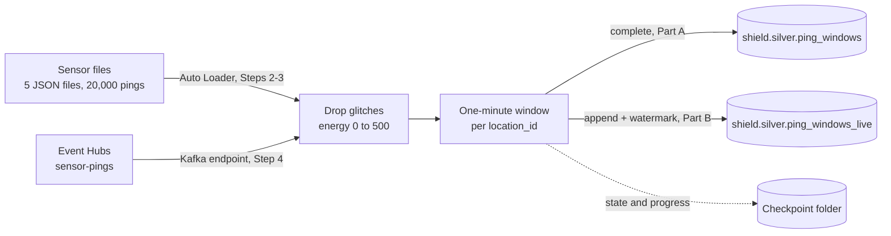

# 09 · Quake tremors

**Notebook:** [09_quake_tremors.ipynb](../notebooks/databricks/09_quake_tremors.ipynb) · **Producer:** [scripts/send_pings.py](../scripts/send_pings.py) · **Event Hubs infra:** [infra/modules/eventhubs.bicep](../infra/modules/eventhubs.bicep)

> 💡 **TL;DR:** A stream is a table that keeps growing: you write ordinary DataFrame code, group it by **event time** windows, and the engine updates the result as new rows arrive. A **checkpoint** remembers what was processed, a **watermark** says how long to wait for late events, and the `availableNow` trigger turns the stream into a cheap scheduled batch. Part A (files) is plain Structured Streaming. **Part B (Event Hubs) is the least verified piece of the repo**: it was never run against a real namespace, and the numbers in the notebook are expectations until someone has run it in a workspace.

---

## The big picture



Part A and Part B share the same aggregation. They differ in the source (files or Event Hubs), the output mode (`complete` or `append`) and the watermark (none or 10 minutes).

---

## Concepts

### 1 · Structured Streaming: a stream is a table that keeps growing

The idea: you write the query as if the data were a static table (filter, group, aggregate). The engine runs it again on every micro-batch of new rows and updates the result. Structured Streaming is a feature of Apache Spark, not something only Databricks has.

```
 files or events ──▶ [ input table: new rows keep arriving ] ──▶ your query ──▶ result table (Delta)
                                                                   │
                                      state and progress are remembered in the CHECKPOINT
```

**How this repo implements it**

* **Part A:** Auto Loader (chapter 03, `format("cloudFiles")`) reads the JSON files in `/Volumes/shield/landing/staging/sensor_pings` (5 files, 20,000 pings: `ping_id`, `sensor_id`, `location_id`, `event_time`, `energy_reading`).
* **Part B:** the Kafka source reads the event hub `sensor-pings` instead. The rest of the query is the same.
* Both write a Delta table in `shield.silver` (`ping_windows`, `ping_windows_live`) with `toTable`.

**Why it helps:** the result stays current without a nightly rebuild, and a restarted stream reads only what is new.

**Trade-offs and common mistakes**

* A stream is a query that never ends. An always-on stream keeps compute running (and billing) 24/7. See concept 7.
* Not every operation works on a stream (for example, some joins and sorts). Stateful operators (aggregations, joins, deduplication) keep state, and that state must be bounded. This is what the watermark is for.
* Debugging is harder than batch: results depend on arrival order and on what the checkpoint already holds. Start by running the same logic as a batch on a small input.

**Not covered yet:** stream-stream joins, Structured Streaming real-time mode, `foreachBatch` (to `MERGE` into a table). For incremental pipelines without hand-written checkpoints, see chapter 08.

### 2 · Event time vs processing time

The idea: every event has two clocks. **Event time** is when it happened (`event_time` in the ping). **Processing time** is when your job saw it. Network delays, retries and offline sensors make them differ. If you group by processing time, a ping that was delayed by 10 minutes lands in the wrong minute. If you group by event time, it lands in the minute it belongs to.

**How this repo implements it:** the pings carry an `event_time` string, parsed with `F.to_timestamp("event_time")`. All windowing uses that column. In the files (chapter 02) a ping arrives every 5 seconds of event time, so 20,000 pings span about 28 hours, even though the stream reads them in seconds of wall time. `send_pings.py` is the opposite case: it stamps each ping with the time it is *sent*, so for Part B event time and processing time are almost the same, and that matters for the watermark (concept 4).

**Why it helps:** the numbers stay right when data arrives late or out of order, and replaying old files gives the same answer as running them live.

**Common mistakes**

* Grouping by an ingestion timestamp (like `_ingested_at` from chapter 03) when you mean event time.
* Forgetting that timestamps are displayed in the session time zone. The notebook shows UTC on serverless.
* Trusting `event_time` blindly: sensors have wrong clocks. Filter or flag events far in the future before you aggregate.

### 3 · Windows

The idea: a **tumbling window** cuts event time into fixed, non-overlapping buckets. `F.window("event_time", "1 minute")` puts a ping at 00:00:05 into the bucket `[00:00:00, 00:01:00)`. The window is a struct with `start` and `end`.

```
 event time  ─ 00:00 ───── 00:01 ───── 00:02 ───── 00:03 ─▶
                [ window 1 ][ window 2 ][ window 3 ]
                 ping ping    ping        ping ping ping
```

**How this repo implements it:** the query groups by `F.window("event_time", "1 minute")` and `location_id`, and computes `avg_energy` and `pings` (the count). The result is selected as `start`, `end`, `location_id`, `avg_energy`, `pings`. Step 2 expects 11,622 rows: one per minute and location that had at least one usable ping. A window with no pings has no row. The `pings` column adds up to 19,034, so every usable ping is counted once.

**Filtering sensor glitches first.** The generator injects `-999` and `1,000,000` as `energy_reading` (966 of the 20,000 pings, Step 1). The stream keeps only `energy_reading BETWEEN 0 AND 500`. Without that filter, one `1,000,000` ping would push its window's average into the thousands. Step 2 checks that the largest `avg_energy` stays below 500.

| Window type | Shape | Use it for |
|---|---|---|
| Tumbling (used here) | fixed, no overlap | per-minute counts and averages |
| Sliding | fixed size, overlapping (`window(col, "10 minutes", "1 minute")`) | moving averages |
| Session | grows while events keep coming | user visits, bursts |

**Common mistakes:** referring to the time column through an expression instead of its name inside `groupBy` and `window` (Learn says to use `"<colName>"` or `col("<colName>")` so the event-time marker is preserved), and choosing windows so small that most hold one ping (the first rows in Step 2 have `pings` of 1 and 2).

**Not covered yet:** sliding and session windows.

### 4 · Watermarks and output modes

The idea: with real events some arrive late, so the engine must decide when a window is **final**. A watermark is that rule: "the newest `event_time` seen, minus a delay". Once a window ends before the watermark, the engine can write it and drop its state (memory). Without a watermark the engine would keep every window forever.

```
 newest event_time seen:  10:15
 watermark (10 minutes):  10:05
 window 10:00-10:01  ended before the watermark -> final: written, state dropped
 window 10:14-10:15  ends after the watermark    -> still open: kept in memory, not written yet
```

The output mode decides when rows are written:

| Output mode | With a windowed aggregation | In this repo |
|---|---|---|
| `complete` | State is never dropped and the whole result table is rewritten on every trigger. No watermark needed, but it only suits small, bounded results. | Part A |
| `append` | A window is written once, after the watermark passes it. Needs a watermark, bounds memory, and delays every row by at least the watermark. | Part B |
| `update` | Writes rows that changed since the last trigger. Not supported by the Delta sink (Learn: use `foreachBatch` with `MERGE`). | not used |

**How this repo implements it**

* Part A uses `complete`: the whole table is rewritten, which is fine for 11,622 rows. That is why a second run changes nothing (concept 5).
* Part B uses `.withWatermark("event_time", "10 minutes")` and `append`. The watermark must be defined on the same column used in the window.
* `scripts/send_pings.py` stamps pings with the send time, so one burst of 500 pings falls into one or two minutes and the watermark never passes those windows. Expect **0 rows** (or very few) after the first run. A ping that is more than 10 minutes newer closes them: publish again after 11 minutes or more, then re-run Step 4. In `availableNow` mode the query stops after the data it found, and windows that are still open stay unwritten. That is correct behaviour, not a bug.

**Trade-offs** (Learn: [watermarks](https://learn.microsoft.com/azure/databricks/structured-streaming/watermarks))

* A short watermark lowers latency and keeps less state, but has little tolerance for late data: events later than the threshold may be dropped.
* A long watermark tolerates more late data, but delays output and keeps more state.
* Late data inside the threshold is always processed. Data later than the threshold *might* still be processed, but is not guaranteed to be.

**Common mistakes:** using `append` without a watermark (the query is rejected), setting a watermark shorter than your real lateness (silent data loss), and expecting the last window to appear: it stays open until a later event moves the watermark.

**Not covered yet:** `update` mode with `foreachBatch`, multiple watermarks for joins.

### 5 · Checkpoints

The idea: a **checkpoint** is a folder where the stream stores its progress (which files or offsets are processed), its intermediate state (open windows) and query metadata. After a restart the stream continues from the last committed point instead of starting over. With a replayable source and a transactional sink such as Delta, this gives exactly-once results: a micro-batch either fully commits or is retried.

**How this repo implements it**

* The notebook's folder is `CP = /Volumes/shield/landing/checkpoints/pings`: `schema` is Auto Loader's schema location, `checkpoint_a` belongs to Part A and `checkpoint_b` to Part B. Each query gets its own checkpoint.
* **Step 3** runs `start_window_stream()` a second time. It finds no new files, so `shield.silver.ping_windows` keeps 11,622 rows and the same 19,034 counted pings.
* The clean-up deletes the `CP` folder with the tables. After that, Part A starts from scratch.

**Why it helps:** you can schedule the same notebook again and again and only new data is processed (chapter 10).

**Rules and common mistakes**

* One checkpoint per query. Sharing one corrupts the recovery metadata.
* Keep the checkpoint in durable storage (a volume), never on local driver disk.
* Treat it as part of the query. Changing stateful operators (grouping keys, the aggregation, the sink type) between restarts is not allowed. Start with a new checkpoint, and think about what happens to data already in the table.
* Dropping the target table but keeping the checkpoint (or the other way round) leaves the two out of sync. Delete both, as the clean-up does.

### 6 · Triggers: `availableNow`

The idea: a **trigger** decides when a micro-batch runs. `availableNow=True` processes everything that is available (in as many micro-batches as needed), then stops. It is a scheduled incremental batch with all the streaming bookkeeping (checkpoint, state). You met it in chapter 03.

**How this repo implements it:** both parts use `.trigger(availableNow=True)` and then `awaitTermination()`, so the cell finishes by itself. `awaitTermination()` is right in an interactive notebook. In a job task you do not need to block on it, because the Jobs service waits (chapter 10).

| Trigger | Behaviour | On serverless |
|---|---|---|
| `availableNow=True` | Process the backlog, stop. | supported, recommended |
| `processingTime="1 minute"` | Run a micro-batch every interval, forever. | not supported in notebooks and jobs |
| `continuous` | Experimental low-latency mode. | not supported |
| none set | Spark defaults to a 0-second processing-time trigger. | fails with `INFINITE_STREAMING_TRIGGER_NOT_SUPPORTED` |

For an always-on stream on serverless, Learn points to Lakeflow pipelines in continuous mode (chapter 08) or a continuous-schedule job with `AvailableNow`. On large backlogs, `maxFilesPerTrigger` or `maxBytesPerTrigger` keep each micro-batch small enough not to run out of memory.

### 7 · Cost: always-on vs scheduled

Your stream's bill is compute time. Two ways to run it:

| | Always-on stream | Scheduled `availableNow` job |
|---|---|---|
| Compute | runs 24/7 | runs only while a batch runs |
| Freshness | seconds | as fresh as the schedule (for example 5 minutes) |
| Cost drivers | cluster or pipeline hours around the clock | batch duration times runs per day, plus start-up time per run |
| Fits | alerts, operational dashboards | most analytics, including Daisy's per-minute averages |

Rule of thumb: cost is roughly (compute price per hour) times (hours running). An always-on stream is 24 hours a day. A job that takes 2 minutes every 5 minutes is about 40 % of that, minus overhead. Frequent short runs also pay start-up time each run, so the real answer needs your prices and measured run times. The notebook does not measure cost, and this doc does not quote prices: compute your own in Try it 3.

Event Hubs is a second cost, charged for as long as the namespace exists, whether or not anything is streaming.

### 8 · Event Hubs through its Kafka endpoint

The idea: Azure Event Hubs is a managed event ingestion service. Its **Kafka-compatible endpoint** lets Kafka clients (including Spark's `kafka` source) talk to it without running Kafka yourself. Event Hubs speaks Kafka, AMQP and HTTP at the same time, so a producer can use one protocol and a consumer another.

| Event Hubs | Kafka |
|---|---|
| namespace | cluster |
| event hub (`sensor-pings`) | topic |
| partition (2 in [eventhubs.bicep](../infra/modules/eventhubs.bicep)) | partition |
| consumer group | consumer group |

**How this repo implements it**

* [infra/modules/eventhubs.bicep](../infra/modules/eventhubs.bicep) creates a Standard namespace (the Kafka endpoint is not available on the Basic tier), the event hub `sensor-pings` with 2 partitions and 1 day of retention, and grants you *Event Hubs Data Owner*.
* `scripts/send_pings.py` publishes JSON pings with the Event Hubs SDK (AMQP) and your Azure CLI login.
* The notebook reads them with `format("kafka")`: `kafka.bootstrap.servers` = `<namespace>.servicebus.windows.net:9093`, `subscribe` = `sensor-pings`, `kafka.security.protocol` = `SASL_SSL`, `kafka.sasl.mechanism` = `PLAIN`, and a JAAS string with user name `$ConnectionString` and the namespace connection string as the password. The connection string is read from the secret `shield` / `eventhubs-conn`.
* `startingOffsets` is `earliest`, so a new checkpoint reads everything still retained.
* The Kafka `value` column is bytes. The notebook casts it to string and parses it with `from_json` and the schema `ping_id string, sensor_id string, location_id string, event_time string, energy_reading double`.
* The part Learn does not show: on Databricks the login module class is `kafkashaded.org.apache.kafka.common.security.plain.PlainLoginModule`. Learn's Event Hubs examples use the unshaded name, so the `kafkashaded.` prefix is a Databricks detail (not verified in this repo).

**Authentication choices**

| Option | Notes |
|---|---|
| Namespace connection string (used here) | Simple. `RootManageSharedAccessKey` can also send and manage; create a policy with **Listen** only. |
| Entra ID (OAuth) | The production option, no secret to rotate. Not covered. |
| Generated SAS tokens | Learn: not supported on the Event Hubs Kafka endpoint. |

**Why a secret scope:** the connection string must never sit in a cell, a widget or a commit. The widget `eventhub_namespace` holds only the namespace name.

**Not covered yet / not verified:** Entra authentication; the dedicated Event Hubs Spark connector (not available in Databricks Runtime); whether the Kafka source is accepted on serverless compute (🧪 unconfirmed here: Learn says `availableNow` is the recommended trigger for Kafka on serverless, so it should work; if it is rejected, use classic compute). Partition count, consumer group offsets and throughput units are not explored.

---

## What the notebook does

Same step numbers and expectations as the [notebook](../notebooks/databricks/09_quake_tremors.ipynb). The Part A numbers assume the chapter 02 dataset (seed 42, 5 % dirty); Part B has no computed numbers.

| Step | Goal | Expected |
|---|---|---|
| 1 | Look at the raw pings (batch read) | 20,000 pings, 966 glitches, 19,034 usable |
| 2 | One-minute windows per location (`complete`, `availableNow`) | `shield.silver.ping_windows` has 11,622 rows; `pings` add up to 19,034; largest `avg_energy` below 500 |
| 3 | Run it again | the same 11,622 rows and 19,034 pings: the checkpoint says nothing is new |
| 4 | Windows from Event Hubs (watermark, `append`), not verified | widget empty: the cell says Part B is off. With a namespace: `shield.silver.ping_windows_live` has 0 rows after one burst; after a second publish more than 10 minutes later, at least one row per location that pinged in the first burst |

The clean-up drops both tables and deletes the checkpoint folder. It does not touch the namespace or the secret.

### Setting up Part B
1. `pip install azure-eventhub azure-identity` and run `python scripts/send_pings.py --namespace <EVENT_HUB_NAMESPACE> --count 500` (you have *Event Hubs Data Owner* from Bicep).
2. Get a connection string: Azure portal → Event Hubs namespace → *Shared access policies*. For learning, `RootManageSharedAccessKey` works, but it can send and manage too. Better: create a policy with **Listen** only (the notebook only reads). Use Microsoft Entra authentication in production.
3. Create a Databricks secret scope and key. Easiest with the CLI: `databricks secrets create-scope shield` then `databricks secrets put-secret shield eventhubs-conn`. (A Key Vault-backed scope is the production option.)
4. Fill the `eventhub_namespace` widget and run Step 4. If the Kafka source is rejected on your compute, use classic compute.

## Gotchas
* In `availableNow` mode with `append`, windows that are not yet final stay unwritten: that is correct behaviour, not a bug. `send_pings.py` stamps pings with the time they are sent, so one burst of 500 pings gives **no rows** until a later ping moves the watermark more than 10 minutes past them. Publish again after 11 minutes and re-run Step 4.
* `kafkashaded.` in the JAAS class name is required on Databricks.
* Filter sensor glitches before aggregating (the generator injects `-999` and `1e6`).
* Never put the connection string in a cell, a widget or a commit. Databricks redacts secret values in output, but do not rely on that.
* The namespace costs money while it exists. Remove the secret (`databricks secrets delete-secret shield eventhubs-conn`, and the scope with `databricks secrets delete-scope shield` if nothing else uses it) and run `azd down --purge` when you are finished.
* Always set a trigger to every stream. Without one, serverless rejects the query.

## Not covered yet
* Entra (OAuth) authentication to Event Hubs and the dedicated Event Hubs Spark connector.
* Always-on streams and their exact cost, Structured Streaming real-time mode, stream-stream joins, sliding and session windows.
* A verified Part B run: the Kafka options follow Microsoft Learn but were never run against a real namespace.
* Chapter 10 schedules `availableNow` runs as a job; chapter 08 shows the declarative way to get incremental streaming tables.

## Try it yourself
1. Add an alert table: windows where `avg_energy` is more than 3 standard deviations above the mean of the same location. Which location alerts most often, and are the alerts real or a few lonely pings in a window?
2. Make the checkpoint do work: copy one more JSON file into `/Volumes/shield/landing/staging/sensor_pings` (any copy with a new name; delete it afterwards) and re-run Step 2. How many rows are added or changed, and why does `complete` mode rewrite the whole table?
3. Estimate the cost of keeping a 24/7 stream running against a 5-minute scheduled `availableNow` job. Then change the Part B watermark to `1 minute`, publish events with an old `event_time`, and watch them get dropped.
