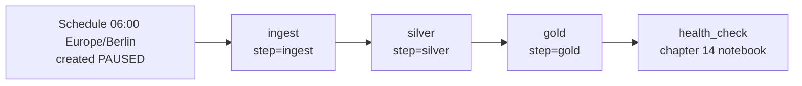

# 10 · Maria Hill schedules

**Notebook:** [10_maria_hill_schedules.ipynb](../notebooks/databricks/10_maria_hill_schedules.ipynb) · **Job as code:** [resources/shield_job.yml](../resources/shield_job.yml) · **Bundle:** [databricks.yml](../databricks.yml) · [deploy guide](deploy-and-automate.md)

> 💡 **TL;DR:** A Lakeflow Job runs tasks in dependency order, with parameters, retries, a schedule and notifications. Here one notebook with a `step` parameter serves three tasks (`ingest → silver → gold`). The job is only safe to retry because every task is **idempotent**: running it twice gives the same result as once. Jobs does not give you that; you design it into the tasks. Nothing in this chapter has run in a real workspace yet.

---

## The big picture



The first three tasks run [the same notebook](../notebooks/databricks/10_maria_hill_schedules.ipynb) with a different `step`. `health_check` runs the chapter 14 notebook and exists only in the bundle version of the job.

---

## Concepts

### 1 · Lakeflow Jobs: jobs, tasks, dependencies

The idea: a **job** is the unit you schedule and monitor. It holds **tasks** (a notebook, a pipeline, SQL, a Python script or wheel, another job, and more) and the dependencies between them. Tasks and dependencies form a directed acyclic graph (a DAG: arrows, no loops). A task starts when everything it depends on has succeeded. Lakeflow Jobs is a Databricks feature; the DAG itself is a general orchestration pattern.

| Part of a job | What it is | In this repo |
|---|---|---|
| Task | one unit of work with its own compute, parameters and retry policy | `ingest`, `silver`, `gold`, `health_check` |
| Dependency | "run after" edge between tasks | `ingest → silver → gold → health_check` |
| Parameters | key-value pairs handed to a task | `step` = `ingest`, `silver` or `gold` |
| Trigger | when the job starts (concept 5) | cron `0 0 6 * * ?`, `Europe/Berlin`, paused |
| Notifications | email or webhooks on start, success, failure, slow runs | UI version only (concept 4) |

**How this repo implements it**

* **By hand (Step 5):** *Jobs & Pipelines → Create → Job*, name `shield_daily`. Three notebook tasks on serverless compute, each with the notebook from your Git folder and a `step` parameter; `silver` depends on `ingest`, `gold` on `silver`. Add retries, a failure notification and a schedule (paused), then **Run now** twice.
* **As code:** [resources/shield_job.yml](../resources/shield_job.yml) defines the same job as `shield_daily_${bundle.target}`, deployed by the bundle in [databricks.yml](../databricks.yml) (`include: resources/*.yml`; see the [deploy guide](deploy-and-automate.md)). It differs from the UI steps in three ways: a fourth task `health_check` runs `14_project_insight.ipynb` after `gold`; each of the first three tasks has `max_retries: 2` but `health_check` has none; and it has no notifications. It sets no compute, so the tasks use the serverless default for jobs. Do not edit a bundle-managed job in the UI: the next deploy overwrites it.
* The hand-made `shield_daily` and the bundle's `shield_daily_<target>` are separate jobs; delete the one you do not need.

**Why it helps:** the platform knows the order, runs a task only when its inputs are ready, shows every run in a matrix, and lets you re-run one piece.

**Alternatives and trade-offs**

| Choice | Here | Alternative | Trade-off |
|---|---|---|---|
| Tasks | one notebook, `step` widget | one notebook per task | One file is easy to read in a course; separate notebooks give cleaner diffs and per-task code review |
| Task type | notebook | Lakeflow pipeline task (chapter 08), SQL task, Python wheel | Notebook tasks are flexible; a pipeline task declares datasets instead of steps |
| Orchestrator | Lakeflow Jobs | Azure Data Factory, Airflow | Jobs sits next to the data and compute and is simplest; an external tool helps when you orchestrate across many systems |

**Common mistakes:** one giant task (no repair granularity), tasks that pass big data to each other (pass table names; use task values only for small signals), and editing a bundle-deployed job in the UI.

**Not covered yet:** task values, `Run if` conditions between tasks, `For each` tasks, job-level parameters, and running several jobs from one (Try it 2 and 3).

### 2 · Parameters: one notebook, many tasks

The idea: a parameter is a value the job hands to a task when it starts, so one piece of code can serve many tasks and environments.

**How this repo implements it:** the notebook declares two widgets: `step` (a dropdown with `ingest`, `silver`, `gold`, `all`) and `deliver_files` (text, default `1`, used by the ingest step only). It reads them with `dbutils.widgets.get`. The three job tasks pass `step` as a task parameter (`base_parameters` in the bundle). Run by hand, the default `all` walks through the three steps and Step 4, then checks the results. With `step = ingest` the notebook only starts the stream and does not wait (see Gotchas).

**Why it helps:** the same tested code runs in a job, from your laptop and in another environment, with only the parameters changed.

**Trade-offs and common mistakes**

* A `step` switch hides three jobs in one notebook. It is a teaching shortcut; at work you would usually import shared functions from a package (like `src/shield_data`) and keep one small notebook or script per task.
* Widgets are strings. Convert (`int(...)`) before you use them, as the ingest step does for `deliver_files`.
* A repair run lets you override parameters for the repaired tasks (the values you enter override the existing ones), which is handy and easy to forget about.

**Not covered yet:** job-level parameters and dynamic value references.

### 3 · Idempotency

The idea: a task is **idempotent** if running it twice gives the same result as running it once. It is a pattern, not a feature. Jobs cannot add it for you: a retry or a repair run re-runs a failed task from its beginning, so a task that wrote half its output and then appends it again duplicates data. Learn's advice is to review what each task writes and prefer overwrite or merge to append.

**How this repo implements it**

| Task | What it does | Why running it twice is safe |
|---|---|---|
| `ingest` | copies the next staged file(s) to `/Volumes/shield/landing/raw/incident_reports`, then loads new files into `shield.bronze.incident_reports` with Auto Loader (`availableNow`) | files already in the raw folder are skipped; the Auto Loader checkpoint (chapter 03) skips files it has read |
| `silver` | rebuilds `shield.silver.incident_reports` and `shield.silver.incident_reports_quarantine` from bronze with the chapter 06 rules (`INCIDENT_RULES`) | a full overwrite of a table derived from its source: same input, same output |
| `gold` | `CREATE OR REPLACE TABLE shield.gold.daily_threat_briefing` from silver | same reason |

The ingest step shares chapter 03's table and checkpoint on purpose. After a complete chapter 03 it finds nothing new, and that is the idempotency you want. Step 4 proves it: run silver and gold a second time and compare the counts before and after.

Techniques, with their trade-offs:

| Technique | How | Trade-off |
|---|---|---|
| Overwrite derived tables (used here) | `overwrite` / `CREATE OR REPLACE` from the source | Simple and safe; reads and writes everything each run, which gets slower as data grows |
| `MERGE` on a business key | upsert by `incident_id` | Only changed rows are written; the key must be truly unique and the source ordered or versioned |
| Skip already-delivered input | file name check, Auto Loader checkpoint | Needs durable state; if you delete the checkpoint you reprocess |
| `replaceWhere` / dynamic partition overwrite | overwrite only the slice you rebuild | Works when the slice is clearly defined (a day) |
| Plain `INSERT` / append | none | Not idempotent. Fine only when duplicates are harmless or removed later |

**Common mistakes**

* Appending in a task that has retries (a retry doubles the rows).
* `current_timestamp()` or random values in a "rebuilt" table: the rerun differs even though the logic did not change. The silver step adds `_quarantined_at`, so the quarantine rows are the same set of rows but not the same bytes. The counts, which the notebook checks, stay equal.
* Overwriting a table and losing what chapter 06 and 07 added. The notebook keeps the table and overwrites the data, so the CHECK constraint (chapter 06) and the change data feed property (chapter 07) should survive. This is not verified in a workspace.

**Not covered yet:** an incremental `MERGE` version of silver (Try it 3).

### 4 · Failure design: retries, notifications, repair runs

The idea: failures come in two kinds, and each needs a different tool.

| Failure | Example | Tool |
|---|---|---|
| Transient | a cluster hiccup, a network blip, a schema change Auto Loader asks you to retry (chapter 03) | **Retries**: the task starts again by itself |
| Needs a human | a missing table, bad data, a bug | **Notification**, then fix, then **repair run** |

* **Retries.** A retry policy says how many times a failed task is started again. Learn: for most configurations the default is no retries, serverless jobs optimize retries automatically, continuous jobs use exponential backoff, and if you set both a timeout and retries, the timeout applies to each retry. Some features, such as schema evolution with Structured Streaming, assume jobs run with retries so that the environment can reset.
* **Notifications.** Job-level notifications are **not** sent when a failed task is retried. To be told about every failed attempt, add notifications on each task. Learn also lists a "mute notifications until the last retry" option for the opposite wish.
* **Repair run.** After a failure, **Repair run** re-runs the failed tasks and the tasks that depend on them, and keeps the successful results. It needs a job with two or more tasks; for a single-task job use Run now. The repaired tasks use the current job and task settings, so you can fix the notebook path or a setting first. And it starts the failed task again from its beginning, which is why idempotency matters (concept 3).

```
 run 1:  ingest ok → silver FAILED → gold (skipped) → health_check (skipped)
 fix the cause, click Repair run
 run 1 (repaired):  ingest (kept) → silver ok → gold ok → health_check ok
```

**How this repo implements it:** `max_retries: 2` on `ingest`, `silver` and `gold` in the bundle (and **Add** next to **Retries** with 2 retries in the UI). In the UI version you also add a failure notification, preferably per task. The bundle has no notifications and no retries on `health_check`. Try it 1 makes the job fail on purpose and repairs it.

**Trade-offs and common mistakes:** retrying a deterministic error (a missing table) three times only delays the alert and costs compute; do not retry what cannot succeed. Too few alerts mean nobody notices a red run; one alert per failed attempt mean alert fatigue.

**Not covered yet:** timeouts and duration warnings, retry intervals, "retry on timeout", `Run if` conditions for cleanup tasks, and exponential backoff for continuous jobs.

### 5 · Schedules and triggers

The idea: a trigger decides when a job starts. Learn lists these:

| Trigger | Starts the job | Note |
|---|---|---|
| Scheduled (cron or periodic) | at a time | what this chapter uses |
| Table update | when a source table changes | good fit for gold after silver changes |
| File arrival | when new files land in a Unity Catalog storage location | event-driven ingestion |
| Model update, job completion | when a model or an upstream job changes | model update and job completion are marked Beta on Learn |
| Continuous | again as soon as the last run ends | for always-on work; serverless jobs support it only with bounded triggers such as `availableNow` |
| None | when you click **Run now** or call the API | |

By default only one run of a job is active at a time; extra runs from most trigger types are skipped.

**How this repo implements it:** the bundle sets `quartz_cron_expression: "0 0 6 * * ?"` (06:00 every day), `timezone_id: Europe/Berlin` and `pause_status: PAUSED`. In `development` mode the bundle also pauses schedules (see [databricks.yml](../databricks.yml)). By hand you add a schedule and start it paused.

**Why paused:** a live schedule keeps spending. A paused job costs nothing.

**Common mistakes:** leaving the time zone implicit (daylight saving makes "6 am" jump), scheduling at midnight when everyone else does, and a cron schedule on data that arrives irregularly (a table update or file arrival trigger fits better).

**Not covered yet:** table-update and file-arrival triggers (not tried here), multiple triggers (Beta on Learn).

---

## What the notebook does

Same step numbers and expectations as the [notebook](../notebooks/databricks/10_maria_hill_schedules.ipynb). The numbers assume the chapter 02 dataset (10,000 incidents, seed 42, 5 % dirty) and a complete chapter 03 (all five files delivered). None of them has run in a workspace.

| Step | Goal | Expected |
|---|---|---|
| 1 | Ingest: deliver the next staged file, load new files into bronze | after a complete chapter 03 nothing is delivered or loaded; bronze keeps 10,250 rows and 10,000 distinct `incident_id`s; 5 files in the raw landing zone |
| 2 | Silver: rebuild silver and quarantine from bronze | `shield.silver.incident_reports` 9,500 rows; `shield.silver.incident_reports_quarantine` 511 rows |
| 3 | Gold: rebuild the daily briefing | `shield.gold.daily_threat_briefing` 8,803 rows, 9,500 incidents, 5,681 casualties |
| 4 | Run silver and gold again | every count equals the count before the second run (`step = all` only) |
| 5 | Create the job in the UI and run it twice | all tasks of both runs green; the checks show 9,500 silver, 511 quarantine and 9,500 incidents in gold; `DESCRIBE HISTORY` of silver shows the job id in the `job` column |

If you stopped chapter 03 early, each ingest run delivers `deliver_files` more files and the counts grow; a failed check then only means "not all files delivered yet". The notebook needs `shield.silver.locations` from chapter 05 or 06 because gold joins it. No tables are deleted at the end: chapter 11 and the chapter 14 health check read what this notebook rebuilt.

## Gotchas
* Time zones: set `timezone_id` explicitly.
* Create schedules **paused** while learning, otherwise they keep spending.
* Don't pass big data between tasks; pass table names. Use task values only for small signals.
* Don't block a job task on `awaitTermination()`: the Jobs service already waits for running streams, and Learn notes that streaming-backlog notifications need the service to see the active query. The notebook only waits when you run it by hand with `step = all`.
* After chapter 03 the ingest step finds nothing new. That is the point: it is safe to run again.
* Job-level notifications are silent about retried failures. Add task notifications if you want to know.
* Repair needs two or more tasks and starts the failed task from its beginning.
* The notebook finds `shield_data` through a relative path from the notebook folder. If a job task cannot import it, Learn warns that the working directory of serverless tasks is not guaranteed; run the notebook from a Git folder or add the `src` folder to the path explicitly.
* A paused job costs nothing, but a hand-made `shield_daily` and the bundle's `shield_daily_<target>` are two jobs. Delete the one you do not use.

## Not covered yet
* File-arrival and table-update triggers, task values, `Run if` conditions, incremental `MERGE`.
* Timeouts, duration warnings and retry intervals.
* A verified run: neither the notebook nor the bundle job has run in a workspace (the bundle is drafted, not validated; see the [deploy guide](deploy-and-automate.md)).

## Try it yourself
1. Make the job fail on purpose (rename `shield.silver.locations`), confirm the notification, then fix it and use **Repair run**. Which tasks were re-run, and which were not?
2. Add a task-level *condition*: only run `gold` if `silver` produced more than 0 rows.
3. Replace the `silver` full overwrite with an incremental `MERGE`. What must stay true for retries to be safe? Bonus: sketch the dependency graph for a nightly load of 10 source systems with one shared dimension table.
