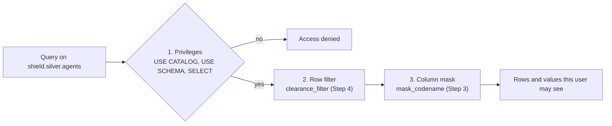

# 11 · Governance vs Hydra

**Notebook:** [11_governance_vs_hydra.ipynb](../notebooks/databricks/11_governance_vs_hydra.ipynb)

> 💡 **TL;DR:** In Unity Catalog, several independent layers decide what a person sees. **Privileges** (`GRANT`) decide whether they may query a table at all. Inside the table, a **column mask** changes the values they see and a **row filter** hides rows. **Tags** describe the data, and **lineage** records where it flows. Masks and filters belong to the table, so every tool obeys them, but they only restrict: they never grant access. Nothing here has run in a real workspace yet.

---

## The big picture



Tags (Step 5) and lineage (Step 6) do not change what a query returns. They make the data findable and traceable.

| Tool | Question it answers | Mechanism | Notebook |
|---|---|---|---|
| Privilege | may this group touch it? | `GRANT USE CATALOG / USE SCHEMA / SELECT` to an account-level group | Step 1 |
| Column mask | what does this person see in the column? | a SQL function bound to the column (`SET MASK`) | Step 3 |
| Row filter | which rows does this person see? | a SQL function bound to the table (`SET ROW FILTER`) | Step 4 |
| Tag | what kind of data is it? | key-value labels (`classification = secret`) | Step 5 |
| Lineage | where did it come from, who used it? | recorded automatically, queryable from system tables | Step 6 |

---

## Concepts

### 1 · The access control layers

The idea: no single switch protects data. Learn describes complementary models: privileges and ownership (who can access what), attribute-based policies (ABAC), table-level filtering and masking (what data a user sees inside a table), and workspace-level restrictions (where data can be reached from, called workspace bindings). They are designed to be used together. Masks and filters add restrictions on top of privileges; neither grants access on its own.

**How this repo implements it:** the notebook uses privileges (Step 1, shown but not run), a table-level mask and row filter (Steps 3 and 4), tags (Step 5) and lineage (Step 6). It does not use ABAC or workspace bindings.

| Layer | Strength | Limit |
|---|---|---|
| Privileges | simple, inherited, audited | all-or-nothing per table |
| Table-level mask / filter | per-table logic, in the table so every tool obeys | each table is configured by hand; the table owner can change or remove them |
| ABAC policies (preview) | one tag-driven policy for a catalog or schema; owners of single tables cannot bypass it | needs governed tags and a recent runtime; preview, see concept 5 |
| Workspace binding | limits where a catalog can be used | a different question from "which rows" |

**Common mistakes:** thinking a mask protects you without a `SELECT` grant model behind it, and treating tags as security (see concept 6).

### 2 · Privileges, the securable hierarchy and least privilege by layer

The idea: Unity Catalog objects form a hierarchy, `metastore → catalog → schema → table / view / volume / function`. A **privilege** is granted on an object to a principal (user, service principal or group). Privileges granted on a container (catalog, schema) are **inherited** by all current and future children. To read a table you need three things:

```
 metastore ─▶ catalog shield ─▶ schema gold ─▶ table daily_threat_briefing
              USE CATALOG       USE SCHEMA      SELECT
              (all three are needed; SELECT or USE SCHEMA alone is not enough)
```

`USE CATALOG` and `USE SCHEMA` do not give data access by themselves. They are the door; `SELECT` is the key. Inheritance is convenient and broad: `SELECT` on a schema means every table in it, today and later, so review what a schema contains before granting.

**How this repo implements it:** least privilege by layer, using the medallion schemas from chapter 05.

| Group | `shield.bronze` / `shield.silver` | `shield.gold` | Writes |
|---|---|---|---|
| engineers | read | read | through pipelines and jobs |
| analysts | nothing | read | none |
| pipelines (service principals) | write | write | the jobs of chapter 10 |

Step 1 runs `SHOW GRANTS ON SCHEMA shield.gold` and checks that you can list at least one gold table. It grants nothing, because the notebook cannot know your group names. On a fresh catalog the grant list may be empty, because ownership is not a grant. The statements to try are in "Grants to try" below.

**Groups, not people.** Grant to account-level groups so onboarding and offboarding is one membership change, and so `is_account_group_member()` can see the group (concept 3).

**Why it helps:** the grant model is small, easy to audit and enforced for every tool that reads through Unity Catalog.

**Trade-offs and common mistakes**

* Grants on a catalog are very broad. Prefer schema level, and keep the layers apart (analysts get gold only).
* Granting to individual users works until someone leaves.
* `BROWSE` on a catalog lets users discover metadata without reading data (Learn). It is a way to let people find a table and ask for access. Not used here.
* Only owners or users with `MANAGE` can grant. If a table owner grants `SELECT` but the schema owner never granted `USE SCHEMA`, the user still cannot read: the schema owner keeps control.

**Not covered yet:** a real set of groups and grants in this repo, ownership transfer, service principals, fine-grained DML privileges, `BROWSE`, workspace bindings.

### 3 · Column masks

The idea: a **column mask** is a SQL function bound to a column. When the column is read, the function receives the stored value and returns what to show, so the answer can depend on who asks. It is part of the table definition, so it holds in SQL, notebooks and BI alike.

```
 stored value        mask function                  what the reader sees
 "Nomad-13"   ──▶   is_account_group_member('fury')?  ──yes──▶ "Nomad-13"
                                                      ──no───▶ "*** CLASSIFIED ***"
```

**How this repo implements it (Step 3)**

* `shield.gold.mask_codename(codename STRING)` returns the codename if `is_account_group_member('fury')`, else `*** CLASSIFIED ***`.
* `ALTER TABLE shield.silver.agents ALTER COLUMN codename SET MASK shield.gold.mask_codename`.
* Check: if you are not in `fury`, all agents (50, or 51 after chapter 04's MERGE) show `*** CLASSIFIED ***`; if you are, none does. The notebook measures `is_account_group_member('fury')` first and adapts its expected value, so it passes either way.
* The function lives in `shield.gold` and the table in `shield.silver`. Learn: to assign a function you need `EXECUTE` on it, `USE SCHEMA` and `USE CATALOG`; to change an existing table you must be its owner or hold `MANAGE` and `SELECT` on it.

**Why it helps:** a dashboard author cannot forget to hide the column. The rule lives with the data.

**Trade-offs, rules and common mistakes**

* The mask only restricts what is shown; the stored data is unchanged, and users still need `SELECT`.
* The mask hides the value but not the row's existence or other columns that could identify it.
* The function parameter type must match the column type. The notebook reads the type of `clearance_level` from the table for the filter. A mismatch casts silently (and with ANSI mode off, failed casts become `NULL`).
* Keep functions simple. Learn's performance advice: prefer simple `CASE` expressions to lookups, limit the number of distinct masks on large tables, use few function arguments, prefer SQL over Python UDFs, use deterministic expressions that cannot throw errors. Masks and filters make the query planner choose the secure plan over the fastest plan, so do not stack them everywhere.
* `CREATE OR REPLACE TABLE` keeps an existing mask on columns with the same name (Learn). A leftover mask from an aborted run would follow the table into later chapters.
* Drop the policy before you drop its function (concept 7).
* Whether the table owner is exempt from the policy is not verified in this repo. The check tables measure what you see instead of assuming.

**Not covered yet:** mapping tables, masks that partially reveal a value (last four characters), dynamic views, mask functions in Python.

### 4 · Row filters

The idea: a **row filter** is a SQL function bound to a table. It returns true for the rows the reader may see. Like a mask it is part of the table.

**How this repo implements it (Step 4)**

* `shield.gold.clearance_filter(clearance <type>)` returns `is_account_group_member('fury') OR clearance <= 3`. `<type>` is the column's real type, read in Step 2 (`clearance_type`).
* `ALTER TABLE shield.silver.agents SET ROW FILTER shield.gold.clearance_filter ON (clearance_level)`.
* Check for a non-member: only clearance 1 to 3 remain (29 agents), the highest clearance seen is 3. For a `fury` member all agents stay. Per level for a non-member: 9 (10 after the MERGE) at level 1, 9 at level 2, 11 (10 after the MERGE) at level 3.

**Mask or filter?**

| | Column mask | Row filter |
|---|---|---|
| Hides | a value | a whole row |
| Bound to | a column | the table, `ON` one or more columns |
| Count per table | one per column | one |
| Typical use | PII, secrets | clearance, region, tenant |

**Trade-offs and common mistakes:** only one distinct row filter can resolve for a user and table, so combine rules inside one function (Learn warns that many `AND` conjuncts cost performance). Counting rows through a filter gives a different count for different people, which confuses audits: say so in your data contract. The filter column must be one you can rely on; a wrong `clearance_level` quietly leaks or hides rows.

**Compute requirements.** Learn: reading a table with a filter or mask needs a SQL warehouse, standard access mode on Databricks Runtime 12.2 LTS or above, or dedicated access mode on Databricks Runtime 15.4 LTS or above (the latter requires a serverless-enabled workspace and may incur serverless charges). The notebook runs on serverless compute or a SQL warehouse.

**Preview status:** the Learn pages on table-level row filters and column masks did not show a preview label when this was written. Newer pieces around them (for example ABAC on views, DENY policies, metastore-level policies) are marked Beta. Check the status of anything you rely on.

**Not covered yet:** filters on several columns, mapping tables, performance measurement.

### 5 · ABAC: policies instead of per-table functions 🧪

The idea: **attribute-based access control** defines a row filter or column mask policy once, on a catalog or schema, and applies it to every table or column that carries a matching **governed tag** (for example `pii`). Tag a new column and the policy applies by itself. Table owners cannot remove or bypass a catalog-level policy. Learn recommends ABAC to centralize and scale access control, and table-level filters and masks when you need per-table logic or have not adopted ABAC.

```
 governed tag on a column:  pii = ssn
 policy on the catalog:     MASK columns tagged pii FOR everyone EXCEPT hr_admins
 ──▶ applies to every matching column in every table below the catalog
```

**Status:** ABAC went to **Public Preview** in the November 2025 release notes (account-level enforcement). Parts of it (DENY policies, policies attached at metastore level, policies on views) are marked Beta on Learn. This repo has not checked its current status or tried it. It needs governed tags (account-level tags with access control), which are not the plain tags of Step 5, and a supported runtime (serverless, or Databricks Runtime 16.4 or above).

**How this repo implements it:** it does not. The notebook uses the table-level form, so the mechanism is visible in one table. Moving to ABAC would replace `mask_codename` and `clearance_filter` with two policies and replace Step 5's plain tags with governed ones.

**Why you would switch:** with hundreds of tables, per-table `ALTER TABLE` statements are not manageable and are easy to forget. A policy follows the tag.

**Trade-offs:** tags become a security boundary (whoever can change a tag changes which policies apply, so control who may apply tags), an extra concept to learn, preview limits, and older runtimes cannot read ABAC-secured tables.

**Not covered yet:** everything about ABAC.

### 6 · Tags

The idea: a **tag** is a key-value label on a catalog, schema, table, column, volume and other objects. Tags classify data (`classification = secret`, `pii = true`) so people can find it and, with governed tags, so policies can target it.

**How this repo implements it (Step 5):** `ALTER TABLE shield.silver.agents ALTER COLUMN codename SET TAGS ('classification' = 'secret', 'pii' = 'true')`, then a read from `shield.information_schema.column_tags` that must list exactly those two tags for `silver.agents.codename`. You need the `APPLY TAG` privilege, which the owner has. The clean-up removes both tags with `UNSET TAGS`.

**Why it helps:** you can search the catalog for `pii` instead of grepping code.

**Rules and common mistakes**

* Tag data is stored as plain text and may be replicated globally (Learn). Never put sensitive values in a tag name, value or description.
* Plain tags describe; they do not protect. Only a policy (mask, filter, ABAC) or a privilege protects.
* Column tags do not inherit from the table. Tags on a catalog or schema are inherited by the objects below when ABAC evaluates them.
* Agree on a naming standard (`pii` vs `PII` vs `contains_pii`) before tagging, or search and policies miss data.

**Not covered yet:** governed tags, automatic classification, tag-based search.

### 7 · Lineage and audit

The idea: **lineage** records which tables, columns, notebooks, jobs and dashboards read or wrote which data. It answers "if `silver.locations` is wrong, what is affected?" from recorded facts, not memory. **Audit** is the record of who did what. Both are automatic once enabled; you do not write code to produce them.

**How this repo implements it (Step 6)**

* A query on `system.access.table_lineage` filtered on `target_table_full_name = 'shield.gold.daily_threat_briefing'`, selecting `source_table_full_name`. The check expects `shield.silver.incident_reports` and `shield.silver.locations` among the sources.
* Catalog Explorer shows the same as a graph: `shield` → `gold` → `daily_threat_briefing` → **Lineage** → **See lineage graph** (upstream tables, notebooks and jobs).
* The audit trail is in `system.access.audit` once the `access` schema is enabled. The notebook does not query it.

**What can go wrong**

* System schemas are off by default: a metastore admin enables them (`access`, `billing`, `lakeflow`). Without it Step 6 prints a message and moves on.
* Lineage only holds what the platform could infer; it is a subset of all read and write events. System tables are not real time, so a failed check right after a run can mean "not recorded yet".
* Lineage system tables keep a rolling 395-day window by default (Learn). Catalog Explorer keeps lineage captured after 1 September 2024 indefinitely.
* The expected result is **not verified** in a workspace.

**Not covered yet:** column lineage (`system.access.column_lineage`), audit queries, the lineage API.

---

## What the notebook does

Same step numbers and expectations as the [notebook](../notebooks/databricks/11_governance_vs_hydra.ipynb). It needs chapter 04 (`shield.silver.agents`: 50 agents, 51 after its MERGE) and, for Step 6, `shield.gold.daily_threat_briefing` (chapter 06 or 10). The check tables adapt to whether you are in the group `fury` (`is_account_group_member('fury')`), so they pass for members and non-members alike.

| Step | Goal | Expected |
|---|---|---|
| 1 | What is granted on `shield.gold`? | `SHOW GRANTS` lists whatever exists (maybe empty); you can list at least one gold table. Nothing is granted |
| 2 | Baseline of `shield.silver.agents` without policies | 50 or 51 agents; 29 with clearance 1 to 3; 21 or 22 with clearance 4 or 5 |
| 3 | Column mask on `codename` | non-member: all agents show `*** CLASSIFIED ***`; `fury` member: none |
| 4 | Row filter on clearance | non-member: 29 agents, highest clearance 3; `fury` member: all agents |
| 5 | Tags on `codename` | `shield.information_schema.column_tags` lists `classification = secret` and `pii = true` |
| 6 | Lineage of `shield.gold.daily_threat_briefing` (not verified) | sources include `shield.silver.incident_reports` and `shield.silver.locations` |

The clean-up removes the filter, the mask, both functions and the tags, in that order, and checks that the table is back to the baseline: all agents visible, none masked, no tags left.

## Grants to try (not run by the notebook)
```sql
GRANT USE CATALOG ON CATALOG shield TO `analysts`;
GRANT USE SCHEMA, SELECT ON SCHEMA shield.gold TO `analysts`;
-- analysts get gold only; engineers keep bronze/silver
-- to undo:
REVOKE USE SCHEMA, SELECT ON SCHEMA shield.gold FROM `analysts`;
REVOKE USE CATALOG ON CATALOG shield FROM `analysts`;
```
Replace `analysts` with a real account-level group.

## Gotchas
* `is_account_group_member()` needs account-level groups (account console), not workspace-local ones. Until the group `fury` exists the policies still run: everybody is simply "not Fury".
* Test masks and filters as a user who is *not* in the privileged group. This repo has not verified whether the table owner is exempt from the policies; the notebook measures instead of assuming.
* Drop the policy before you drop its function (`ALTER TABLE ... DROP ROW FILTER`, then `DROP FUNCTION`), otherwise the table becomes unreadable.
* `CREATE OR REPLACE TABLE` keeps an existing row filter and masks on columns with the same name. Leftover policies from an aborted run would follow the table into later chapters.
* The function parameter type must match the column type; otherwise values are cast, and with ANSI mode off failed casts become `NULL`.
* Reading a table with a filter or mask needs a SQL warehouse, standard access mode, or dedicated compute on Databricks Runtime 15.4 LTS or above.
* System schemas are off by default: a metastore admin enables them (`access`, `billing`, `lakeflow`). System lineage can lag behind and only holds lineage the platform could infer.
* Masks and filters add cost to queries; don't stack them everywhere.
* Tags are plain text. Don't put secrets in them.

## Not covered yet
* ABAC and governed tags 🧪, dynamic views, mapping tables, workspace bindings.
* Real groups and grants in the repo (only the statements above), service principals.
* The audit system table `system.access.audit` and column lineage.
* A verified run: nothing here has run in a workspace.

## Try it yourself
1. Create the `fury` group, add yourself, and re-run the notebook. Which values in the check tables change?
2. Write a policy for a table you own at work: which columns are PII, who may see them? Express one as a mask function and one as a row filter.
3. Answer from lineage: if `silver.locations` is wrong, which gold tables are affected? Bonus: write a one-page data access policy for S.H.I.E.L.D. (roles → privileges → layers).
