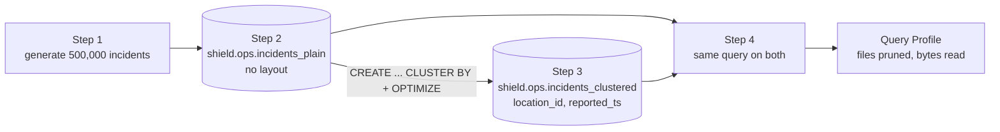

# 12 · Hawkeye's precision

**Notebook:** [12_hawkeyes_precision.ipynb](../notebooks/databricks/12_hawkeyes_precision.ipynb) · **Generator:** [src/shield_data/generate.py](../src/shield_data/generate.py)

> 💡 **TL;DR:** A query is cheap when it reads few files. Delta keeps the min and max of each column per file, so a filter can **skip** files that cannot match, but only if similar rows sit together. **Liquid clustering** (`CLUSTER BY`) plus `OPTIMIZE` arranges rows by the columns you filter on. You judge the effect in the Query Profile (files pruned, bytes read), not with a stopwatch. At 500,000 rows the effect can be small or invisible: that is a real lesson, not a failure. Nothing here has run in a real workspace yet.

---

## The big picture



Step 5 (a broadcast join) is a separate check on `incidents_plain`.

---

## Concepts

### 1 · Data skipping

The idea: when Delta writes a file it records statistics for it: the minimum, maximum and null count of each column, and the number of records. At query time the engine compares your `WHERE` clause with those ranges and does not open files that cannot contain a match.

```
 unorganised table: every file holds every location and every month
   file 1 [L001..L010, Jan..Dec]   file 2 [L001..L010, Jan..Dec]   file 3 [L001..L010, Jan..Dec]
   WHERE location_id = 'L003' AND March  ->  all three files might match: read all of them

 clustered by (location_id, reported_ts)
   file 1 [L001..L003, Jan..Jun]   file 2 [L003..L006, Jan..Dec]   file 3 [L007..L010, ...]
   same query  ->  files whose range cannot match are skipped
```

**How this repo implements it:** Step 4 runs `COUNT(*)` and `SUM(casualties)` for `location_id = 'L003'` and `reported_ts` in March 2025 on both tables. Delta collects the statistics on its own when the tables are written; the notebook sets no statistics options.

**Why it helps:** fewer files read means fewer bytes, less compute, lower cost. It costs nothing at query time.

**Rules and common mistakes** (Learn: [data skipping](https://learn.microsoft.com/azure/databricks/tables/data-skipping))

* By default statistics are collected for the **first 32 columns** of the table. A filter column beyond that gets no skipping. Put the columns you filter by early in the schema, or set `delta.dataSkippingStatsColumns` (a column list, DBR 13.3 LTS and above) or `delta.dataSkippingNumIndexedCols`. Changing these does not recompute statistics for old data; `ANALYZE TABLE ... COMPUTE DELTA STATISTICS` does that on DBR 14.3 LTS and above. For managed tables, predictive optimization can add statistics on frequently filtered columns beyond the first 32.
* Long strings are truncated in statistics and expensive to collect; keep them out of the statistics columns when you do not filter on them.
* Skipping only helps when ranges are narrow. A column whose values are spread over every file (the `unorganised` picture) prunes nothing, which is the next concept.
* Min/max works well for numbers, dates and strings. Filtering on a function of a column (`WHERE upper(city) = ...`) hides the column from the comparison.

**Not covered yet:** looking at the statistics themselves, the statistics column settings, dynamic file pruning in joins.

### 2 · File layout and file size

The idea: a table is a set of Parquet files. Two things decide how well it performs: **how big** the files are and **which rows** are in which file. Too many small files means slow listing and opening and many tasks that do little. Files that mix everything defeat data skipping.

**How this repo implements it**

* Step 1 writes the generated data as 50 JSON files (about 120 MB in total) in `/Volumes/shield/landing/staging/big/incident_reports`. `generate(BIG, incidents=500_000, pings=1000, seed=7, dirty=0.0, batches=50)` is idempotent: if the folder exists, it is reused (delete it to regenerate). The last 20 % of the rows carry the extra field `source_channel` (the schema drift of chapter 03).
* Step 2 writes the data as it came into `shield.ops.incidents_plain`. Step 3 reports `numFiles` and `sizeInBytes` of both tables from `DESCRIBE DETAIL`. They are shown, not asserted: no single value is right.
* Both tables are Unity Catalog **managed** tables. For those, Learn says Databricks tunes file sizes automatically and manual tuning advice does not apply. With default settings the autotuned target is 256 MB for tables under 2.56 TB, growing to 1 GB at 10 TB and above. A fixed size is possible with the `delta.targetFileSize` table property, which then turns autotuning off.

**The honest warning.** 500,000 rows are about 120 MB of JSON and probably only tens of megabytes as Parquet. Both tables will end up with a handful of files, maybe one. With one file there is nothing to skip, and you will see no pruning. Scale up to see the effect (Try it 3).

| Problem | Symptom | Fix |
|---|---|---|
| Many small files (streaming or frequent small appends) | slow scans, huge file listings | `OPTIMIZE` compacts; auto compaction and optimized writes help; predictive optimization automates it |
| Few huge files | too little parallelism, poor skipping | set a smaller target size or cluster |
| Files that mix all key ranges | no pruning | clustering on the filter columns |

**Not covered yet:** `delta.targetFileSize`, auto compaction and optimized writes in detail, `VACUUM` (chapter 04), what a Parquet row group is.

### 3 · OPTIMIZE

The idea: `OPTIMIZE` rewrites a table's files. With no clustering it does **bin-packing**: it combines small files into larger ones. On a table with liquid clustering it also reorganizes the data by the clustering keys. It changes layout, never content: a read before and after returns the same result. Bin-packing is idempotent: a second run on the same data does nothing. Readers keep a consistent snapshot while it runs.

**How this repo implements it:** Step 3 runs `OPTIMIZE shield.ops.incidents_clustered` right after creating the table. That statement is what clusters the data, which is why the notebook says "`OPTIMIZE` is what clusters the data". Re-running the cell recreates the table. The `OPTIMIZE` run is visible on the table's **History** tab.

**Rules and common mistakes**

* The old files stay in storage until `VACUUM` removes them after the retention period, so the folder gets bigger right after `OPTIMIZE` while the table's logical size shrinks.
* It is not free: it uses compute. For tables above about 1 TB Learn recommends scheduling it; on managed tables predictive optimization runs it for you (concept 5).
* Updated rows are not re-clustered automatically; `OPTIMIZE` does that.
* `ZORDER BY` is the older way to co-locate data. It cannot be combined with liquid clustering.

### 4 · Liquid clustering

The idea: **liquid clustering** is a Delta table setting that replaces hand-tuned partitioning and `ZORDER`. You name the columns you filter by with `CLUSTER BY (...)`. `OPTIMIZE` then groups rows with similar key values into the same files, which gives data skipping narrow ranges to work with. Rows are not sorted into folders, so there is no partition explosion.

**How this repo implements it (Step 3)**

```sql
CREATE OR REPLACE TABLE shield.ops.incidents_clustered CLUSTER BY (location_id, reported_ts)
AS SELECT * FROM shield.ops.incidents_plain;
OPTIMIZE shield.ops.incidents_clustered;
```

The check expects the same 500,000 rows and `clusteringColumns = [location_id, reported_ts]` in `DESCRIBE DETAIL`. The key choice follows the Step 4 query: a location and a time range. The number of files is likely a handful, probably not more than the plain table's (not verified).

**What Learn says about keys and changes**

| Topic | Rule |
|---|---|
| Choosing keys | the columns most often used in filters; up to four keys; more keys can hurt single-column filters on tables under about 10 TB |
| Statistics | key columns need statistics (first 32 columns by default) |
| Types | date, timestamp, string, numbers, and fields inside structs; not arrays, maps or whole structs |
| Changing keys | `ALTER TABLE ... CLUSTER BY (new_cols)`: later `OPTIMIZE` and writes use the new keys, **existing data is not rewritten** |
| Rewriting old data | `OPTIMIZE table FULL` (DBR 16.0 and above) reclusters everything; on a big table this can take hours |
| Turning it off | `ALTER TABLE ... CLUSTER BY NONE` |
| Automatic keys | `CLUSTER BY AUTO` lets predictive optimization choose keys (managed tables); not used here |
| Combining | not with `ZORDER`; partitioning and clustering do not mix on one table |
| Compatibility | clustered tables use a newer Delta protocol (writer 7, reader 3); older clients cannot read them and you cannot downgrade |

**Why it helps:** one setting replaces the partition-or-Z-order decision, keys can change as the questions change, and it suits high-cardinality filters, skewed data and tables that grow fast.

**Trade-offs and common mistakes**

* Clustering helps queries that filter on the keys; it does nothing for others. Try it 1 shows this.
* Too many keys, or keys no query uses, only cost write and optimize time.
* Forgetting `OPTIMIZE`: `CREATE ... CLUSTER BY` alone does not lay out the existing rows.
* Changing keys without a plan to recluster the old data (Try it 2).

**Preview status:** the Learn pages on liquid clustering that I read did not show a preview label for the core feature (`CLUSTER BY` with keys). Some neighbours are version-specific (hierarchical clustering needs DBR 17.1 and above; converting a partitioned table with `REPLACE PARTITIONED BY WITH CLUSTER BY` needs DBR 18.1 and above). Check the runtime you use.

**Not covered yet:** `CLUSTER BY AUTO`, hierarchical clustering, choosing keys for a real workload, converting partitioned tables.

### 5 · Predictive optimization

The idea: for Unity Catalog managed tables Databricks can run `OPTIMIZE`, `VACUUM` and `ANALYZE` for you, picking the tables that benefit and collecting statistics on write. It runs on serverless compute and is billed to your account as a serverless jobs SKU.

**How this repo handles it:** not run by the notebook; it is listed as an "other habit". It matters here because it may already be running `OPTIMIZE` on your tables in the background, which makes before/after comparisons less clean.

**Status:** Learn says it is on by default for accounts created on or after 11 November 2024, and is being enabled for existing accounts gradually, expected to finish by August 2026. Check, do not assume: the Learn page "Predictive optimization for Unity Catalog managed tables" explains how to verify it. You can set `ENABLE`, `DISABLE` or `INHERIT` per catalog, schema or table with `ALTER ... PREDICTIVE OPTIMIZATION`. Requirements: Premium plan, a supported region, SQL warehouses or DBR 12.2 LTS and above, managed tables only. One Learn page labels its `ANALYZE` part as Public Preview; this repo has not checked which parts are preview today 🧪.

**Trade-offs:** it saves a maintenance job and the knowledge to schedule it, but you lose direct control of when compute runs, and the compute costs money. Its `OPTIMIZE` does not run `ZORDER`.

**Not covered yet:** reading its history in system tables, turning it on or off.

### 6 · Partitioning

The idea: partitioning splits a table into folders by the value of a column. The engine skips whole folders. It is static: the layout is fixed by the column you chose.

**How this repo handles it:** it does not partition. Learn says to avoid partitioning tables below 1 TB, to partition only by a column where each partition holds at least 1 GB, and to use liquid clustering for new Delta tables.

| | Partitioning | Liquid clustering |
|---|---|---|
| Good for | very large tables with a low-cardinality column every query filters on (a date) | most new tables; high-cardinality filters; changing access patterns |
| Change later | rewrite the table | `ALTER TABLE ... CLUSTER BY` |
| Risk | too many small files (over-partitioning) | needs `OPTIMIZE`; key choice still matters |

### 7 · Joins

The idea: a join needs matching keys in one place. A **shuffle** (sort-merge) join moves both sides across the network, which is slow. A **broadcast join** sends the small table to every worker so the big table never moves.

**How this repo implements it (Step 5):** `incidents_plain` joined with `F.broadcast(shield.silver.locations)` (10 locations) on `location_id`. The check expects 500,000 rows (every incident has a known location) and that the plan text from `EXPLAIN` contains the word "Broadcast". On Photon the node may be called `PhotonBroadcastHashJoin`. Plan text and node names are not verified.

**Rules and common mistakes**

* Broadcast only small tables. Learn: adaptive query execution (AQE, on by default) can switch a sort-merge join to a broadcast join at runtime if one side is under a threshold (30 MB by default), but a broadcast planned up front is usually better, so a hint is still useful when you know your data.
* AQE also splits skewed partitions in sort-merge and shuffle-hash joins automatically; it never optimizes skew in broadcast joins.
* Filter before you join, and join on the same data type (a string against an integer key causes casts and bad plans).
* Collect statistics so the cost-based optimizer can choose join order; AQE does not reorder joins.
* Skew (one key holding most rows) shows up as a few slow tasks. Try AQE first, then salting.

**Not covered yet:** skew handling in practice, range joins, hints other than broadcast.

### 8 · Measure, then change one thing

The idea: durations in a notebook are noisy (caches, cluster state, other users). Compare **results** first, then **work done** (files read and pruned, bytes read, spill, the slowest operator) in the **Query Profile**.

**Method (always the same)**
1. Reproduce the slow query.
2. Open its profile.
3. Find the biggest cost (scan, shuffle, skew, spill).
4. Change one thing.
5. Compare the profile.

**How this repo implements it (Step 4)**

| Item | Value |
|---|---|
| Query | `COUNT(*)` and `SUM(casualties)` for `location_id = 'L003'` and `reported_ts` from 2025-03-01 up to (not including) 2025-04-01 |
| Asserted | both tables return `n = 4,184` and `casualties = 2,515` |
| Shown only | seconds. Each query runs twice and the second timing is shown, so warm-up does not favour the table that goes second |
| Look at | query history → the query → **See query profile**: files read, files pruned, bytes read |

The counts assume a UTC session time zone (the serverless default); another zone moves the month boundaries. Learn notes the Spark UI is not available on serverless compute and points to the query profile instead.

**Common mistakes:** timing a single run, comparing a cold run with a warm one, changing three things at once, optimizing a query that runs once a month.

### 9 · Cost

Cost is DBUs times time, plus storage. Query-level levers:

* Read less: select only the columns you need, filter early, cluster on the filter keys, avoid `collect()` and `toPandas()` on big tables.
* Keep joins cheap (concept 7) and avoid re-running full refreshes (chapters 05 and 08).
* Use serverless or right-sized job compute, and stop interactive compute when idle (auto termination).
* Let maintenance run once on a schedule or through predictive optimization, not by hand each day.
* Tag compute and watch `system.billing.usage` to see where DBUs go (Learn's cost optimization advice).

This chapter does not price anything. It shows how to see whether a layout reads less data; what that is worth in money depends on your compute and your table sizes.

---

## What the notebook does

Same step numbers and expectations as the [notebook](../notebooks/databricks/12_hawkeyes_precision.ipynb). The counts come from the generator with `seed=7` and no defects and assume a UTC session time zone. Durations, file counts and sizes cannot be predicted and are never asserted.

| Step | Goal | Expected |
|---|---|---|
| 1 | Generate 500,000 incidents | 50 files, 500,000 rows, 500,000 distinct `incident_id`s; location `L003` is the largest with 50,539 rows |
| 2 | Baseline: `shield.ops.incidents_plain` | 500,000 rows; file count and size shown, not checked |
| 3 | Liquid clustering: `shield.ops.incidents_clustered` | 500,000 rows; `clusteringColumns = [location_id, reported_ts]`; file count shown, likely a handful |
| 4 | Same query on both | both return 4,184 incidents and 2,515 casualties for `L003` in March 2025; times shown, not checked |
| 5 | Broadcast join with `shield.silver.locations` | 500,000 joined rows; the plan contains "Broadcast" |

Needs chapter 01 (schema `shield.ops`, the `landing` volumes) and, for Step 5, `shield.silver.locations` from chapter 05 or 06. The clean-up drops both tables, the temp view and the generated JSON files (about 120 MB); `shield.ops` stays. No later chapter uses these tables.

## Gotchas
* 500k rows is still small (about 120 MB of JSON). Both tables end up with only a few files, maybe one, and then there is nothing to skip. Look at *files pruned* and *bytes read*, not wall-clock seconds, and scale up to see the effect (Try it 3).
* Clustering helps queries that filter on the keys; it does nothing for others.
* `CREATE ... CLUSTER BY` does not cluster by itself; `OPTIMIZE` does.
* The expected counts in the notebook change if you change `INCIDENTS` or the seed: that gives a failed check, not a bug.
* Predictive optimization may already be running `OPTIMIZE` in the background, so layouts can change between your runs.
* Drop the demo tables afterwards (the notebook's clean-up does).

## Not covered yet
* `CLUSTER BY AUTO`, hierarchical clustering, key selection for a real workload, converting partitioned tables.
* Statistics settings, `delta.targetFileSize`, auto compaction and optimized writes.
* Skew handling, range joins, reading the Query Profile in depth, cost measurement with system tables.
* A verified run: no number, file count or plan text here has been checked in a workspace.

## Try it yourself
1. Query by `incident_type` only. Is the clustered table still faster? Why or why not?
2. `ALTER TABLE shield.ops.incidents_clustered CLUSTER BY (incident_type)` and re-`OPTIMIZE`. What is the cost of changing keys, and is the old data reclustered? (Hint: compare with `OPTIMIZE ... FULL`.)
3. Set `INCIDENTS = 5_000_000` in Step 1 (the clean-up deleted the old files, so it regenerates) and compare the Query Profiles again. Bonus: write the three questions you would ask when someone says "the dashboard is slow".
