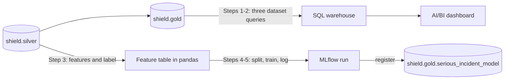
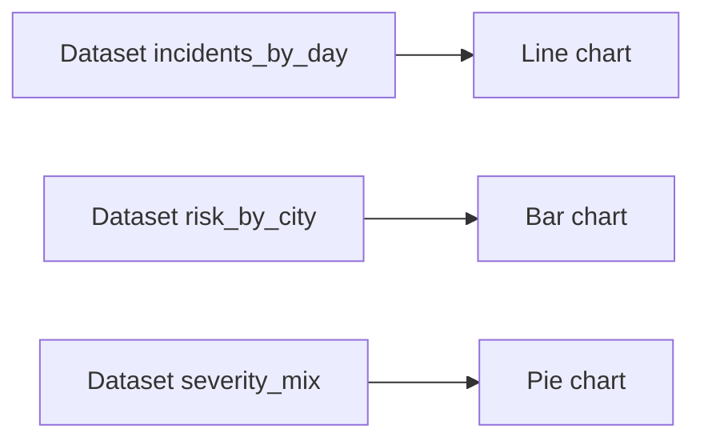
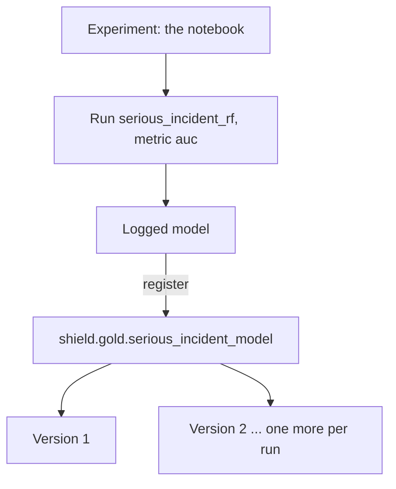

# 13 · The Avengers Initiative

**Notebook:** [13_avengers_initiative.ipynb](../notebooks/databricks/13_avengers_initiative.ipynb)

> 💡 **TL;DR:** Gold tables only matter when someone reads them. This chapter gives gold two consumers: an AI/BI **dashboard** on a SQL warehouse, and a scikit-learn **model** tracked with MLflow and registered in Unity Catalog as `shield.gold.serious_incident_model`. The data is random, so the model scores AUC ≈ 0.5. That is the lesson: the plumbing is what you learn, and a pipeline that reports "no signal" honestly is a good pipeline.
>
> Status: drafted. Nothing here has run in a real workspace yet. The notebook's **Expected** values are expectations, and the dashboard step (UI) is unverified.

---

## The big picture

---

## Concepts

### 1 · The serving layer

The idea: a gold table is only worth what people and systems get out of it. The *serving layer* is every way gold is read: a dashboard, a BI tool over JDBC/ODBC, an API, a notebook, a model. It is a role, not a Databricks feature. The data engineer's job there is a **stable, documented gold table**, not the chart.

| Consumer | Reads | Through | Built in |
|---|---|---|---|
| Field team dashboard | `gold.daily_threat_briefing`, `gold.location_risk` | a SQL warehouse | Steps 1 and 2 |
| Threat-ranking model | `silver.incident_reports` | a notebook, then MLflow | Steps 3 to 5 |

How this repo implements it:

* **Dashboard:** three SQL queries become the *datasets* of an AI/BI dashboard. Step 1 runs them in the notebook first. Step 2 is the click-through in the UI, with no code.
* **Model:** a random forest predicts `serious` (severity `high` or `critical`) from location, incident type, hour and weekday. The label comes from silver, not gold, because gold has already lost the individual rows.

Why it helps: the same gold tables feed every consumer, so a fix in silver reaches the dashboard and the next training run.

What goes wrong: dashboards query live tables, so a gold table that changes shape (a renamed column, a dropped one) breaks every chart on it. Treat gold column names like an API. When you must change them, add the new column first, move the consumers, then drop the old one.

Alternatives: BI tools such as Power BI over a SQL warehouse, a REST API in front of a serving table, or Delta Sharing for consumers outside the workspace. None is built here.

Not covered yet: scheduled dashboard refresh, scoring jobs, a serving endpoint and Genie (see Not covered yet).

**Feature status** (checked against Microsoft Learn, not by running it):

| Feature | Status |
|---|---|
| AI/BI dashboards | Generally available. The older "legacy" dashboards have reached end of life |
| Genie (spaces, now called Genie Agents) | Generally available, but the workspace must allow partner-powered AI features. Companion Genie spaces for dashboards are labelled Public Preview on one page and not on another: 🧪 treat as preview |
| Custom Model Serving, CPU | Region-dependent. Listed for `swedencentral`, not for every region. GA or preview for your account: not verified, check before promising it |
| MLflow 3 (`name=` in `log_model`) | Documented for Databricks. Older MLflow uses `artifact_path=` |

### 2 · SQL warehouses and AI/BI dashboards

The idea: a **SQL warehouse** is compute tuned for SQL and BI queries. **Serverless** warehouses start in seconds and stop when idle, but they bill while they run, including while a dashboard refreshes. An **AI/BI dashboard** is a set of *datasets* (SQL queries) plus a canvas of charts built on them.

How this repo implements it (Step 1):

| Dataset | Query reads | Chart it feeds |
|---|---|---|
| `incidents_by_day` | `gold.daily_threat_briefing` | incidents per day (line) |
| `risk_by_city` | `gold.location_risk` | serious incidents per city (bar) |
| `severity_mix` | `gold.daily_threat_briefing` | share per severity (pie) |

* The queries select **only the columns the charts need**. Viewers of a dashboard can reach everything a dataset returns, even columns no chart shows.
* The notebook checks each query before you paste it into the UI, so a broken chart is never a broken query.
* Step 2 is the UI: **New → Dashboard**, **Data** tab, **Add SQL dataset** once per query (older UI text: *Create from SQL*), three charts on the canvas, **Publish**, and choose the warehouse. A *draft* dashboard can only be shared with people inside the workspace.

Why it helps: one query per question keeps datasets small and cacheable, and the same SQL works in a notebook, a dashboard and a test.

Trade-offs and common mistakes:

* A dataset with `SELECT *` leaks columns. Select what you chart.
* Aggregate in the dataset query, not in the chart, so the warehouse does the work and the browser gets few rows.
* Publish settings decide whose permissions run the queries: the publisher's (shared data permissions) or each viewer's. Check which one you chose before you share a dashboard on a table with restricted columns.
* A warehouse left running costs money long after the demo. Set an auto-stop.

Not covered yet: dashboard parameters, filters, and a dashboard task in a job (mini-project 2).

### 3 · Features and a label

The idea: a model learns from numeric **features** (the inputs) to predict a **label** (what we want to know). Categories become 0/1 columns by *one-hot encoding*: one column per value. The label must not leak into the features: only things known when the report arrives are features.

How this repo implements it (Step 3), from `shield.silver.incident_reports`:

| Column | Role | How it becomes numeric |
|---|---|---|
| `location_id` (10 values) | feature | one-hot encoding: 10 columns |
| `incident_type` (6 values) | feature | one-hot encoding: 6 columns |
| `hour`, `dow` (day of week) | features | already numbers (from `reported_ts`) |
| `serious` | label | 1 when `severity` is `high` or `critical`, otherwise 0 |

* 18 feature columns = 2 + 10 + 6. 9,500 rows, of which 1,863 are serious (about 20 %).
* `toPandas()` pulls the whole table to the driver. That is fine for 9,500 rows and would not be for 500 million. At scale you would train with Spark ML or on a sample.

Why it helps: the features pipeline is data engineering. It is reproducible, testable SQL on a governed table, not a spreadsheet someone exported.

Common mistakes: using `severity` itself (or anything derived from it, such as a gold column that already counts serious incidents) as a feature; one-hot encoding with a different set of values at training and at scoring time; and training on a table that another job is rewriting while you read it. Use a versioned snapshot (time travel, chapter 07) and log the version.

Not covered yet: a feature table in Unity Catalog, feature scaling, and point-in-time correctness (mini-project 3).

### 4 · Train/test split and AUC

The idea: keep rows the model never sees while training, so the score measures prediction and not memory. **AUC** is the chance that a randomly chosen serious incident gets a higher score than a randomly chosen ordinary one. 1.0 is perfect, **0.5 is a coin flip**.

How this repo implements it:

* Step 4: `train_test_split(test_size=0.2, random_state=42)` gives 7,600 training rows and 1,900 test rows. The split is by position in the table. Spark does not promise a row order, so the *rows* in each part can differ between runs even though the sizes do not.
* Step 5: `RandomForestClassifier(n_estimators=100, max_depth=6, random_state=42)`, scored with `roc_auc_score` on the test set.
* The generator draws every column independently, so there is nothing to learn. AUC lands near 0.5. A stand-in run gave 0.49 to 0.51; the notebook accepts 0.45 to 0.55.

Why it helps: an AUC of 0.5 on random data proves the pipeline does not invent signal. If it showed 0.9, you would look for leakage first.

Trade-offs: a random split is wrong for time-ordered data (use a cut-off date), and with 20 % serious incidents plain accuracy is misleading (always answering "not serious" scores 80 %), which is why AUC is used.

Not covered yet: cross-validation, class weights, other metrics (precision, recall), and tuning.

### 5 · Models in Unity Catalog

The idea: *MLflow tracking* records what a training run did (parameters, metrics, the model file). The *Unity Catalog model registry* keeps the models you decide to keep, as governed objects with versions, like tables. Both are features of Databricks and MLflow. Which models are worth registering is your team's rule.

How this repo implements it:

* `mlflow.set_registry_uri("databricks-uc")` (Setup) sends registrations to Unity Catalog instead of the legacy workspace registry.
* Step 5 starts one run named `serious_incident_rf`, logs the metric `auc`, and calls `mlflow.sklearn.log_model(..., registered_model_name=MODEL_NAME)`.
* The name has three levels, `catalog.schema.model`, so the model lives in `shield.gold` and follows that schema's grants (chapter 11). You need `CREATE MODEL` and `USE SCHEMA` there.
* `input_example` lets MLflow infer the model **signature** (input columns and types). Unity Catalog refuses model versions without one.
* In a Databricks notebook, runs are recorded in the notebook's own experiment, so there is no experiment to create.
* **Every run registers a new model version.** The check only asks for at least one.

Why it helps: you can reproduce and compare runs, and later scoring jobs or endpoints refer to `shield.gold.serious_incident_model` and a version, not to a pickle file somebody emailed.

Alternatives and next steps (not built here):

* **Aliases** are mutable names for a version (such as `Champion`). Batch jobs load `models:/shield.gold.serious_incident_model@Champion`, so promoting a new version needs no code change.
* **Model Serving** puts a registered model behind a REST endpoint. It is region-dependent and bills while up (see the status table above).
* **Promotion across environments:** Databricks recommends retraining in each environment from code; copying a version between catalogs is the fallback when retraining is too costly.

Common mistakes: registering on every experiment run (versions pile up; register only runs you would keep), forgetting `set_registry_uri` (the model lands in the legacy registry), and a two-level name (registration fails).

### 6 · Data engineers and ML

You do not need to be a data scientist. You own the *features pipeline*: reproducible, tested, versioned data that models train and score on, plus the plumbing that registers, schedules and monitors the model. Chapter 14 checks that gold is healthy; it does not check the model.

---

## What the notebook does

Same step numbers and expectations as the [notebook](../notebooks/databricks/13_avengers_initiative.ipynb). The numbers assume the chapter 02 dataset (10,000 incidents, seed 42, 5 % dirty) after chapter 06.

| Step | Goal | Expected |
|---|---|---|
| 1 | Check the three dataset queries | 365 days, incidents add up to 9,500, 10 cities with Budapest on top (214 serious incidents), 4 severities |
| 2 | Build the dashboard in the UI | each dataset shows the Step 1 rows; the published dashboard renders three charts (unverified, UI) |
| 3 | Features and label from silver | 9,500 rows, 18 feature columns, 1,863 serious incidents |
| 4 | Hold out a test set | 7,600 training rows, 1,900 test rows |
| 5 | Train, log and register | AUC between 0.45 and 0.55; at least one version of `shield.gold.serious_incident_model` |

If you only ran chapter 05, silver still holds 500 defective incidents and the numbers differ (❌ in the notebook, not a bug).

## Cost and clean-up

A running SQL warehouse, a registered model and MLflow runs all stay behind. The notebook's 🧹 Clean up cell deletes the model (all versions) when you set `CLEAN_UP = True`; deleting a model cannot be undone. Stop the warehouse, trash the dashboard and delete the runs yourself. Chapter 14 does not need anything from this chapter except the silver and gold tables.

## Gotchas
* Dashboards query live tables: gold must be stable and documented. A renamed column breaks the charts.
* Never train on a table that is mutated while you read it; use a versioned snapshot (time travel) and log the version.
* Every run of the training cell registers a **new model version**.
* Model serving endpoints are region-dependent and bill while they are up; check availability before promising one.
* Chapter 06 must have run. After chapter 05 only, the expected numbers differ.
* Serverless notebook compute may not have `scikit-learn`, `pandas` and `mlflow`; not verified. Databricks Runtime ML has them.

## Not covered yet
* Scoring new incidents in a job and writing `shield.gold.incident_scores`.
* A serving endpoint, model aliases, and loading a version for batch scoring.
* Genie on the gold tables, and a dashboard task that refreshes the dashboard from a job.

## Try it yourself
1. Make the generator produce a real signal (e.g. more `critical` in one city at night), rebuild silver and gold, and watch the AUC rise. Which feature carries the signal?
2. Refresh the dashboard from the `shield_daily` job with a **dashboard task** after `gold`. What identity refreshes it, and what happens when `gold` fails? (Per Microsoft Learn: the task needs a serverless or pro warehouse, and for a dashboard published without shared data permissions the job's **Run as** identity refreshes it.)
3. Add a feature table with per-location incident counts and join it for training. Which leakage risks appear? Bonus: log the Delta version of the training table as an MLflow tag so you can reproduce the run.
