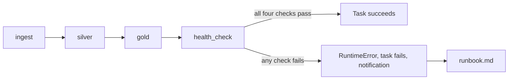

# 14 · Project Insight (capstone)

**Notebook:** [14_project_insight.ipynb](../notebooks/databricks/14_project_insight.ipynb) · **Job:** [resources/shield_job.yml](../resources/shield_job.yml) · **Runbook:** [runbook.md](runbook.md)

> 💡 **TL;DR:** The capstone is a platform you can **hand over**: it loads on a schedule, protects its consumers from bad data, tells you when it is unhealthy, and explains how to fix it. The notebook is the `health_check` task, the last task of `shield_daily`. It only reads, runs four invariant checks (reconciliation, quarantine rate, freshness, uniqueness), prints cost and job history from system tables, and raises one error naming every failed check, so a bad run turns the job red.
>
> Status: drafted. Nothing here has run in a real workspace yet. The notebook's **Expected** values are expectations.

---

## The big picture

The checklist this series ends on:

| Area | Where it lives |
|---|---|
| Infrastructure as code | `infra/`, `databricks.yml` ([deploy guide](deploy-and-automate.md)) |
| Ingestion with drift handling | chapter 03, `ingest` task, pipeline of chapter 08 |
| Quality gates and quarantine | `quality.py`, chapter 06 |
| Orchestration with retries | `shield_daily` job, chapter 10 |
| Governance | chapter 11 |
| Tests and CI | `tests/`, `ci.yml` ([deploy guide](deploy-and-automate.md)) |
| Health checks and alerts | this chapter, as the last task |
| Cost visibility | `system.billing.usage` query in Step 5 |
| Runbook | [runbook.md](runbook.md) |

---

## Concepts

### 1 · The health check: fail loudly

The idea: a *health check* is a set of invariants that must hold after every run, evaluated by code, with a failure that someone sees. A green job that quietly serves bad data is worse than a red one. It is a pattern, not a Databricks feature: you pick the invariants. Databricks also ships built-in data quality monitoring, which this repo does not cover.

| Check | The question | Passes when | Step |
|---|---|---|---|
| `reconciliation` | did any incident vanish between bronze and silver plus quarantine? | silver + quarantined incidents ≥ 99 % of the distinct bronze incidents | 1 |
| `quarantine_rate` | is a producer sending much more garbage than usual? | under 15 % of incidents are quarantined | 2 |
| `gold_freshness` | did the gold task actually write? | the latest change to `gold.daily_threat_briefing` is under 24 hours old | 3 |
| `silver_unique` | did duplicates leak into silver? | no `incident_id` appears twice | 4 |

How this repo implements it:

* One small `check(name, ok, detail)` function (Setup) records each result in a list and shows it as a one-row table. Every step is one check. The thresholds are named constants at the top of Setup: `RECONCILIATION_TOLERANCE = 0.99`, `QUARANTINE_RATE_LIMIT = 0.15`, `FRESHNESS_LIMIT_HOURS = 24`.
* The checks never raise by themselves. Step 6 collects the failed names and raises **once**: `RuntimeError: Project Insight health check failed: [...]`. One run tells you everything that is wrong, not only the first problem.
* In the job, the task is `health_check` in [shield_job.yml](../resources/shield_job.yml): it depends on `gold`, runs this notebook with **no parameters** (so no widgets), and fails when the notebook raises. The file names no compute, so the task relies on serverless compute for jobs. The schedule is deployed paused.
* The notebook creates nothing. It needs `shield.bronze.incident_reports`, `shield.silver.incident_reports`, `shield.silver.incident_reports_quarantine` and `shield.gold.daily_threat_briefing`. If one is missing, Setup stops with `Missing tables`.
* "Could not check" is different from "found a problem". Both fail the job, but a missing table means an upstream task did not do its work. The [runbook](runbook.md) tells the two apart.

Why it helps: the check runs at the end of every job, so a bad feed shows up as a red task within minutes. The check name tells you which layer broke, and the runbook maps each name to a first action.

Alternatives and trade-offs:

| Option | Gain | Cost |
|---|---|---|
| Checks in a last task (here) | simple, visible in the run, versioned with the code | runs only when the job runs |
| Expectations inside the pipeline (chapter 08) | stops bad rows at the source | judges rows, not whole-platform invariants |
| Built-in Databricks monitoring | profiles and drift metrics without code | not covered here |
| Alert on job failure only | nothing to build | silent when a job is green but wrong |

Honest limits: the thresholds are choices for this synthetic data, not rules. The checks do not look inside values and say nothing about schema drift (mini-project 3). The `health_check` task has no `max_retries` and the bundle defines no notifications; alert routing (who gets the email) is a UI step from chapter 10 that the bundle does not reproduce yet (see the [deploy guide](deploy-and-automate.md)).

### 2 · Reconciliation: nothing lost between layers

The idea: every row that entered a layer must be accounted for in the next. Counting is the cheapest way to catch a join that drops rows, a filter that is too strict, or a task that wrote half its output.

How this repo implements it (Step 1):

| Input | What is counted |
|---|---|
| `shield.bronze.incident_reports` | distinct `incident_id` (bronze keeps replayed duplicates) |
| `shield.silver.incident_reports` | rows (silver has one row per incident) |
| `shield.silver.incident_reports_quarantine` | distinct `incident_id` (a bad incident can be quarantined more than once) |

* Rule: `silver + quarantine >= bronze * 0.99`. With the chapter 02 dataset and all five files: bronze 10,000, silver 9,500, quarantine 500, so the sum is exactly 10,000.
* The 1 % slack is a choice. Set `RECONCILIATION_TOLERANCE` to 1.0 for an exact match.
* Inside the job, `ingest` may deliver only some of the files per run. The checks compare layers with each other, so they still pass; only the printed counts differ.

Why distinct counts: bronze is append-only and holds replays, and the quarantine can hold the same incident twice. Raw row counts would disagree even on a healthy platform.

Common mistakes: comparing raw row counts across layers, and an exact-equality check on a table that legitimately gains rows during the run.

### 3 · A quality rate with a tolerance

The idea: a rate catches what an absolute rule cannot. One bad row is normal. Ten times the usual share means a producer changed something.

How this repo implements it (Step 2): `quarantine_rate = quarantined / max(bronze, 1)`, and the check passes when it is **under** 15 %. The generator makes 5 % of incidents defective, so 500 of 10,000 (5.0 %) are quarantined. The step reuses the counts from Step 1, so run Step 1 first.

To rehearse a failure without touching any data, set `QUARANTINE_RATE_LIMIT = 0.01` in Setup and run again: 5.0 % is above 1 %, so this check fails and Step 6 raises. Put the limit back to 0.15.

Trade-offs: a fixed limit is easy to explain but ignores seasonality; a limit relative to the last N runs adapts but needs history. A rate that is too low also matters: 0 % quarantined for weeks may mean the rules stopped running. Not covered yet.

### 4 · Freshness

The idea: a pipeline can be green and still stale, because a task ran but wrote nothing or the schedule did not fire. Freshness asks when the table last changed.

How this repo implements it (Step 3): the maximum `timestamp` of `DESCRIBE HISTORY shield.gold.daily_threat_briefing` (Delta history, chapter 07), compared with the current time in Spark, so no time zone conversion happens in Python. The check passes under 24 hours.

* **Any** operation counts as a write, including `OPTIMIZE` or other maintenance. A maintenance run can hide a stale table.
* Right after the `gold` task the age is minutes. Run by hand days later, it **fails on purpose**: the data really is old. Run the `gold` step (chapter 10) and try again.
* The limit must match the schedule. With a daily job, 24 hours leaves no room for a late run. Choose the limit from the schedule, not the other way round.

Alternative: check the newest business timestamp in the data (the latest `reported_ts`). That catches an upstream feed that stopped, which table history cannot see. Not covered yet.

### 5 · Uniqueness of the silver key

The idea: silver promises one row per business key (chapter 05). If it breaks, every gold count is inflated and nothing errors.

How this repo implements it (Step 4): `GROUP BY incident_id HAVING COUNT(*) > 1`, and the check passes when the count of duplicated ids is 0. Silver is built with one row per incident (chapters 05, 06 and 10), so a non-zero number means that step broke.

Why it helps: it guards the deduplication logic itself, which is the part most likely to be edited by hand. Fix: re-run `silver` (a full overwrite is idempotent).

### 6 · System tables for cost and job history

The idea: *system tables* are read-only tables Databricks maintains in the `system` catalog. They hold your account's operational data, so you can query usage and job history with SQL. They are a feature, not a pattern.

| Table | One row is | Used here for |
|---|---|---|
| `system.billing.usage` | usage of one SKU in a time slice, in DBUs (not money; prices are in `system.billing.list_prices`) | DBUs per day and SKU, last 14 days |
| `system.lakeflow.job_run_timeline` | a slice of a job run, up to one hour long; `result_state` is filled only on the last slice | runs per job and outcome, last 7 days |

How this repo implements it (Step 5): two read-only queries inside one `try`, each capped at 20 rows. The job query counts `DISTINCT run_id` where `result_state IS NOT NULL`, so a long run split into hourly slices is counted once. If the schemas are not enabled or you lack `SELECT`, the cell prints `System tables unavailable ...` and the task still succeeds. Cost is information here, not a gate.

Requirements (Microsoft Learn): an account admin enables the `system.lakeflow` schema; users need `USE CATALOG` on `system` plus `USE SCHEMA` and `SELECT` on the schemas, granted by someone who is both metastore admin and account admin. System tables were previously called `workflow` for the job schema; the content is identical.

Latency: billing records are typically available within 12 hours, job records within about one hour, so the run executing right now does not show up yet.

Honest limits: turning DBUs into money needs a join with `list_prices`, which the notebook does not do. The `system.lakeflow` job tables record regional data, so other regions are not visible from this workspace. Retention and the full table list differ by account: check the system tables reference.

---

## What the notebook does

Same step numbers and expectations as the [notebook](../notebooks/databricks/14_project_insight.ipynb). The numbers assume the chapter 02 dataset (10,000 incidents, seed 42, 5 % dirty) with all five files in bronze.

| Step | Goal | Expected |
|---|---|---|
| 1 | Reconciliation | `bronze=10000 silver=9500 quarantine=500`, PASS |
| 2 | Quarantine rate | 5.0 % quarantined (limit 15 %), PASS |
| 3 | Freshness | gold last written minutes ago (example 0.1 hours, limit 24), PASS |
| 4 | Uniqueness | 0 duplicated `incident_id` values, PASS |
| 5 | DBUs per day and job outcomes | two tables, or `System tables unavailable ...`; both fine, never a failure |
| 6 | Verdict | four PASS rows and `All checks passed.`; otherwise `RuntimeError` listing every failed check |

## Gotchas
* `gold_freshness` fails by design when you run the notebook by hand days after the gold task. Run the `gold` step first.
* The thresholds (99 %, 15 %, 24 h) are choices for this synthetic data.
* Running the job costs DBUs. The schedule is deployed paused. Tear everything down with `azd down --purge` and `databricks bundle destroy` when you finish.
* Different data gives different numbers and a ❌ in the notebook, which is not a bug.

## Production gaps (be honest in the interview)
* Auth uses personal login and a connection string; production uses service principals and managed identity.
* No network isolation (private endpoints, VNet injection).
* One environment's data; no data contracts with producers.
* Monitoring stops at a failing job; no dashboards on freshness SLAs.
* The bundle files have not been validated with the CLI, and nothing in this series has run in a real workspace.

## Not covered yet
* Schema-drift checks, relative thresholds, and business-time freshness.
* Built-in Databricks data quality monitoring, and turning DBUs into cost with `list_prices`.
* Retries and notifications on `health_check` in the bundle.

## Run it
1. Deploy the bundle (see the [deploy guide](deploy-and-automate.md)) and run `shield_daily`. The guide says the bundle files have not been validated, so expect to fix field names.
2. Open the `health_check` task of the run and read the summary table.
3. Break something on purpose (mini-project 1) and fix it using only the runbook.

## Try it yourself
1. Break each check on purpose and confirm the failure message tells you where to look: delete some rows from silver (reconciliation), deliver a file full of bad timestamps (quarantine rate), duplicate a silver row (uniqueness), wait out the freshness window. Fix each one using only the runbook.
2. Write the 5-minute walkthrough of this platform: sources → layers → quality → orchestration → governance → cost → what fails and how you know. Or pick a dataset from your current or target employer and design the same platform on paper in one page.
3. Add a check for schema drift (a new column in bronze that silver does not know about). Should it fail the task or only warn?
