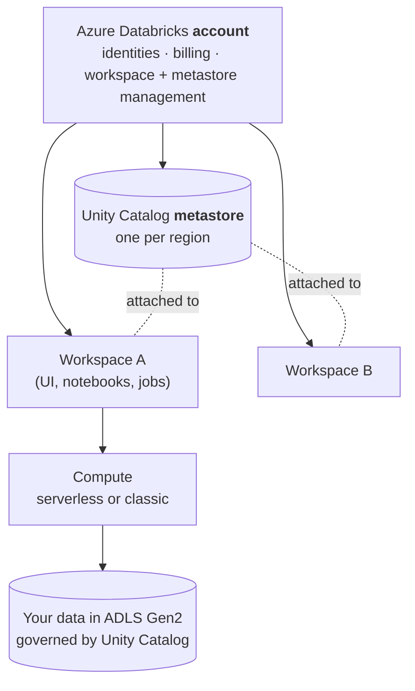
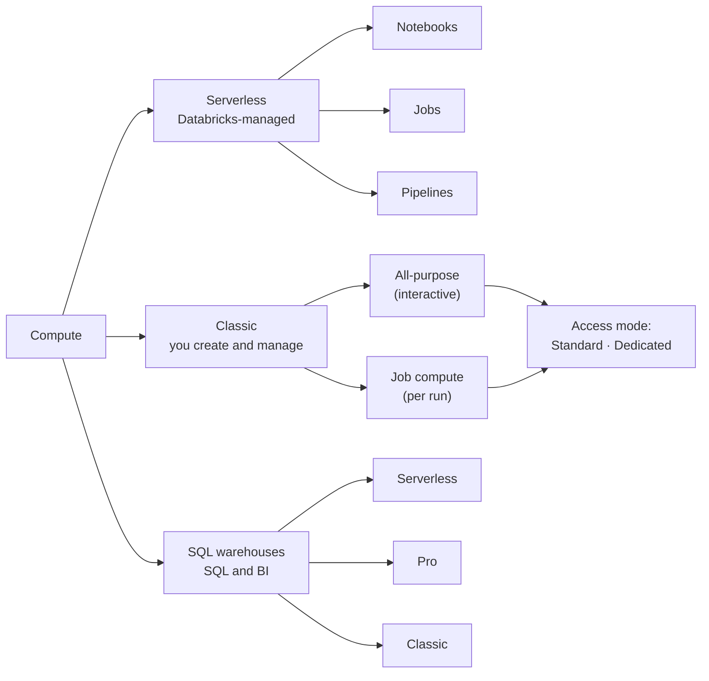
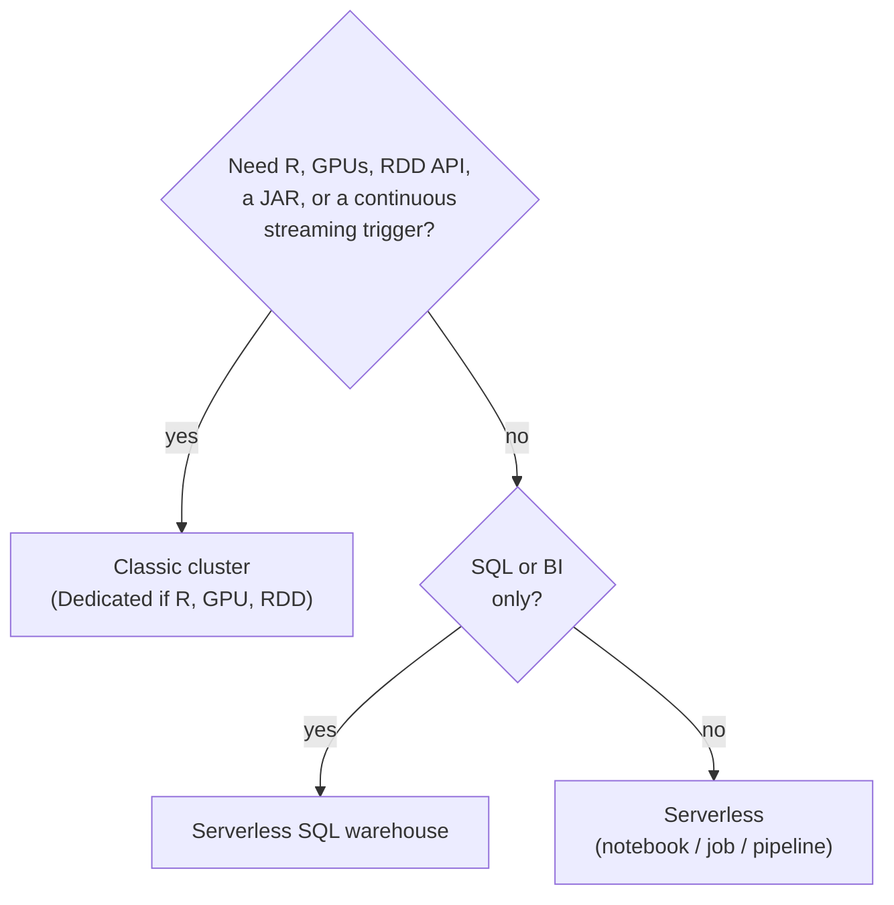

# Core concepts: the map of Databricks

> "Before you assemble a team, you need to know what the building looks like." — Nick Fury, probably

New to Databricks? The words *account*, *workspace*, *metastore*, *catalog*, *cluster*, and *warehouse* get thrown around as if everyone was born knowing them. This page is the map. Read it once before chapter 01, come back whenever a term in a later chapter feels fuzzy. The [glossary](glossary.md) has one-line definitions; this page explains how the pieces fit together.

Everything here is checked against Microsoft Learn (links at the end). Where a feature is in preview or behaves oddly, it says so.

## 1. The big picture



Three layers, three different questions:

| Layer | Question it answers | Examples |
|---|---|---|
| **Account** | Who are we and what do we own? | Users, groups, service principals, workspaces, metastores, billing |
| **Workspace** | Where do people work? | Notebooks, jobs, dashboards, compute, Git folders |
| **Unity Catalog** | What data exists and who may touch it? | Catalogs, schemas, tables, volumes, permissions, lineage |

In S.H.I.E.L.D. terms: the **account** is the Helicarrier's registry of every agent and building, a **workspace** is one field office, and **Unity Catalog** is the vault with the access badges.

## 2. Account, workspace, and the two planes

### Account
The top-level construct. Identities (users, groups, service principals), workspace creation and Unity Catalog metastores are managed here, in the **account console**. One account can hold many workspaces and metastores. The first account admin has to be a Microsoft Entra ID Global Administrator at first login; after that the role is no longer needed.

### Workspace
The collaboration environment: the web UI where you run ingestion, explore data, schedule jobs, and train models. Our `azd up` creates one workspace (Premium plan, which Unity Catalog requires). A workspace belongs to one Azure region.

What lives *in* a workspace: notebooks and files (usually via a **Git folder**, see [how to run notebooks](how-to-run-notebooks.md)), compute, jobs and pipelines, SQL warehouses, dashboards, and a Catalog Explorer view of Unity Catalog.

What does **not** live in a workspace: the data itself. Data lives in cloud storage and is registered in Unity Catalog, whose metastore is shared by every workspace in the region.

### Control plane vs compute plane
Azure Databricks runs in two halves:

* **Control plane**: backend services Databricks operates in *its* account (web app, job scheduler, notebook metadata, cluster management).
* **Compute plane**: where your data is actually processed. Two flavours:
  * **Classic compute plane**: VMs run in *your* Azure subscription, in a virtual network in your subscription.
  * **Serverless compute plane**: compute runs in Databricks' account, in the same region as your workspace, inside a network boundary isolated per workspace.

Why you care: networking, firewalls, and cost all depend on which plane runs your code. If your storage account has a firewall, you must allow the classic VNet *and* the serverless plane. Private networking is out of scope for this repo; see the Learn links if you need it for real.

## 3. Unity Catalog: governance for everything

Unity Catalog (UC) sits beneath every query: it checks permissions, records lineage, and writes audit logs automatically. New workspaces are UC-enabled by default (created after 9 Nov 2023), and serverless compute requires UC.

### The object model
```
metastore                       (one per region, attached to workspaces)
└── catalog                     (e.g. shield)       ← main unit of data isolation
    └── schema                  (e.g. bronze)
        ├── table / view        (shield.bronze.incident_reports)
        ├── volume              (files: /Volumes/shield/landing/raw)
        ├── function
        └── model
```
Everything you can grant permission on is a **securable object**. Data and AI assets use the three-level name `catalog.schema.object`. A few objects sit directly under the metastore instead: **storage credentials**, **external locations**, connections, and shares.

| Object | In one line | In this repo |
|---|---|---|
| Metastore | Regional top-level container for metadata and permissions | Created with the workspace, you do nothing |
| Catalog | Isolation boundary, often per environment or team | `shield` (chapter 01) |
| Schema | Folder inside a catalog | `landing`, `bronze`, `silver`, `gold`, `ops` |
| Table | Rows, stored as Delta | Medallion layers |
| Volume | Governed folder for *files* | `raw`, `staging`, `checkpoints` |
| Storage credential | How UC authenticates to storage | `shield_cred` (access connector) |
| External location | Storage path + credential | `abfss://uc-managed@<account>.dfs.core.windows.net/` |

### Managed vs external
* **Managed** tables and volumes: UC owns governance *and* the files. Databricks recommends them for most cases and all new tables.  Dropping a managed table means UC also deletes the underlying files.
* **External** tables and volumes: UC governs access, but you own the files and lifecycle. Use them for non-Delta formats, data that other systems write, or landing zones.

Managed data lands in **managed storage**: the nearest level (schema, then catalog, then metastore) that has a location set. Our catalog sets `MANAGED LOCATION`, because the regional metastore has no storage of its own. That is why chapter 01 creates an external location first.

### Permissions flow downhill
Privileges are inherited down the hierarchy. To read `shield.silver.agents` a user needs:

| Privilege | On | Why |
|---|---|---|
| `USE CATALOG` | `shield` | Permission to *see into* the catalog |
| `USE SCHEMA` | `shield.silver` | Same for the schema |
| `SELECT` | the table (or the whole schema/catalog) | Permission to read |

```sql
GRANT USE CATALOG ON CATALOG shield TO `analysts`;
GRANT USE SCHEMA, SELECT ON SCHEMA shield.gold TO `analysts`;
```
`USE` privileges alone grant no data access. `BROWSE` lets people discover that data exists without reading it. Chapter 11 goes deep.

Habits worth copying: grant to **groups**, never individuals; give **ownership** of production objects to groups; let **service principals** (not people) run production jobs; define identities at the **account** level, from your identity provider.

### Metastore ≠ data isolation
You get one metastore per region, shared by every workspace in that region. Isolation normally starts at the **catalog** level (and you can bind a catalog to specific workspaces). To share across regions, use Delta Sharing / OpenSharing, not a second external table.

## 4. Compute: serverless vs clusters vs warehouses

"Compute" is what runs your Spark or SQL. Databricks gives you three families.



### Serverless compute
On-demand, managed by Databricks, no cluster to configure. It exists for **notebooks**, **Lakeflow Jobs**, and **Lakeflow pipelines**, and starts in seconds. You pick nothing: no VM size, no runtime version, no scaling rules. Databricks handles autoscaling and upgrades.

Requirements: a UC-enabled workspace in a [region that supports serverless](https://learn.microsoft.com/azure/databricks/resources/feature-region-support). Sweden Central and Germany West Central (this repo's defaults) both do.

The trade-offs (current as of writing, so check the limitations page when it matters):

* Scala and R are not supported in notebooks; **JAR libraries** are not supported in notebooks.
* Only **Spark Connect** APIs: no RDD API, no Spark UI. Name resolution happens at execution time, which can change behaviour.
* **ANSI mode is on** by default: invalid casts and overflow raise errors instead of returning `NULL`.
* Default session time zone is **UTC**.
* DBFS access is limited: use **volumes** and workspace files. External data needs **external locations**.
* **Streaming**: only `Trigger.AvailableNow()` works in serverless notebooks and jobs. `ProcessingTime` and `Continuous` triggers fail with `INFINITE_STREAMING_TRIGGER_NOT_SUPPORTED`, and so does a stream with no trigger. For always-on streams use a pipeline in continuous mode. This bites in chapter 09.
* Runs have a **7-day maximum**. Serverless notebooks have a **2.5 hour** default execution timeout (admins can change it).

### Classic compute (clusters)
Compute you create and configure: a driver plus workers (VMs in your subscription), a Databricks Runtime version, and an **access mode**.

| Type | Lifetime | Use for |
|---|---|---|
| **All-purpose** | Stays up until terminated; shared by interactive users | Exploration, development |
| **Job compute** | Created for one job run, then terminated | Production jobs (fresh, isolated compute per run) |
| **Instance pools** | Warm VMs waiting to be used | Cutting startup time |

**Access mode** decides who can use the cluster and what it can do:

| | Standard | Dedicated |
|---|---|---|
| Who | Many users at once (user code isolated by Lakeguard) | One user or one group |
| Languages | Python, SQL, Scala | Python, SQL, Scala, **R** |
| Pick it for | Most workloads, ETL, shared dev | RDD APIs, GPUs, R, privileged machine access |

Databricks recommends **Standard** unless you need something it cannot do. The default `Auto` picks Standard, except for ML runtimes, GPU instances, or Databricks Runtime older than 14.3 (then Dedicated). Clusters must use one of these two modes to access Unity Catalog data.

Two habits that save money: set **auto termination** (10 to 10,000 minutes; idle clusters still bill DBUs *plus* the VMs), and run production jobs on **job compute**, not an all-purpose cluster someone forgot.

### SQL warehouses
Compute tuned for SQL queries, BI, and dashboards (used in chapter 15). Three types:

| Type | Where it runs | Startup | Notes |
|---|---|---|---|
| **Serverless** | Databricks' account | ~2 to 6 seconds | Best performance and autoscaling; the UI default where available |
| **Pro** | Your subscription | ~4 minutes | Use when serverless is unavailable in the region, or you need custom networking |
| **Classic** | Your subscription | ~4 minutes | Entry-level performance |

Note the API default is *classic*, the UI default is serverless. If you create a warehouse in Bicep or the API, set the type explicitly.

### So which one?


| | Serverless | Classic cluster |
|---|---|---|
| Setup | None | Choose runtime, VM type, scaling, access mode, policy |
| Start time | Seconds | A few minutes |
| Billing | DBUs for what ran | DBUs **and** Azure VM costs, including idle time |
| Control | Low | High (libraries, init scripts, Spark conf, networking) |
| Right for | Almost everything in this repo | Workloads serverless cannot run, strict network setups |

**This repo defaults to serverless**, except where a chapter says otherwise (chapter 09 flags the streaming trigger limits). Both bill in **DBUs** (Databricks Units) per hour; the rate depends on the compute type and the plan.

## 5. Where does code and data physically live?

| Thing | Lives in | Governed by |
|---|---|---|
| Tables, managed volumes | ADLS Gen2 (the catalog's managed location) | Unity Catalog |
| Raw landing files | External or managed **volume** | Unity Catalog |
| Notebooks, `.py` modules | **Workspace** (usually a Git folder) | Workspace permissions |
| System data, logs, notebook results | **Workspace storage account** in your subscription | Workspace |
| `dbfs:/` root | Legacy; avoid | Not governed by UC |

Rule of thumb: tables for rows, **volumes** for files, workspace files for code. Avoid DBFS for anything new.

## 6. The rest of the vocabulary, briefly

* **Spark**: distributed engine; you write DataFrames or SQL and it parallelises ([chapter 02](02-first-recon.md)).
* **Delta Lake**: open table format (Parquet files + transaction log) giving ACID, time travel, and schema control ([chapter 04](04-delta-lake-101.md)).
* **Lakeflow**: Databricks' data engineering suite: **Jobs** (orchestration, [chapter 10](10-maria-hill-schedules.md)), **Spark Declarative Pipelines** (declarative ETL, [chapter 08](08-declarative-pipelines.md)), **Connect** (managed ingestion).
* **Auto Loader**: incremental file ingestion, only processes new files ([chapter 03](03-coulson-ingests.md)).
* **Photon**: Databricks' vectorized query engine; speeds up SQL and DataFrame work.
* **Declarative Automation Bundles**: your jobs, pipelines, and config as code ([chapter 13](13-infrastructure-as-code.md)).

## 7. Mapping to this repo

| Concept | Where it shows up |
|---|---|
| Account/workspace | `infra/` creates the workspace; account console is only needed for metastore admin work |
| Metastore, catalog, external location | [Chapter 01](01-assemble-the-platform.md) |
| Serverless notebooks | Every notebook; see [how to run notebooks](how-to-run-notebooks.md) |
| Streaming trigger limits | [Chapter 09](09-quake-tremors.md) |
| Grants, groups, lineage | [Chapter 11](11-governance-vs-hydra.md) |
| DBUs, cost, compute choice | [Chapter 12](12-hawkeyes-precision.md) |
| SQL warehouse | [Chapter 15](15-avengers-initiative.md) |

## Sources (Microsoft Learn)

* [High-level architecture](https://learn.microsoft.com/azure/databricks/getting-started/high-level-architecture)
* [What is Unity Catalog?](https://learn.microsoft.com/azure/databricks/data-governance/unity-catalog/) and [best practices](https://learn.microsoft.com/azure/databricks/data-governance/unity-catalog/best-practices)
* [Compute overview](https://learn.microsoft.com/azure/databricks/compute/), [serverless limitations](https://learn.microsoft.com/azure/databricks/compute/serverless/limitations), [classic compute overview](https://learn.microsoft.com/azure/databricks/compute/use-compute), [compute configuration reference](https://learn.microsoft.com/azure/databricks/compute/configure)
* [SQL warehouse types](https://learn.microsoft.com/azure/databricks/compute/sql-warehouse/warehouse-types)

Details like limits and defaults change often. When a number here matters to you, check the linked page.

## Try it yourself

1. **Draw your own map.** Without looking, sketch account → workspace → metastore → catalog → schema → table for your own employer's data. Then open **Catalog** in the workspace sidebar and compare with the real `shield` catalog.
2. **Serverless vs cluster, on paper.** Pick three workloads you have run (a nightly ETL, an ad-hoc exploration, an always-on stream). For each, decide serverless, standard cluster, or dedicated cluster, and write the one limitation or requirement that drove the choice.
3. **Permission puzzle.** An analyst group has `SELECT` on `shield.gold.briefings` but gets "cannot access catalog". Which privileges are missing, and on which objects? Write the two `GRANT` statements, then check your answer against chapter 11.
