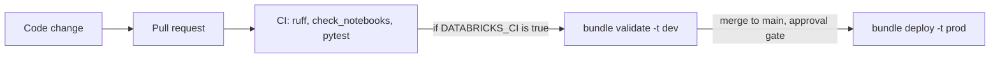

# Deploy and automate

**Files:** [databricks.yml](../databricks.yml) · [resources/shield_job.yml](../resources/shield_job.yml) · [resources/shield_pipeline.yml](../resources/shield_pipeline.yml) · [.github/workflows/ci.yml](../.github/workflows/ci.yml) · [scripts/check_notebooks.py](../scripts/check_notebooks.py) · [tests/](../tests) · [infra/](../infra)

> 💡 **TL;DR:** Nobody clicks in production. The cloud resources come from Bicep and `azd` (chapter 01). The jobs and the pipeline come from a **Declarative Automation Bundle** (formerly Databricks Asset Bundles) deployed to a `dev` or `prod` target. GitHub Actions runs lint, tests and a bundle validation on every pull request, and deploys to prod on merge behind an approval gate.
>
> Status: **drafted, not validated.** The Databricks CLI was not installed when this was written, so `databricks bundle validate` has not been run. Run it first and fix whatever it reports (field names change between CLI versions). Of the CI workflow, only the `test` job is exercised; the two bundle jobs are **untested** and switched off until you set the repo variable `DATABRICKS_CI=true` and the secrets.

This is a guide, not a chapter: there is **no notebook**, because the work happens in config files and a terminal. Do it after chapter 10, or after the capstone (chapter 14), whose health check is a task of the deployed job.

---

## The big picture



By chapter 10 you built a platform and a daily job by hand. That works once. It does not survive a colleague, a second environment or a bad Friday. The fix has three parts, and each answers a different question:

| Question | Answer | Where in this repo |
|---|---|---|
| How do I create the cloud resources repeatably? | Infrastructure as code for the cloud | Bicep + `azd` in [infra/](../infra) (chapter 01) |
| How do I deploy jobs and pipelines to each environment the same way? | Infrastructure as code for the workspace | **Declarative Automation Bundles**: [databricks.yml](../databricks.yml), [resources/](../resources) |
| How do I make sure a change is safe before it reaches production? | Continuous integration and delivery | GitHub Actions: [ci.yml](../.github/workflows/ci.yml) |

---

## Concepts

### 1 · Infrastructure as code for the cloud

The idea: describe Azure resources in files and let a tool make reality match them. Re-running is safe because the tool compares the file with what exists.

How this repo implements it: [infra/main.bicep](../infra/main.bicep) with modules for the Databricks workspace, ADLS Gen2 storage, the access connector, Key Vault and Event Hubs (`infra/modules/`). `azd up` deploys it, `azd down --purge` removes it. Chapter 01 walks through it. The Unity Catalog objects (credential, external location, catalog) are not in Bicep; a notebook creates them.

Not covered yet: deploying the cloud layer from CI (`azd` in a pipeline). The bundle and CI below deal only with the workspace.

### 2 · Bundles: the workspace as code

The idea: a **bundle** is `databricks.yml` plus resource files plus the source they reference, deployed as one unit to a workspace. It is a feature of the Databricks CLI.

| Concept | What it does | In this repo |
|---|---|---|
| **Resource** | A job, pipeline, dashboard or permission described in YAML | `resources/shield_job.yml`, `resources/shield_pipeline.yml` (pulled in by `include: resources/*.yml`) |
| **Target** | An environment that overrides settings | `dev` (default) and `prod` in `databricks.yml` |
| **`mode: development`** | Prefixes resources with `[dev <user>]`, tags them, pauses schedules and triggers, allows concurrent runs, turns off the deployment lock | the `dev` target |
| **`mode: production`** | Turns those defaults off and validates the deployment. Databricks recommends a service principal (`run_as`) | the `prod` target, with `root_path: /Workspace/Shared/.bundle/${bundle.name}/${bundle.target}` |
| **Variable** | Keeps environment differences out of the code (`${var.catalog}`) | `catalog`, default `shield`, used by the pipeline's `catalog` and `raw_path` |
| **Substitution** | Built-in values such as `${bundle.target}` | job name `shield_daily_${bundle.target}`, pipeline schema `pipeline_${bundle.target}` |

What the resource files deploy:

| Resource | Key | Contents |
|---|---|---|
| Job | `shield_daily` | Tasks `ingest` → `silver` → `gold` run [10_maria_hill_schedules.ipynb](../notebooks/databricks/10_maria_hill_schedules.ipynb) with `step` set to the task name and `max_retries: 2`. Then `health_check` runs [14_project_insight.ipynb](../notebooks/databricks/14_project_insight.ipynb) with no parameters. Schedule `0 0 6 * * ?` in `Europe/Berlin`, **deployed paused** |
| Pipeline | `shield_insight` | Name `shield_insight_<target>`, serverless, catalog `${var.catalog}`, schema `pipeline_<target>` (not `pipeline`, see [chapter 08](08-declarative-pipelines.md)), source [pipelines/shield_insight.py](../pipelines/shield_insight.py), `raw_path` set to the `landing/raw` volume |

Notes:

* Job tasks reference notebooks as `.ipynb` files, with paths relative to the resource file. The file names no compute, so serverless compute for jobs must be enabled.
* `health_check` has no `max_retries`, and neither the job nor its tasks define notifications. Chapter 10 sets notifications by hand in the UI; the bundle does not reproduce them yet.
* The `prod` target sets no `run_as` and no `permissions`. For production mode, Microsoft Learn says the CLI validates that these are specified when you do not use a service principal, so expect `validate -t prod` to ask for them (not run).
* Bundle-managed resources belong to the bundle. A change made in the UI is overwritten by the next deploy.

Why it helps: the same files give a personal copy in `dev` and the shared one in `prod`, a review diff for every change, and one command to remove it all.

Alternatives: Terraform for the workspace (more general, a separate state to keep), or the UI (fast to try, impossible to review). Bundles are the Databricks-native choice for jobs and pipelines.

### 3 · CI: tests before production

The idea: continuous integration runs fast, cheap checks on every change before a human reviews it. It needs no production access.

How this repo implements it: `ci.yml` runs on every pull request and on pushes to `main`.

| Job | Runs | Condition | Status |
|---|---|---|---|
| `test` | Python 3.12 and Java 17 (for PySpark), `pip install -r requirements.txt pyspark`, then `ruff check .`, `python scripts/check_notebooks.py`, `pytest -q` | always | the only part exercised |
| `bundle-validate` | `databricks bundle validate -t dev` with `DATABRICKS_HOST` and `DATABRICKS_TOKEN` from secrets | after `test`, and only if the repo variable `DATABRICKS_CI` is `true` | untested |
| `deploy-prod` | `databricks bundle deploy -t prod` in the `production` environment | after `bundle-validate`, on `main`, and only if `DATABRICKS_CI` is `true` | untested |

What the tests cover:

| Check | What it guards |
|---|---|
| `tests/test_generate.py` | the synthetic dataset is deterministic, clean at `dirty=0`, dirty with duplicates and defects otherwise, and schema drift appears late |
| `tests/test_quality.py` | clean rows pass every rule, every injected defect is caught by `INCIDENT_RULES`, and the Python mirror ([quality.py](../src/shield_data/quality.py)) gives the same failure counts as the Spark SQL expressions |
| `tests/test_notebooks.py` | every notebook in the repo passes `check_notebooks.py`, and the checker itself flags what it should |
| `scripts/check_notebooks.py` | each notebook is valid nbformat 4, cell ids are present and unique, code cells have no outputs and no execution count, no cell uses `%run`, every code cell parses |

* The Spark parity test needs PySpark and Java, which CI installs. Locally it is skipped when PySpark is missing (`pytest.importorskip`), so a plain local run does not prove the rules match Spark.
* **What to unit test in data engineering:** pure functions and rule definitions, SQL expressions, transformations on tiny in-memory DataFrames. **What to test with integration runs:** the pipeline on a dev workspace with generated data. Many fast unit tests, a few end-to-end runs: the test pyramid. This repo has the first kind only.

### 4 · CD and secrets

The idea: continuous delivery deploys what passed CI, the same way every time, with a person approving production.

How this repo implements it: `deploy-prod` uses the GitHub environment `production`. Add required reviewers to that environment and the job waits for an approval. Authentication is a personal access token in `DATABRICKS_TOKEN`, which is the simplest thing that works and not what you want in production.

* **Secrets:** never in the repo. Prefer OIDC federation or a service principal over a personal token.
* `databricks/setup-cli@main` tracks the main branch, so the CLI version can change under you. Pin a version once you validate.
* Pull requests from forks get no secrets, so `bundle-validate` cannot run for them.
* Microsoft Learn recommends validating before deploying, separate reviewed deploy steps, and integration tests after deploy. The third is not here yet.

---

## What to do

No notebook steps, so here are the commands.

| Step | Command | Expected |
|---|---|---|
| 1 | Install the CLI (`winget install Databricks.DatabricksCLI`) and log in: `databricks auth login --host <DATABRICKS_HOST>` | a profile for your workspace |
| 2 | `databricks bundle validate -t dev` | no errors; fix field names it reports (not run yet) |
| 3 | `databricks bundle deploy -t dev` | job `[dev <user>] shield_daily_dev` and pipeline, schedule paused |
| 4 | `databricks bundle run shield_daily -t dev` (or `shield_insight` for the pipeline) | a run with four tasks |
| 5 | `databricks bundle destroy -t dev` when done | the dev resources removed |

Other commands: `bundle summary` inspects what is deployed.

### Run the checks locally
```bash
pip install -r requirements.txt
ruff check .
python scripts/check_notebooks.py
pytest -q
```
To also run the Spark parity test: `pip install pyspark` (needs Java 17).

### Enable the Databricks jobs in CI
1. Create a service principal and give it access to the workspace and catalog.
2. Add repo secrets `DATABRICKS_HOST` and `DATABRICKS_TOKEN` (or switch to OIDC).
3. Add repo variable `DATABRICKS_CI = true`, and a `production` environment with required reviewers.

## Gotchas
* Never edit bundle-managed jobs in the UI; the next deploy overwrites your change.
* Production deploys should use a **service principal**, not a person.
* A green CI run proves the Spark-free logic, the Spark parity of the rules and the lint. It does not prove that the pipeline works. That needs the integration run.
* A bundle deploy is not a transaction. A failed deploy can leave a mix of old and new resources.
* `bundle destroy -t prod` removes production. Treat it like `DROP SCHEMA`.
* The bundle YAML, the `prod` target and the CI bundle jobs have not been run. Treat every field name as unverified until `bundle validate` passes.

## Not covered yet
* Promotion between more than two environments, and per-environment catalogs (mini-project 1).
* Deploying the cloud layer from CI (`azd` in a pipeline).
* Rollbacks, and integration tests after a deploy.
* Declaring the dashboard of chapter 13 and notifications in the bundle.

## Try it yourself
1. Add a `staging` target and give prod a different catalog (`shield_prod`) through a target-level variable override, plus a `run_as` service principal on prod.
2. Add a test that fails when someone adds a rule to `INCIDENT_RULES` without a matching case in `failed_rules`. Break it on purpose in a pull request and watch CI go red.
3. Add `max_retries` and an email notification to the `health_check` task, then validate the bundle.
